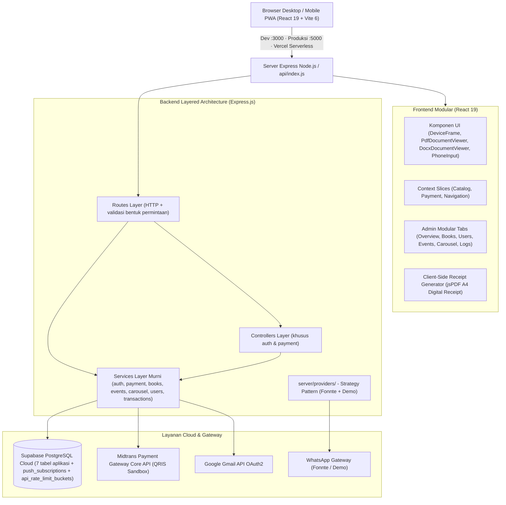

# 📖 Wahidiyah Book — Digital Library, Real Midtrans QRIS & WhatsApp Authenticator
## 🧠 Master Memory Workflow & Dokumentasi Teknis Sistem Terpadu (Single Source of Truth)

[](https://nodejs.org/)
[](https://react.dev/)
[](https://expressjs.com/)
[](https://vitejs.dev/)
[](https://tailwindcss.com/)
[-emerald.svg)](https://supabase.com/)
[-0052cc.svg)](https://midtrans.com/)
[](https://whatsapp.com/)
[](https://vercel.com/)

> 🎯 **FUNGSI UTAMA BERKAS INI:** 
> Berkas ini adalah **SATU-SATUNYA SUMBER KEBENARAN (Single Source of Truth / Memory Tunggal)** untuk seluruh arsitektur, spesifikasi REST API, alur pembayaran Midtrans QRIS, gateway autentikasi WhatsApp, integrasi database Supabase Cloud, panduan developer, naskah akademik/Zotero, standar keamanan siber, dan riwayat rilis aplikasi **Wahidiyah Book**.
>
> 
> Ini satu-satunya **memory teknis utama**. Spesifikasi produk khusus, seperti spesifikasi aplikasi mobile dan panduan upload buku, tetap berada di dokumen terpisah. Jika dokumentasi berbeda dengan kode aktif atau `full_setup.sql`, kode dan skema aktif menjadi acuan lalu memory ini diperbarui.

---

## ⛔ ATURAN KERAS 0 — DILARANG MEMAKAI JSC / MEMATIKAN HERMES

> **Berlaku selamanya selama proyek memakai Expo SDK 58 / React Native 0.88.1. BACA SEBELUM MENYENTUH `app.json`, `eas.json`, config plugin, atau build Android.**
> Regresi 9 November 2026: dialog sistem **"Mobile-app-ebook terus berhenti"** pada Samsung Galaxy J7 Prime (32-bit `armeabi-v7a`, Android 9 32-bit, kernel Linux 3.18 / Exynos 7870).

**DILARANG KERAS** — tidak ada alasan "kompatibilitas kernel lama" yang membenarkannya:

- Menaruh `"jsEngine": "jsc"` (atau nilai `jsc` apa pun) di `app.json` / `eas.json`.
- Menjalankan config plugin yang menyuntik `hermesEnabled=false` ke `gradle.properties` — dulu `mobile-app/plugins/withJscEngine.cjs`, **sudah dihapus**, direktori kosongnya pun sudah dibuang.
- Membuat ulang plugin sejenis, menyertakan `libjsc.so`, atau mendistribusikan APK ber-engine JSC.
- Mengganti bundel HBC dengan bundel JS polos atas nama "dukungan 32-bit".

**Mengapa:** Expo SDK 58 / RN 0.88.1 **hanya mendukung Hermes V1** (`useHermesV1: true`, default sejak RN 0.84). `jsEngine: "jsc"` tidak diterima skema SDK 58 (diabaikan), sedangkan plugin `hermesEnabled=false` benar-benar menghasilkan APK dengan `libjsc.so` + bundel JS polos (magic `76617220` = `"var "`) — **satu-satunya build yang force close** (`versionCode 4`, 48.318.860 byte). Anggapan "Hermes crash di kernel 3.18" **terbukti keliru**: yang memperbaiki crash lama adalah guard `window.location` khusus platform web (commit `1b83232`), bukan JSC. Masalah 32-bit sesungguhnya bukan soal ABI — semua build sudah memuat `armeabi-v7a` + `arm64-v8a` dengan `minSdk 24`.

**Konfigurasi yang BENAR dan tidak boleh diubah:**

```json
"plugins": [
  [
    "expo-build-properties",
    {
      "android": {
        "buildArchs": ["armeabi-v7a", "arm64-v8a"],
        "minSdkVersion": 24,
        "useHermesV1": true,
        "usesCleartextTraffic": true
      }
    }
  ],
  "expo-font"
]
```

`app.json` saat ini: `version 0.1.5`, `versionCode 7`, **tanpa** `jsEngine`, **tanpa** plugin JSC.

**Cek biner wajib sebelum APK dipublikasikan** (jangan hanya percaya pada config):

- `lib/armeabi-v7a/libhermesvm.so` → **ADA**.
- `lib/arm64-v8a/libhermesvm.so` → **ADA**.
- `libjsc.so` di ABI mana pun → **TIDAK BOLEH ADA**.
- Magic `assets/index.android.bundle` → `c61fbc03` (HBC), bukan `76617220`.
- `minSdkVersion` 24; `versionCode` selalu naik, tidak pernah turun.

**Artefak cacat sudah dihapus pada 10 November 2026:** `.expo/builds/mobile-app-ebook-0.1.2-jsc.apk` dan **GitHub Release `v0.1.2`** (aset `mobile-app-ebook-0.1.2-jsc.apk`, URL unduhnya kini 404). Tag git `v0.1.2` sengaja dipertahankan hanya sebagai jejak histori, tanpa aset unduhan. Rilis yang sah: **v0.1.5** (`wahidiyah-v0.1.5-hermes-32bit.apk`), APK final mandiri yang menyematkan bundel JS terakhir; v0.1.1/0.1.3/0.1.4 tetap arsip kronologi.

**Unduhan wajib same-origin (ditetapkan 10 November 2026):** menyalurkan tombol unduh langsung ke URL `github.com` membuat browser **mengabaikan atribut HTML `download`** (cross-origin), sehingga pengguna malah dinavigasi ke halaman GitHub "Mendownload..." dan bukan menerima berkas. Karena itu APK disalin ke `public/unduh/wahidiyah-v0.1.5-hermes-32bit.apk` dan disajikan dari domain sendiri dengan header `Content-Disposition: attachment` + `Content-Type: application/vnd.android.package-archive` (diatur di `vercel.json`). `APK_DOWNLOAD_URL` = `/unduh/wahidiyah-v0.1.5-hermes-32bit.apk`; `/download` dan `/download/apk` hanya alias redirect internal. **GitHub Release v0.1.5 tetap arsip rilis kanonik, tetapi bukan tujuan unduh pengguna.** Saat rilis baru, perbarui ketiganya: berkas di `public/unduh/`, nilai `DIRECT_APK_URL`, serta target redirect/header di `vercel.json`. Regresi dikunci otomatis oleh `tests/jsc_engine_plugin.test.mjs` — **jangan dilonggarkan atau dihapus**.

**APK final mandiri v0.1.5 (keputusan 10 November 2026):** bundel yang tertanam di APK v0.1.4 ternyata masih UI lama (1.860.168 byte, HBC `c61fbc03`, ada "Pindai QRIS untuk Membayar", tanpa "Mode Tamu" / "Simulator QRIS Midtrans" / "Unduh QR"). Ketiga fitur itu hanya hidup di bundel OTA runtime 0.1.4, sehingga instal segar tanpa jaringan menampilkan UI lama. Karena proyek belum produksi dan tujuannya satu artefak demo yang tidak bisa gagal, dibangun ulang APK **0.1.5 / versionCode 7** dengan seluruh JS terbaru ikut tertanam. Penguji yang memasang dari landing tidak lagi bergantung pada EAS Update / internet. Konsekuensi: `runtimeVersion` naik ke `0.1.5` (policy `appVersion`), jadi cabang OTA runtime 0.1.4 tidak berlaku untuk APK ini; bila nanti ada perubahan JS untuk 0.1.5, terbitkan OTA pada channel `preview` dengan runtime 0.1.5. Sertifikat penandatanganan v2 ternyata **identik** di semua build (0.1.1 s.d. 0.1.5; SHA-256 sertifikat `713c4b84…`), jadi upgrade in-place 0.1.4 → 0.1.5 (versionCode 6 → 7) **tidak wajib uninstall**; catatan lama yang mengatakan sebaliknya keliru. Uninstall hanya disarankan bila perangkat menyimpan cache OTA runtime lama. Rilis lama (v0.1.1/0.1.3/0.1.4) sengaja tidak dikirimi OTA dan tidak dihapus, cukup arsip kronologi iterasi skripsi.

**Prefiks kunci Midtrans bukan penentu lingkungan (dikoreksi 10 November 2026):** `SB-Mid-…` pasti sandbox, tetapi kunci **tanpa** prefiks (`Mid-server-…`) bisa berasal dari akun sandbox lama. Bukti terukur: `Mid-server-Ela…` membuat QRIS **201** di `api.sandbox.midtrans.com` dan ditolak **401** di `api.midtrans.com`. Guard karena itu hanya memblokir `SB-Mid-…` + `MIDTRANS_IS_PRODUCTION=true`; selain itu lingkungan mengikuti flag. Jangan mengembalikan aturan lama yang menganggap semua kunci non-`SB-` sebagai produksi — aturan itulah yang memblokir charge sah dan memunculkan pesan "Gagal membuat transaksi di Midtrans." pada 10 November 2026. "Signature Secret Key" di halaman Access Keys juga bukan server key untuk Basic auth Core API (401); uji `/v2/charge` sebelum memakai kunci baru.

> ⚠️ **Peringatan untuk agent/sesi berikutnya:** catatan lama di `.agents/teamwork/**/handoff.md`, `DISPATCH.md`, dan `PROJECT.md` masih memuji plugin JSC sebagai "PASS / benar / kompatibel 32-bit". Itu **dokumen usang dan SALAH** — abaikan. Berkas ini adalah satu-satunya sumber kebenaran.

---

## 📑 Daftar Isi

> ⛔ **Baca dulu bagian "ATURAN KERAS 0 — DILARANG MEMAKAI JSC / MEMATIKAN HERMES" tepat di atas**, sebelum mengikuti bagian mana pun di bawah.

1. [Ringkasan Eksekutif & Tech Stack](#1-ringkasan-eksekutif--tech-stack)
2. [Fitur Unggulan Sistem](#2-fitur-unggulan-sistem)
3. [Arsitektur Sistem & Rekayasa Perangkat Lunak (Modular Layered Monolith)](#3-arsitektur-sistem--rekayasa-perangkat-lunak-modular-layered-monolith)
4. [Spesifikasi Lengkap Design System & Standar Visual UI](#4-spesifikasi-lengkap-design-system--standar-visual-ui)
5. [Spesifikasi Lengkap REST API (/api/*)](#5-spesifikasi-lengkap-rest-api-api)
6. [Mekanisme & Alur Pembayaran Real Midtrans QRIS](#6-mekanisme--alur-pembayaran-real-midtrans-qris)
7. [Arsitektur Provider WhatsApp Gateway](#7-arsitektur-provider-whatsapp-gateway)
8. [Panduan Setup & Skema Database Supabase Cloud](#8-panduan-setup--skema-database-supabase-cloud)
9. [Standar Keamanan Sistem (30 Indikator Software Quality & Security Hardening)](#9-standar-keamanan-sistem-30-indikator-software-quality--security-hardening)
10. [Panduan Pengembangan & Penambahan Fitur Baru](#10-panduan-pengembangan--penambahan-fitur-baru)
11. [Panduan Akademik & Integrasi Sitasi Zotero SINTA](#11-panduan-akademik--integrasi-sitasi-zotero-sinta)
12. [Prasyarat & Konfigurasi Lingkungan (.env)](#12-prasyarat--konfigurasi-lingkungan-env)
13. [Panduan Instalasi & Katalog NPM Scripts](#13-panduan-instalasi--katalog-npm-scripts)
14. [Struktur Direktori Repositori Terpadu](#14-struktur-direktori-repositori-terpadu)
15. [Riwayat singkat](#15-riwayat-singkat)
16. [Roadmap & Rencana Pengembangan Mendatang](#16-roadmap--rencana-pengembangan-mendatang)
17. [Informasi Pengembang & Identitas Skripsi](#17-informasi-pengembang--identitas-skripsi)

---

## 1. Ringkasan Eksekutif & Tech Stack

Aplikasi **Wahidiyah Book** dibangun menggunakan arsitektur **Modular Layered Monolith (Murni React 19 JSX + Node.js Express)** dengan integrasi Service Layer decoupled dan Single-Port delivery:

* **Frontend:** React 19 (`.jsx` dan `.js`), Vite 6, React Router v7, Tailwind CSS 4, Headless UI, Lucide Icons, Sonner.
* **Document Engine:** Native Mozilla PDF.js (`pdfjs-dist/web/pdf_viewer.mjs` via `PdfDocumentViewer.jsx` dengan EventBus, PDFLinkService, virtualisasi halaman otomatis, double-buffered rendering bebas kedip & zero layout shift) dan client-side Word paginated renderer (`docx-preview` via `DocxDocumentViewer.jsx`).
* **Receipt Engine:** `jspdf` untuk ekspor kwitansi digital A4 resmi instan di peramban (client-side) tanpa dialog print fisik.
* **Backend:** Node.js 24.x (`engines` di `package.json`) dan Express.js 4 (ES Module), dengan Service Layer dan adapter serverless Vercel (`api/index.js`).
* **Database & BaaS:** Supabase Cloud (PostgreSQL 17 dengan *Row Level Security* fail-closed dan zona waktu `Asia/Jakarta`).
* **Payment Gateway:** Midtrans Core API QRIS. Server menyimpan payload EMVCo `qr_string` dan URL gambar resmi Midtrans; UI menampilkan gambar resmi (diproksikan server), dengan fallback QR SVG dari `qr_string`, lalu webhook idempoten.
* **WhatsApp Gateway (Fonnte):** Berbasis *Strategy Pattern* di `server/providers/` dengan Fonnte sebagai satu-satunya gateway nyata dan Demo lokal untuk pengembangan.
* **Image Processing:** Sharp (kompresi & sanitasi otomatis gambar sampul ke format WebP).
* **Email & Notifikasi:** Google OAuth2 API (Gmail API HTTPS untuk OTP email registrasi & verifikasi) dan Web Push VAPID untuk pengingat agenda.
* **Quality Harness:** `npm run build` (Vite), `npm run format:check` (Prettier `printWidth: 100`), dan `npm run health` (7 pemeriksaan konfigurasi). Tidak ada suite unit test aktif; status lulus terakhir harus dicatat bersama perubahan yang diverifikasi.

---

## 2. Fitur Unggulan Sistem

### 2.1. Katalog Buku & Universal Document Reader (Read-Only)
- **Katalog Interaktif Minimalis:** Desain elegan ala e-reader (Moco-style) yang menonjolkan sampul jilid dan judul kitab tanpa teks penulis generik, dilengkapi pencarian katalog instan dan badge akses (*locked* vs *free*).
- **Universal Document Reader (PDF & Word DOCX):**
  - **Dukungan Berkas PDF Continuous Vertical Scroll:** Dirender interaktif via mesin native Mozilla PDF.js (`pdfjs-dist/web/pdf_viewer.mjs` di `PdfDocumentViewer.jsx`) dengan gulir vertikal mulus (*continuous scroll*), virtualisasi DOM halaman otomatis, double-buffered rendering bebas kedip & layout shift, dan perbesaran alami (*smooth browser zoom*). Top bar pembaca dirancang sangat bersih dan minimalis (tombol kembali, indikator halaman `1 / X`, dan tombol layar penuh).
  - **Dukungan Naskah Word DOCX:** Dirender langsung di sisi klien ke lembaran A4 fisik terpaginasi lengkap dengan margin, kolom, tabel, dan tipografi asli menggunakan pustaka `docx-preview` (`DocxDocumentViewer.jsx`) tanpa membutuhkan converter server.
  - **Proteksi Hak Cipta:** Larangan seleksi teks (`select-none` di `PdfReaderScreen.jsx:241` dan `TextDocViewer.jsx:49`) dan pengiriman konten via HTTP header `inline` berotorisasi JWT. Tanda air identitas di kanvas dan pemblokiran klik kanan **tidak ada di kode** — memulihkannya atau menurunkan klaimnya adalah keputusan terbuka (lihat 15.15), dan judul skripsi menyebut "Pembaca PDF Terproteksi", jadi ini harus diputuskan sebelum Bab IV dikunci.
- **Last Read Tracker (Ingat Posisi Terakhir):** Otomatis menyimpan posisi halaman baca pengguna ke `localStorage` peramban (tanpa beban latensi database) dan menampilkan dialog resume *"Lanjut membaca dari Halaman X?"*.
- **Mode Tema Pembaca:** Pilihan latar belakang **Terang**, **Sepia (Hangat Lembut)**, dan **Malam (Gelap Elegan)** untuk kenyamanan membaca dalam waktu lama.

### 2.2. Autentikasi Pengguna & WhatsApp Gateway Fonnte (R61–R67)
- **Registrasi & Verifikasi Dual-Channel Terkendali:**
  - **Registrasi Akun:** 100% menggunakan verifikasi OTP via **Email (Gmail API OAuth2)** bebas biaya API dan anti-flooding (*OTP Flooding Protection*). `RegisterScreen.jsx` mengunci `deliveryMethod = 'email'`; tombol pendaftaran berlabel bersih *"Daftar"*.
  - Kanal WhatsApp untuk nomor Indonesia dialokasikan sebagai opsi pemulihan sekunder (*Secondary Fallback Account Recovery*) pada fitur Lupa Password dan kirim ulang kode.
- **Nomor WhatsApp Indonesia Saja (Tanpa Bendera):**
  - Tidak ada lencana bendera atau pemilih negara: `PhoneInput.jsx` hanya menerima nomor Indonesia dan `src/lib/phone.js` menjaga dua bentuk — `62xx` untuk disimpan, `0xx` tanpa spasi untuk ditampilkan.
  - Parsing nomor memakai helper lokal `src/lib/phone.js` (`normalizePhone`, `displayPhone`, `isValidPhone`), bukan pustaka luar.
  - Nomor wajib diisi saat registrasi (`registerSchema` di `server/lib/validate.js`); Fonnte selalu mengirim `countryCode: '62'`.
  - Pembuangan otomatis angka nol di awal nomor lokal (`0812...` ➔ `62812...`).
- **Login Akun Google:** Integrasi resmi Google OAuth 2.0 (*Direct Authorization Code Flow*) dengan verifikasi token ID dan pembuatan sesi JWT aman.
- **Sesi Aman & Proteksi Hak Akses:** Penyimpanan kata sandi dengan salt hashing `bcryptjs` (12 rounds), sesi berbasis token `jsonwebtoken` (JWT), dan mitigasi celah *self-demotion* (admin tidak dapat mencabut hak admin dirinya sendiri).

### 2.3. Sistem Keanggotaan Pro & Pembayaran Real Midtrans QRIS
- **Paket Pro Tunggal Terstandarisasi:** Skema keanggotaan Pro tunggal `monthly` dengan tarif Rp 25.000/bulan ditambah biaya administrasi Rp 3.000 (`server/lib/constants.js`), sehingga total tagihan Rp 28.000.
- **Integrasi Midtrans Core API Sandbox Eksklusif:** Charge QRIS dibuat langsung dari backend server dengan payload EMVCo dinamis (bebas dari manipulasi harga di sisi klien). QRIS adalah jalur otomatis utama; **metode transfer manual masih tersedia dan masih terpasang** (`src/features/payment/ManualPaymentForm.jsx` dirender di `PaymentConfirmScreen.jsx:217`, `POST /api/transactions`) — ia hanya tidak berautomasi, bukan dihapus.
- **Bantuan Pengujian Sandbox:** Kotak *"Simulator QRIS Midtrans"* menyediakan tautan QR yang dapat disalin (`qrMidtransUrl` pada sandbox, atau URL proxy gambar) untuk ditempel ke kolom **"QR Code Image Url"** simulator. Tidak ada tautan keluar otomatis maupun tombol pembayaran simulasi di aplikasi.
- **Simpan QRIS ke Galeri Ponsel:** Gambar QR (SVG/PNG) digambar ulang ke `<canvas>` berukuran 320 px dengan kop hijau dan keterangan e-wallet, lalu diunduh sebagai PNG agar dapat dipindai dari galeri (DANA, GoPay, BCA, OVO, ShopeePay).
- **Batalkan & Buat Ulang:** Tombol batal memanggil `POST /api/payments/qris/:orderId/cancel`, mematikan order di Midtrans bila didukung (QRIS sering menolak dengan 412), lalu membuat order baru. Bila Midtrans menolak, server menjelaskan bahwa QR lama masih berlaku sampai kedaluwarsa.
- **Polling & Webhook Idempoten:** Pengecekan otomatis status transaksi setiap 3 detik dan verifikasi *SHA512 Signature Key* pada endpoint webhook notifikasi. Logika berpindah di paket `server/services/payment/` — `status_service.js` (polling), `notification_service.js` (webhook), dan `settlement_service.js` (mesin status) — dengan mekanisme klaim bersyarat (*conditional claim*) untuk mencegah aktivasi membership ganda.
- **Faktur Kwitansi Pembayaran Resmi & Unduh PDF Instan:**
  - Format kwitansi A4 resmi dengan desain profesional, branding hijau zamrud tua, metadata dua kolom rapi, rincian biaya transparan, dan stempel verifikasi resmi Wahidiyah Book.
  - Unduh langsung ke format PDF di sisi klien menggunakan pustaka `jspdf` — cepat, tanpa dialog `window.print()` peramban, dan terhindar dari pemotongan halaman fisik.
  - Riwayat langganan dilengkapi fallback otomatis ke tabel `transactions` sehingga histori transaksi selalu tampil lengkap.

### 2.4. Panel Administrasi Komprehensif (Modular Sub-Tabs)
- **Arsitektur Sub-Tab Terisolasi:** `AdminDashboard.jsx` hanya menyusun tab dan hook; enam panel mandiri berada langsung di `src/features/admin/`, dengan sub-komponen agenda di `events/` dan hook data di `hooks/`:
  1. `OverviewTab.jsx`: tiga kartu KPI (Total pengguna, Koleksi aktif, Langganan aktif), donut *Status langganan* (Pro vs Reguler) via `recharts`, kartu pendapatan tervalidasi, riwayat 10 transaksi terakhir, dan tombol ekspor laporan lengkap `.xlsx`.
  2. `BooksTab.jsx` + `BookModal.jsx`: manajemen katalog buku, formulir tambah/edit, unggah naskah ke Supabase Storage via tanda unggah, kompresi sampul WebP via `sharp`, dan kelola visibilitas Pro.
  3. `UsersTab.jsx`: manajemen anggota, pencarian pengguna, penugasan role admin, dan toggle Pro.
  4. `EventsTab.jsx`: orkestrator kalender agenda; panel dipecah menjadi `EventCalendarPanel`, `SelectedDateAgenda`, `AllAgendaPanel`, `EventFormPanel`, dan `PushStatusBanner`, dengan state di `useAdminEventEditor`.
  5. `CarouselTab.jsx`: pengelolaan banner carousel beranda dinamis (termasuk unggah gambar).
  6. `LogsTab.jsx`: pemantauan log aktivitas sistem (langganan + pengguna) dengan tombol refresh di samping filter.
- **Hook Komposisi:** `useAdminDashboardData` memuat statistik, pengguna, transaksi, agenda, dan carousel; `useAdminBookEditor` mengelola unggah sampul/naskah; `useAdminEventEditor` mengelola agenda terpilih.
- **Ekspor Laporan 1-Klik:** Unduh riwayat transaksi, data pengguna, dan katalog buku langsung ke format Microsoft Excel (`.xlsx`) via library `exceljs` yang dimuat secara dinamis.

### 2.5. Antarmuka Pengguna & Navigasi Terpadu (Mobile, Tablet, Desktop)
- **Cupertino Inset Grouped Profile Hub:** Halaman profil (`EditProfileScreen.jsx`) didesain ulang dengan gaya modern iOS/Cupertino inset grouped card. Bagian **Data Akun** ditempatkan di paling atas dengan kartu profil taktil yang elegan dan tombol ubah kata sandi. Toggle mode gelap/terang **tidak ada** — aplikasi satu tema terang (lihat 15.15).
- **Konsolidasi Halaman Sekunder:** Halaman Tentang Aplikasi (`/about`), Pusat Bantuan (`/help`), dan Riwayat Langganan (`/riwayat`) disatukan ke dalam Hub Akun Profil. Sidebar desktop dibersihkan dari menu redundan dan tombol badge EB yang mengganggu telah dihilangkan.
- **Universal Sticky Back Button Header (`DeviceFrame.jsx`):**
  - Hadir seragam di **Desktop, Tablet, dan Ponsel Mobile** untuk seluruh sub-halaman (`/about`, `/help`, `/riwayat`, `/profile`).
  - Posisi *sticky* di bagian atas konten dengan margin responsif yang pas terhadap sidebar (`md:ml-[218px]` terbuka, `md:ml-[68px]` ciut).
  - Mekanisme navigasi pintar: menggunakan `window.history.back()` jika ada riwayat jelajah, atau fallback otomatis ke halaman profil/beranda.
- **Tampilan Bersih & Minimalis:**
  - Halaman Pusat Bantuan dibersihkan dari judul dan ikon ganda yang redundan.
  - Halaman Tentang Aplikasi dibersihkan dari logo besar yang mengganggu agar fokus pada teks informasi.
- **Tema Tampilan Menyeluruh (Satu Terang):** Seluruh antarmuka memakai satu palet terang sadar-tema dengan CSS variable Tailwind berstandar 3 Color Key (60-30-10) dan 17 pasangan kontras WCAG AA $\ge 4.5:1$. Mode malam dan toggle-nya dihapus 3 November 2026 — lihat butir "Satu Tema Terang" di §4 dan catatan 15.15.
- **Progressive Web App (PWA):** Terintegrasi Web App Manifest & Service Worker untuk instalasi ke Layar Utama (*Home Screen*).

---

## 3. Arsitektur Sistem & Rekayasa Perangkat Lunak (Modular Layered Monolith)

Aplikasi dibangun menggunakan prinsip **Modular Layered Monolith (Unified Single-Port & Service-Decoupled Architecture)**:



### 3.1 Konvensi Kode & Pembagian Tanggung Jawab 4 Lapisan:
Pemisahan lapisan (*Separation of Concerns*) dilakukan secara ketat untuk menjamin *loose coupling*, *high cohesion*, dan kemampuan uji unit (*testability*):
1. **Routes Layer (`server/routes/`):**
   - Tipis (*thin routes*): mendefinisikan URL, metode HTTP (`GET`, `POST`, `PUT`, `DELETE`), menyematkan middleware terkait (`requireAuth`, `requireAdmin`, `authRateLimiter`, `paymentRateLimiter`), lalu memetakan hasil service menjadi respons HTTP.
   - Boleh memvalidasi bentuk permintaan yang dangkal (mis. `isOneOf(action, ['approve', 'reject'])`), tetapi **tidak memuat aturan bisnis**.
   - Status migrasi per Oktober 2026: modul **books, users, transactions, events, carousel, auth, dan payments** sudah 0 referensi `supabaseServer` di berkas rutenya. Tiga rute masih memanggil Supabase langsung sebagai pengecualian yang diketahui: `subscriptions_routes.js` (riwayat + fallback transaksi), `admin_routes.js` (log aktivitas), dan `health_routes.js` (`/health`, `/stats`).
2. **Controllers Layer (`server/controllers/`):**
   - Bukan lapisan wajib untuk semua modul. Hanya alur autentikasi dan pembayaran QRIS yang membutuhkannya karena memerlukan skema `zod`, ekstraksi `req`, dan amplop respons khusus.
   - Modul lain (buku, agenda, carousel, pengguna, transaksi) melompat langsung dari route ke service; satu lapisan tambahan di sana hanya memindahkan kode tanpa menambah kejelasan. Nama berkas memakai garis bawah: `auth_controller.js`, `payment_controller.js`.
3. **Services Layer Murni (`server/services/`):**
   - Menampung seluruh aturan bisnis (*business rules*) dan query Supabase. Modul yang masih terbaca dipakai lima service satu-berkas: `books_service`, `events_service`, `carousel_service`, `users_service`, `transactions_service`. Dua modul besar dipecah menjadi subfolder per alur (R79), tanpa barrel/re-export:
     - `auth/`: `messages.js` (teks seragam anti-enumerasi + formatter galat Zod), `session_service.js`, `registration_service.js`, `password_reset_service.js`, `otp_resend_service.js`, `google_oauth_service.js`.
     - `payment/`: `constants.js` (proyeksi kolom & himpunan status gagal), `order_service.js`, `settlement_service.js` (satu-satunya tempat status berpindah), `status_service.js`, `notification_service.js`.
   - **Bebas mutlak dari objek `req` dan `res` Express** sehingga aturan bisnis dapat diverifikasi tanpa menjalankan HTTP server.
   - Hasil bisnis yang wajar (bukan galat) dikembalikan sebagai objek `outcome`; kegagalan aturan bisnis dilempar melalui `createServiceError(pesan, { statusCode, code, extra })` dari `server/lib/errors.js`.
4. **Helper & Database Layer (`server/lib/` & `server/db.js`):**
   - `errors.js`: `createServiceError` — satu-satunya cara service menyatakan status HTTP yang diusulkan.
   - `midtrans.js`: Integrasi API Midtrans Core (charge QRIS, status polling, pembatalan/expire, verifikasi signature SHA512, unwrap payload, `isTransactionSettled`).
   - `time.js`: Penanggalan WIB tunggal terstandarisasi dengan `dayjs` (zona waktu `Asia/Jakarta`).
   - `validate.js`: Skema validasi terstruktur dengan `zod` dan penjepit nilai query (`toBoundedInt`).
   - `images.js`: Pengolahan kompresi gambar WebP dengan `sharp`.
   - `http.js`: Helper pembungkus respons HTTP (`wrap`, `fail`, `badRequest`/`notFound`/`conflict`). `fail` menerjemahkan `error.statusCode` dari service menjadi respons 4xx/5xx yang seragam.
   - `otp.js` + `oneTimeCode.js`: Manajemen pembuatan kode OTP terenkripsi, cooldown kirim ulang, dan kode sesi sekali-pakai.
   - `membership.js` + `constants.js`: Aturan aktivasi Pro, klaim transaksi bersyarat, dan harga paket (Rp 25.000 + Rp 3.000).
   - `storage.js` + `sniff.js`: Penanda `storage://buku/...`, URL bertanda, serta deteksi MIME dari magic bytes.
   - `origin.js`, `pushEndpoint.js`, `webpush.js`, `pushGuards.js`, `pushSubscriptionStore.js`, `eventReminder.js`: Validasi origin OAuth, whitelist endpoint push, pengiriman Web Push, gerbang VAPID/skema, penyimpanan tabel `push_subscriptions`, dan eksekusi + penjadwal pengingat agenda H-1.
   - `sanitizeHtml.js`: Re-export `shared/sanitizeHtml.js` untuk konversi DOCX.
   - `db.js`: Klien `supabaseServer` ber-role service dengan Row Level Security fail-closed.

### 3.2 Evaluasi Kritis 30 Prinsip Kualitas Perangkat Lunak (Software Quality):
Sistem dirancang dan dievaluasi berpatokan pada 3 tingkatan prioritas (*Tiers*):
- **Tier 1: Pondasi Kritis & Mutlak (P1)**
  1. *Separation of Concerns (SoC):* Pemisahan tegas Routes $\rightarrow$ Controllers (auth & payment) $\rightarrow$ Services $\rightarrow$ Database; modul CRUD lain langsung Routes $\rightarrow$ Services.
  2. *Idempotency (Operasi Bayar & Webhook):* Webhook Midtrans dan aktivasi keanggotaan menggunakan klaim UPDATE bersyarat atomik untuk mencegah aktivasi ganda (*prevent double fulfillment*).
  3. *Security by Design:* Row Level Security fail-closed, parameter query anti-SQLi, enkripsi kata sandi `bcryptjs` 12 rounds, rate limiting pada endpoint pembayaran, dan proteksi hak cipta e-reader.
  4. *Testability:* Logika autentikasi, pembayaran, membership, parsing Midtrans, dan sanitasi berada di service layer murni sehingga dapat diperiksa tanpa mock HTTP. Repo tidak lagi memuat suite unit test; verifikasi rilis dilakukan manual lewat `npm run format:check`, `node --check`, `npm run build`, dan `npm run health`.
  5. *KISS & YAGNI:* Menghindari abstraksi dinamis berlebih yang tidak dibutuhkan skripsi.
  6. *High Cohesion & Loose Coupling:* Modul mandiri yang hanya berkomunikasi via antarmuka fungsi terdefinisi.
- **Tier 2: Standar Clean Code & Operasional (P2)**
  7. *Maintainability & Readability:* Penamaan fungsi deklaratif, konsistensi ES Module, Prettier `printWidth: 100`, dan dokumentasi single source of truth.
  8. *DRY (Don't Repeat Yourself):* Penggunaan helper terpusat (`http.js`, `time.js`, `validate.js`, `cn()`).
  9. *Extensibility (Strategy Pattern):* WhatsApp Gateway memakai kontrak `BaseWhatsAppProvider` dengan implementasi Fonnte dan Demo; provider baru cukup menambah satu kelas dan mendaftarkannya di registry.
  10. *Robustness & Fault Tolerance:* Polling status QRIS tetap berjalan aman meskipun ada fluktuasi jaringan; global error handler mencegah crash proses server.
  11. *Performance & Lazy Loading:* Pemisahan bundel manual (*manual chunks*) pada Vite untuk library berat (`pdfjs`, `exceljs`, `recharts`).
  12. *Observability & Structured Logging:* Logger performa tinggi berbasis `picocolors` dengan penanda waktu WIB dan prefix modul.
- **Tier 3: Anti-Pattern yang Dihindari (P3)**
  - ❌ *Microservices:* Diabaikan karena overhead latensi dan kompleksitas deployment tidak proporsional untuk sistem perpustakaan.
  - ❌ *Event Sourcing & CQRS:* Diabaikan karena integritas transaksional PostgreSQL Supabase sudah mencukupi.
  - ❌ *Distributed Message Broker (Kafka/RabbitMQ):* Diabaikan karena volume antrean webhook dapat ditangani secara asinkron oleh Express.

### 3.3 Dukungan Lingkungan & Vercel Serverless:
- **Development:** `npm run dev` menyalakan Express dengan middleware Vite HMR dalam satu port di `http://localhost:3000` (`VITE_PORT`, default 3000). `PORT=5000` hanya dipakai mode API/Produksi.
- **Vercel Serverless (`api/index.js` + `vercel.json`):** Server Express dibungkus menjadi serverless handler yang kompatibel dengan runtime Node 24 Vercel, dengan rewrite `/api/(.*)` ke serverless function dan aset statis disajikan via CDN edge Vercel. Node dipatok `24.x` lewat `engines` di `package.json`.
- **Region function:** `regions: ["sin1"]` dipasang di `vercel.json`. Tanpa itu Vercel memakai `iad1` (Virginia) sehingga setiap panggilan API menyeberangi Samudra Pasifik meski pembaca berada di Indonesia; terukur pada `GET /api/health` turun dari 1,2–1,8 detik menjadi 0,13–0,77 detik setelah dipindah ke Singapura. Paket Hobby hanya boleh satu region, jadi `sin1` tidak bisa digabung dengan region lain.
- **Naskah di Supabase Storage:** Vercel menolak body request maupun response di atas 4,5 MB dengan `413 FUNCTION_PAYLOAD_TOO_LARGE` sebelum kode Express berjalan, sehingga naskah buku tidak boleh lewat function. Berkas dikirim peramban langsung ke bucket privat `buku` memakai tanda unggah dari `POST /api/books/upload-intent`, dan kolom `content_url` hanya menyimpan penanda `storage://buku/<path>` (`server/lib/storage.js`). `server/middleware/uploads.js` kini hanya menampung sampul (5 MB). Bucket `buku` dibuat oleh blok **PATCH Naskah di Storage** di `supabase_database/full_setup.sql`, sehingga project Supabase yang dibuat ulang tinggal menjalankan blok itu.
- **Atribusi IP klien:** `TRUST_PROXY` harus diisi jumlah hop proxy di depan Express. Di Vercel nilainya `1`. Tanpa nilai ini `req.ip` jatuh ke alamat antarmuka dalam (`127.0.0.1` di Vercel), sehingga pembatasan berbasis IP dihitung sebagai satu ember global untuk seluruh pengguna. Verifikasi lewat log permintaan: kolom IP pada baris `REQ [HTTP]` harus menampilkan IP publik pengirim, bukan `127.0.0.1`. Tepi Vercel menimpa `x-forwarded-for` dengan alamat peer-nya (terverifikasi: kiriman header palsu tetap tercatat IP asli), sehingga `TRUST_PROXY: true` tidak diperlukan dan hop tambahan tidak perlu dihitung. Bila kelak dipasang Cloudflare di depan Vercel, yang terlihat justru IP egress Cloudflare — menaikkan jumlah hop tidak memulihkan IP klien; solusinya memercayai `cf-connecting-ip` dan hanya saat traffic memang lewat Cloudflare.
- **Rate limit:** Endpoint sensitif (`qris-status`, `payment`, `qris-image`, `push-subscription`) memakai store in-memory bawaan `express-rate-limit` per proses. Store bersama lintas-instance berbasis Supabase (`server/lib/supabaseRateLimitStore.js`) sudah dilepas dari kode karena `SHARED_RATE_LIMITS` tidak pernah diaktifkan; fungsi RPC dan tabel `api_rate_limit_buckets` masih ada di `supabase_database/full_setup.sql` dan di database cloud sampai diputuskan menjatuhkannya.
- **Login Google lintas-instance:** Kode sesi acak sekali-pakai disimpan dalam bentuk hash di `email_verifications`, kedaluwarsa setelah 60 detik, dan dihapus atomik saat ditukar. Tabel yang sudah ada dipakai kembali.
- **Pemeliharaan terjadwal:** Vercel menjalankan `/api/cron/daily-maintenance` sekali sehari pada `01:00 UTC` (sekitar `08:00–08:59 WIB` di paket Hobby). Handler memverifikasi `CRON_SECRET` sebelum mengirim pengingat agenda dan menyapu langganan kedaluwarsa. Isi `CRON_SECRET` di Production Environment Variables Vercel dengan nilai acak minimal 16 karakter.

---

## 4. Spesifikasi Lengkap Design System & Standar Visual UI

### 4.1 Visual Atmosphere & Design POV
Wahidiyah Book adalah platform perpustakaan digital dan komunitas spiritual untuk pengamal Sholawat Wahidiyah. Antarmukanya mencerminkan nilai-nilai:
* **Berwibawa & Teduh (Sacred & Serene):** Tidak berisik seperti SaaS modern generik, melainkan memiliki ketenangan manuskrip klasik dan kehangatan ruang baca perpustakaan pesantren.
* **Presisi Akademis (Academic Rigor):** Tipografi teks dan sitasi yang rapi, layout hierarkis terstruktur, keterbacaan tinggi untuk membaca PDF kitab tebal berjam-jam tanpa kelelahan mata.
* **Kepercayaan Transaksi Finansial (Midtrans Trust):** Alur checkout QRIS dan keanggotaan Pro yang transparan, aman, responsif, dan memberikan umpan balik instan.

### 4.2 Tiga Dial Desain (Core Configuration)
* **`DESIGN_VARIANCE: 6`** — Keseimbangan antara keteraturan editorial katalog buku dan dinamika kartu asimetris pada hero section.
* **`MOTION_INTENSITY: 4`** — Gerakan halus, berpijak pada spring physics alami (`stiffness: 120, damping: 20`). Tanpa animasi berulang yang mengganggu kekhusyukan membaca.
* **`VISUAL_DENSITY: 5`** — Ruang bernapas yang cukup pada halaman bacaan dan katalog, namun ringkas dan efisien pada tabel administrasi dan data transaksi.

### 4.3 3 Color Key & Prinsip 60-30-10 (Wajib Semua Route)
Seluruh rute antarmuka wajib menerapkan TIGA color key dari Tema 1 "Editorial Elegan" dengan proporsi **60-30-10**:

| Peran | Proporsi | Warna | Token Tailwind | Pemakaian |
|---|---|---|---|---|
| **Dominan** | ±60% | Krem Hangat `#FBF8F3` | `cream-*`, `ui-bg/surface/card`, `ink-*` | Latar kanvas, kartu, panel, teks, border |
| **Sekunder** | ±30% | Hijau Zamrud Tua `#14523A` | `brand-*`, `primary` | Sidebar, tombol aksi, header, ikon, state aktif |
| **Aksen** | ±10% | Emas Antik `#B8860B` | `gold-*`, `accent-gold` | Lencana PRO, highlight, ornamen, detail premium |

**Aturan Penerapan:**
1. **Status Fungsional:** Menggunakan token semantik `semantic-success/warning/danger/info` (bukan warna dekoratif, tidak dihitung dalam 60-30-10).
2. **Larangan Palet Mentah:** Dilarang keras memakai kelas warna Tailwind mentah (`slate-*`, `gray-*`, `zinc-*`, `indigo-*`, `rose-*`, `emerald-*`, dll.) untuk elemen struktural. Seluruh warna wajib melalui CSS variable token.
3. **Pengecualian Resmi:** Logo Google multicolor pada tombol OAuth, logo resmi QRIS di `public/payments/` (`qris.svg` dan `qris-putih.svg`), serta token merah resmi QRIS `qris-600/700` (`#E30613`/`#C00511` — kemasan merah baku QRIS Indonesia). Wordmark QRIS satu warna tampil apa adanya di atas kartu terang; tidak lagi dibalik, karena penanda `mono` dan varian invert tema gelap sudah ikut dihapus bersama mode malam. Bukan memakai pelat putih, karena pelat menciptakan kotak putih yang tidak menyatu dengan kartu.
4. **Satu Tema Terang:** Aplikasi tidak lagi punya mode malam. Seluruh warna mengalir dari CSS variable palet "Editorial Elegan" versi terang, dan proporsi 60-30-10 dijaga pada palet itu saja.

### 4.4 Palet Tunggal "Editorial Elegan" (Terang)
Sumber kebenaran warna ada di `component.json` (`colors`) dan disuntikkan ke CSS variables oleh `src/theme/themeInjector.js`. Hanya ada **satu palet untuk satu tema terang**: mode malam dan pilihan tema sudah dibuang, jadi tidak ada kelas `dark` di `<html>`, tidak ada `ThemeProvider`/`themeMode.js`, tidak ada tombol ganti tema, dan tidak ada skrip pra-cat di `index.html`.

| Peran | Nilai | Token |
|---|---|---|
| **Brand / Sekunder** | Hijau Zamrud Tua `#14523A` (brand-700), hover `#0E3D2C` | `brand-*` |
| **Latar Dominan** | Krem Hangat `#FBF8F3`, surface `#F7F2E9`, card `#FFFDFA` | `cream-*`, `ui-*` |
| **Teks / Ink** | Tinta Arang `#1D1B17`, sekunder `#5A554E`, muted `#7C766E` | `ink-*`, `ui-text-*` |
| **Aksen** | Emas Antik `#B8860B` (gold-500), highlight `#D4AF4F` | `gold-*`, `accent-gold` |
| **Border** | `#E4D9C6` | `ui-border`, `cream-300` |

Permukaan yang memang gelap secara desain (sidebar admin) memakai token `semantic-dangerOnDark` dan `semantic-mutedOnDark`. Dua token itu bertahan karena ia menerangkan makna "teks di atas permukaan gelap", bukan bagian dari mode malam. Konsekuensi lain: `script-src` CSP kini cukup `'self'` karena tidak ada lagi skrip inline yang butuh hash `THEME_INIT_HASH`.

### 4.5 Tipografi & Hirarki Skala
> Keputusan akhir (revisi R29): seluruh font kustom dihapus — Google Fonts →
> `@fontsource` self-host → kini **full font bawaan OS** (unduhan font = 0 KB,
> tanpa FOUT). Identitas serif & Arab dipertahankan lewat stack bawaan OS.
* **Display / Judul:** stack serif bawaan OS (`Georgia, Cambria, 'Times New Roman', serif`) lewat `.font-display`.
* **Body / Teks Bacaan:** stack sans bawaan OS (`system-ui, 'Segoe UI', Roboto, …`), `line-height: 1.65`, batas maksimal paragraf `65ch`.
* **Ayat & Kaligrafi Arab:** stack Arab bawaan OS (`'Traditional Arabic'` Windows, `'Geeza Pro'` macOS/iOS, `'Noto Naskh Arabic'` Android) lewat `.font-arabic`, ukuran proporsional lebih besar dengan ruang harakat yang lapang.
* **Angka Finansial & Kode:** `font-mono` bawaan sistem untuk nominal QRIS dan nomor referensi; tidak ada font kustom yang diunduh sama sekali (0 KB).

### 4.6 Arsitektur Navigasi Terpadu (Responsive Design)
* **Desktop Sidebar (Ramping & Fokus):**
  - Lebar Terbuka: `218px` (proporsional dengan kanvas konten)
  - Lebar Ciut (Collapsed): `68px` (ikon + tooltip cerdas)
  - Menu Pengguna — Utama: Beranda, Kalender, Pro. Akun: Profil, Log Out. (Riwayat Langganan, Pusat Bantuan, dan Tentang dijangkau dari Hub Profil.)
  - Menu Admin: saat pengguna ber-role admin, sidebar hanya menampilkan section **Administrasi** berisi Beranda (overview), Koleksi, Pengguna, Agenda, Carousel, Log Aktivitas, dan Log Out — menu pengguna digantikan.
  - Label mengikuti `src/components/layout/navigationConfig.jsx`; tombol badge EB yang mengganggu telah dihilangkan.
* **Universal Sticky Top Back Button Header (`DeviceFrame.jsx`):**
  - Hadir seragam di **Desktop, Tablet, dan Mobile** (`← [Judul]`) untuk sub-halaman: `/about` (Tentang Aplikasi), `/help` (Pusat Bantuan), `/riwayat` (Riwayat Langganan), dan `/profile` (Profil).
  - Margin dinamis terhadap sidebar desktop (`md:ml-[218px]` saat terbuka, `md:ml-[68px]` saat ciut) sehingga tidak saling bertumpuk.
  - *Smart Fallback Navigation:* Mengutamakan `window.history.back()`, jika riwayat kosong otomatis kembali ke Hub Profil atau Beranda.
* **Mobile Bottom Dock Bar:**
  - Bar melayang di bagian bawah dengan radius `20px` dan bayangan lembut.
  - Pengguna: 4 tombol — Beranda, Kalender, Pro (lencana bintang emas), Profil. Admin: Ringkasan, Koleksi, Pengguna, Agenda, dan tombol **Menu**.
  - Target sentuh minimal `44px × 44px` memenuhi standar aksesibilitas mobile WCAG.

### 4.7 Spesifikasi Wireframe & Layout Layar Inti
1. **Katalog & Beranda (Home):**
   - Hero Carousel banner dinamis tanpa tombol navigasi yang berisik.
   - Kartu buku minimalis Moco-style (sampul jilid dominan, judul kitab tegas, tanpa nama penulis generik, badge status Pro emas).
   - Pencarian instan dan filter akses (Semua / Gratis / Pro).
2. **Universal Document Reader (Continuous Vertical Scroll):**
   - Penampil PDF multi-halaman berbasis arsitektur native Mozilla PDF.js viewer (`PdfDocumentViewer.jsx` via `pdfjs-dist/web/pdf_viewer.mjs`, EventBus, dan PDFLinkService).
   - Auto scroll-spy untuk sinkronisasi halaman aktif secara otomatis saat digulir.
   - Double-buffered virtualized page rendering bebas kedip dan zero layout shift.
   - Perbesaran alami (*smooth browser zoom*) yang mulus di peramban tanpa listener sentakan manual; top bar pembaca dirancang sangat bersih dan minimalis (tombol kembali, indikator halaman `1 / X`, dan tombol layar penuh).
   - Pembaca Word DOCX berbasis render lembaran fisik terpaginasi di sisi klien (`docx-preview` via `DocxDocumentViewer.jsx`) dengan tata letak, margin, font, dan tabel presisi tanpa converter server.
   - Proteksi hak cipta: larangan seleksi teks (`select-none`). Tanda air dinamis identitas pembaca dan pelarangan klik kanan (`contextmenu`) **belum ada di kode** — statusnya keputusan terbuka (15.15).
3. **Membership Pro & Real Midtrans QRIS:**
   - Paket Pro tunggal terstandarisasi Rp 25.000/bulan + biaya administrasi Rp 3.000.
   - Tampilan QRIS: gambar QR resmi Midtrans yang diproksikan `GET /api/payments/qris/:orderId/qr.png`, fallback `QRCodeSVG` dari `qrString` bila gambar gagal dimuat. Timer 15 menit, tombol simpan PNG, tombol **Salin Kode QR** (menyalin tautan gambar untuk kolom *QR Code Image Url* simulator), dan tombol **Batalkan & Buat Kode Baru**.
   - Tidak ada tombol pembayaran simulasi maupun flag `ALLOW_PAYMENT_SIMULATION`; pelunasan hanya terjadi lewat Midtrans (scan asli atau simulator sandbox).
   - **Faktur Kwitansi Digital Resmi A4 (jsPDF):** Dibuat instan di sisi klien via pustaka `jspdf` tanpa dialog print peramban, memuat kop hijau zamrud resmi, 2 kolom metadata, rincian biaya, dan stempel verifikasi digital. Riwayat langganan terhubung otomatis ke tabel transaksi agar histori pembayaran tidak pernah kosong.
4. **Kalender Kegiatan Mujahadah:**
   - Matriks kalender bulanan interaktif dengan zona waktu `Asia/Jakarta`.
   - Pemisahan jelas antara teks nama lokasi dan tombol navigasi rute presisi Google Maps.
5. **Admin Management Dashboard (6 Sub-Tabs Modular):**
   - `OverviewTab.jsx`: tiga kartu KPI, donut status langganan, pendapatan tervalidasi, riwayat transaksi, ekspor Excel.
   - `BooksTab.jsx` + `BookModal.jsx`: Manajemen katalog buku, unggah naskah, dan kompresi WebP otomatis.
   - `UsersTab.jsx`: Manajemen akun anggota dan penugasan peran admin.
   - `EventsTab.jsx` + `events/*`: Manajemen jadwal majelis mujahadah.
   - `CarouselTab.jsx`: Pengelolaan banner beranda dinamis.
   - `LogsTab.jsx`: Pemantauan log aktivitas sistem dengan tombol refresh di samping filter.
6. **Cupertino Inset Grouped Profile Hub (`EditProfileScreen.jsx`):**
   - Desain modern iOS Cupertino inset grouped card dengan Data Akun di posisi paling atas dan kartu profil taktil yang elegan.
   - Tombol ganti kata sandi dan switch slider tema gelap/terang.
   - Menu sub-halaman terintegrasi: Riwayat Langganan, Pusat Bantuan (bersih tanpa judul ganda), dan Tentang Aplikasi (bersih tanpa logo besar).
   - Tombol logout dengan label yang jelas dan penanganan sesi aman.
7. **Autentikasi Pengguna:**
   - Formulir login, pendaftaran, dan pemulihan kata sandi yang bersih dan proporsional.
   - Tombol registrasi sederhana dengan label tunggal *"Daftar"*.
   - Verifikasi OTP registrasi via email terverifikasi, serta alokasi WhatsApp sebagai fallback pemulihan lupa sandi.
   - **Mode tamu + soft gate (katalog tanpa login):** aplikasi langsung membuka beranda, agenda, dan halaman Pro tanpa akun. Endpoint publik `/api/books`, `/api/events`, `/api/carousel` sudah mendukungnya dan `BookContext` hanya memanggil `/api/subscriptions/my` bila ada `sessionToken`. Aksi beridentitas (membaca naskah, riwayat langganan, membuat tagihan QRIS) melewati **satu** `requireAuth()` terpusat di `App.js`: bottom sheet `AuthModal` memuat pesan kontekstual, ikon **X** / tombol **Nanti** untuk menutup sekaligus membatalkan aksi, dan `pendingAction` dijalankan ulang setelah login agar pengguna tidak kembali ke Beranda. Sudah login tetapi bukan Pro tidak mendapat sheet login — ia diarahkan ke penawaran Pro. Tab Profil tamu berisi kartu **Masuk / Daftar**, nomor versi, tombol **Cek Pembaruan OTA**, bantuan, dan tentang. `apiRequest` hanya memicu auto-logout saat 401 bila ada token tersimpan, sehingga tamu tidak terjebak logout loop. **Tidak ada perubahan server.**

### 4.8 Anti-Patterns & Banned Clichés
* **DILARANG:** Gradien ungu-neon atau biru AI (`linear-gradient(to right, #8B5CF6, #EC4899)`).
* **DILARANG:** Hitam pekat murni `#000000` atau putih silau `#FFFFFF` sebagai kanvas utama.
* **DILARANG:** Baris 3 kartu identik tanpa ritme komposisi.
* **DILARANG:** Teks placeholder generik seperti *Lorem Ipsum*, nama palsu *John Doe* atau *Acme Corp*.
* **DILARANG:** Animasi tak beralasan yang memakan beban prosesor.
* **DILARANG:** Kelas warna palet Tailwind mentah di luar token design system.
* **WAJIB:** Rasio kontras teks minimal 4.5:1 untuk teks normal dan 3:1 untuk teks besar (17 pasangan WCAG AA lulus).
* **WAJIB:** Penggunaan tripel RGB CSS variables yang kompatibel langsung dengan Tailwind CSS `rgb(var(--brand-700) / <alpha>)`.

---

## 5. Spesifikasi Lengkap REST API (`/api/*`)

* **Base URL:** `http://localhost:3000/api` saat `npm run dev` (satu port Vite middleware). Mode Produksi `http://localhost:5000/api` atau `/api` di Vercel. `npm run dev:frontend` memakai proxy Vite ke `http://localhost:5000`.
* **Format Request/Response:** `application/json` (kecuali upload multipart). Sukses selalu `{ "success": true, ...data }`; kegagalan `{ "success": false, "message": "..." }`.
* **Otentikasi:** Header `Authorization: Bearer <JWT_TOKEN>` untuk rute terproteksi. Rute admin menambah `requireAdmin` (verifikasi role langsung ke database).
* **Kegagalan service:** `createServiceError(pesan, { statusCode, code })` di `server/lib/errors.js`; `fail()` di `server/lib/http.js` menerjemahkan `statusCode` menjadi respons HTTP.

**Ringkasan 55 endpoint aktif:**

| Modul | Jumlah | Modul | Jumlah |
|---|---:|---|---:|
| Auth | 10 | Books | 10 |
| Payments | 6 | Users | 6 |
| Transactions | 3 | Subscriptions | 1 |
| Events | 5 | Carousel | 6 |
| Notifications | 4 | Health & Stats | 2 |
| Admin logs | 1 | Cron | 1 |

### 5.1. Otentikasi (`/api/auth`)

| Metode | Path | Akses | Body utama |
|---|---|---|---|
| POST | `/login` | Publik | `{ identifier \| email, password }` |
| POST | `/register` | Publik | `{ name, email, phone, password }` |
| POST | `/verify-registration` | Publik | `{ identifier \| email \| phone, code }` |
| POST | `/request-password-reset` | Publik | `{ method: 'email' \| 'whatsapp', email \| phone }` |
| POST | `/reset-password` | Publik | `{ method, identifier \| email \| phone, code, password }` |
| POST | `/resend-verification` | Publik | `{ method, identifier, purpose: 'register' \| 'reset' }` |
| POST | `/google-supabase` | Publik | `{ accessToken, googleName?, googleEmail? }` |
| GET | `/google/callback` | Publik | Redirect OAuth (query `code`) |
| POST | `/exchange` | Publik | `{ code }` — kode sesi sekali-pakai, berlaku 60 detik |
| GET | `/me` | Bearer | — |

#### `POST /api/auth/login`
Masuk dengan kredensial email dan password.
* **Body:**
  ```json
  {
    "identifier": "user@email.com",
    "password": "password123"
  }
  ```
* **Response (200 OK):**
  ```json
  {
    "success": true,
    "message": "Login berhasil",
    "token": "eyJhbGciOi...",
    "user": {
      "id": "usr-12345678",
      "name": "Nama User",
      "email": "user@email.com",
      "role": "user",
      "isPro": false
    }
  }
  ```

#### `POST /api/auth/register`
Mendaftarkan akun baru. Registrasi **selalu** mengirim OTP ke email (`deliveryMethod` dikunci `email` di server), dengan proteksi cooldown dan anti-flooding.
* **Body:**
  ```json
  {
    "name": "Nama Lengkap",
    "email": "user@email.com",
    "phone": "6281234567890",
    "password": "password123"
  }
  ```
  *(Catatan: `phone` wajib dan dinormalisasi ke format `62xxx` tanpa tanda plus.)*
* **Response (202 Accepted):**
  ```json
  {
    "success": true,
    "message": "Kode verifikasi telah dikirim ke email user@email.com dan berlaku 10 menit.",
    "email": "user@email.com",
    "phone": "6281234567890",
    "identifier": "user@email.com",
    "deliveryMethod": "email",
    "deliveredBy": "email"
  }
  ```
  *(Bila pengiriman gagal, mis. mode demo, `devOtp` hanya muncul saat `EXPOSE_DEV_OTP=1` di lingkungan non-produksi.)*

#### `POST /api/auth/verify-registration`
Memvalidasi kode OTP 6-digit untuk menyelesaikan pembuatan akun.
* **Body:**
  ```json
  {
    "identifier": "user@email.com",
    "code": "123456"
  }
  ```
* **Response (201 Created):**
  ```json
  {
    "success": true,
    "message": "Akun berhasil dibuat.",
    "token": "eyJhbGciOi...",
    "user": {
      "id": "usr-12345678",
      "name": "Nama Lengkap",
      "email": "user@email.com",
      "phone": "6281234567890",
      "role": "user",
      "isPro": false
    }
  }
  ```

#### `POST /api/auth/resend-verification`
Meminta pengiriman ulang kode verifikasi pendaftaran atau reset password dengan proteksi cooldown 60 detik.
* **Body:**
  ```json
  {
    "method": "email",
    "identifier": "user@email.com",
    "purpose": "register"
  }
  ```
  *(Pilihan `method`: `"email"` atau `"whatsapp"`; `purpose`: `"register"` atau `"reset"`)*
* **Response (200 OK):**
  ```json
  {
    "success": true,
    "message": "Kode OTP baru telah dikirimkan."
  }
  ```

#### `POST /api/auth/request-password-reset`
Meminta OTP reset password ke email atau nomor WhatsApp terdaftar. Respons selalu seragam untuk mencegah enumerasi akun.
* **Body:** `{ "method": "whatsapp", "phone": "6281234567890" }`
* **Response (200 OK):** `{ "success": true, "message": "Jika data cocok, kode reset password telah dikirim." }`

#### `POST /api/auth/reset-password`
Mereset password dengan OTP yang valid.
* **Body:** `{ "method": "email", "identifier": "user@email.com", "code": "123456", "password": "newpassword123" }`
* **Response (200 OK):** `{ "success": true, "message": "Password berhasil diperbarui." }`

#### `GET /api/auth/me`
Mengambil data profil pengguna yang sedang login.
* **Header:** `Authorization: Bearer <TOKEN>`
* **Response (200 OK):** Mengembalikan objek `user` aktif.

---

### 5.2. Katalog Buku (`/api/books`)

| Metode | Path | Akses | Keterangan |
|---|---|---|---|
| GET | `/books` | Publik | Query `search`, `sort` |
| GET | `/books/:id` | Publik | Detail metadata buku |
| GET | `/books/:id/thumbnail` | Publik | Data URL WebP atau `302` ke Storage |
| GET | `/books/:id/html` | Bearer | HTML DOCX ter-sanitasi; paywall Pro berlaku |
| GET | `/books/:id/content` | Bearer | PDF inline / DOCX-TXT attachment; Pro wajib untuk `is_locked` |
| POST | `/books` | Admin | Metadata saja. **Body wajib memuat `author` dan `category`** karena `bookInputSchema` (`server/lib/validate.js:52-56`) menuntut keduanya non-kosong — nilainya lalu dibuang, sebab tabel `books` tidak punya kolom itu. Payload tanpa keduanya dijawab 400 (lihat 15.15). |
| POST | `/books/upload-intent` | Admin | Tanda unggah sekali-pakai ke bucket `buku` |
| POST | `/books/upload` | Admin | Multipart: metadata + `content_path` + `thumbnail` (≤5 MB) |
| PUT | `/books/:id` | Admin | Perbarui metadata / sampul / naskah |
| DELETE | `/books/:id` | Admin | Hapus buku beserta objek penyimpanannya |

#### `GET /api/books`
Mengambil daftar buku (terbuka untuk publik).
* **Response (200 OK):**
  ```json
  {
    "success": true,
    "books": [
      {
        "id": "buku-123",
        "title": "Buku Wahidiyah",
        "pages": 120,
        "content_name": "buku.pdf",
        "content_extension": "pdf",
        "content_size": 1048576,
        "is_locked": true,
        "has_thumbnail": true,
        "has_content": true
      }
    ]
  }
  ```

#### `POST /api/books/upload-intent`
Minta tanda unggah sekali-pakai agar berkas naskah dikirim peramban langsung ke Supabase Storage.
* **Header:** `Authorization: Bearer <ADMIN_TOKEN>`, `Content-Type: application/json`
* **Body:** `{ "filename": "terjemah-al-hikam.pdf" }` — ekstensi harus termasuk `CONTENT_EXTENSIONS`
* **Response (200):** `{ "success": true, "bucket": "buku", "path": "naskah/tmp-<hex>/<nama-aman>.pdf", "token": "<sekali-pakai>", "maxBytes": 52428800 }`
* Peramban melanjutkan `uploadToSignedUrl(path, token, berkas)` dengan kunci anonim; byte tidak pernah melewati function.

#### `POST /api/books/upload`
Mencatat buku baru setelah naskahnya ada di penyimpanan.
* **Header:** `Authorization: Bearer <ADMIN_TOKEN>`
* **Content-Type:** `multipart/form-data`
* **Fields:** `title`, `pages`, `is_locked`, `content_path` (hasil intent), `content_name` (nama asli untuk tampilan)
* **Files:** `thumbnail` saja (gambar max 5 MB, dikompres ke WebP 600 px dan disimpan sebagai data URL)
* **Pemeriksaan:** path harus cocok `naskah/<id>/<berkas>`, ukuran dibaca dari penyimpanan (maks 50 MB), dan beberapa byte pertama diuji magic byte terhadap ekstensinya (VULN-11).
* **`pages` untuk PDF diabaikan:** jumlah halaman dihitung dari berkasnya lewat `server/lib/pdfPages.js` (pdfjs di sisi server) dan nilai itulah yang disimpan; angka dari formulir hanya dipakai untuk non-PDF (DOCX/TXT tidak punya halaman yang bisa dibaca tanpa tata letak). Pada `PUT /books/:id`, bila berkas tidak diganti dan ekstensinya PDF, `pages` dari klien **tidak ditulis sama sekali** — menyunting judul tidak boleh menimpa hasil hitungan. Berkas di atas 25 MB tidak di-probe (dibatasi agar tidak menelan memori function), dan kegagalan hitungan hanya dicatat di log, tidak menolak unggahan.
* **Response (201 Created):** `{ "success": true, "message": "Buku berhasil diunggah", "bookId": "buku-..." }`

#### `GET /api/books/:id/content`
Membaca/mengunduh isi buku.
* **Header:** `Authorization: Bearer <TOKEN>`
* **Rules:** Pengguna biasa hanya dapat mengakses buku yang `is_locked: false`. Buku `is_locked: true` membutuhkan akun Pro atau role Admin (403 jika tidak Pro).
* **Response:** buku lama berupa data URL dialirkan langsung (`200`, `Content-Disposition: inline`); buku di penyimpanan dialihkan `302` ke URL bertanda berumur pendek dengan `Cache-Control: no-store` agar alamat itu tidak ikut tersimpan di tepi CDN.

---

### 5.3. Pembayaran QRIS Midtrans (`/api/payments`)

| Metode | Path | Akses | Pembatas |
|---|---|---|---|
| POST | `/qris/charge` | Bearer | 20 / 5 menit |
| GET | `/qris/:orderId/status` | Bearer | 150 / 5 menit per akun |
| POST | `/qris/reconcile` | Bearer | 150 / 5 menit per akun |
| POST | `/qris/:orderId/cancel` | Bearer | 20 / 5 menit |
| GET | `/qris/:orderId/qr.png` | Bearer | 60 / menit |
| POST | `/midtrans/notification` | Publik | Verifikasi signature SHA512 |

#### `POST /api/payments/qris/charge`
Membuat invoice pembayaran QRIS ke Midtrans Core API.
* **Header:** `Authorization: Bearer <TOKEN>`
* **Body:** `{ "planId": "monthly", "phone": "6281234567890" }`
* **Response (201 Created):**
  ```json
  {
    "success": true,
    "orderId": "tx-123456",
    "refNo": "000012345678",
    "qrString": "00020101021226600016ID.CO.GOPAY.WWW0118...",
    "qrImageUrl": "/api/payments/qris/tx-123456/qr.png",
    "qrMidtransUrl": "https://api.sandbox.midtrans.com/v2/qris/.../qr-code",
    "planName": "Paket Bulanan",
    "amount": 25000,
    "adminFee": 3000,
    "totalPaid": 28000,
    "status": "pending",
    "expiredAt": "2026-10-07T22:30:00.000Z"
  }
  ```
  *(Bila ada order pending yang masih valid untuk paket sama, respons `200` memuat `reused: true`. Bila pengguna sudah Pro, respons `200` memuat `alreadyPro: true`.)*

#### `GET /api/payments/qris/:orderId/status`
Mengecek status pembayaran (polling berkala tiap 3 detik).
* **Header:** `Authorization: Bearer <TOKEN>`
* **Response (200 OK):**
  ```json
  {
    "success": true,
    "orderId": "tx-123456",
    "status": "settlement",
    "isPaid": true,
    "totalPaid": 28000,
    "expiredAt": "2026-10-07T22:30:00.000Z"
  }
  ```

#### `POST /api/payments/qris/reconcile`
Menagih ulang maksimal 5 order QRIS `pending` **milik pemanggil sendiri** — penutup celah "bayar setelah polling berhenti". Dipanggil klien saat sesi dipulihkan dan saat tab kembali fokus, bukan dari cron.
* **Header:** `Authorization: Bearer <TOKEN>`
* **Response (200 OK):** `{ "success": true, "checked": 2, "settled": 1, "closed": 1 }`
* Transisi status tetap lewat `settlement_service` (jalur yang sama dengan polling dan webhook), jadi tidak ada logika settle kedua.
* Order yang ternyata lewat masa berlaku ikut ditutup ke `rejected` oleh jalur yang sama.
* Kegagalan satu order tidak membatalkan sisanya; klien sengaja diam terhadap galat endpoint ini.

#### `POST /api/payments/qris/:orderId/cancel`
Membatalkan order aktif di Midtrans (expire lalu cancel) dan menandai baris lokal. Bila Midtrans menolak pembatalan QRIS, server hanya menghentikan order lokal dan mengembalikan `warning` agar pengguna tidak membayar QR lama.
* **Header:** `Authorization: Bearer <TOKEN>`
* **Response (200 OK):** `{ "success": true, "cancelled": true, "voidedByMidtrans": true, "orderId": "tx-123456" }`

#### `GET /api/payments/qris/:orderId/qr.png`
Proxy gambar QR resmi Midtrans (PNG).
* **Header:** `Authorization: Bearer <TOKEN>`
* **Proteksi:** Anti-SSRF whitelist domain `*.midtrans.com` dan protokol HTTPS; `404` bila transaksi hanya punya `qr_string`.

#### `POST /api/payments/midtrans/notification`
Webhook endpoint untuk menerima HTTP Notification dari server Midtrans.
* **Header:** `Content-Type: application/json`
* **Keamanan:** Verifikasi `signature_key = SHA512(order_id + status_code + gross_amount + ServerKey)`.
* **Response (200 OK):** `{ "success": true, "alreadyProcessed": false }`

---

### 5.4. Layanan Pendukung

**Pengguna (`/api/users`):**
| Metode | Path | Akses | Keterangan |
|---|---|---|---|
| PUT | `/users/profile` | Bearer | Ubah nama profil sendiri |
| GET | `/users` | Admin | Daftar seluruh pengguna |
| PUT | `/users/:id/role` | Admin | `{ role: 'user' \| 'admin' }`; menolak self-demotion |
| PUT | `/users/:id/pro` | Admin | `{ isPro: boolean }` |
| POST | `/users` | Admin | Buat akun manual + password sementara |
| DELETE | `/users/:id` | Admin | Hapus akun; menolak self-delete |

**Transaksi (`/api/transactions`):**
| Metode | Path | Akses | Keterangan |
|---|---|---|---|
| GET | `/transactions` | Admin | `?limit=` 1–200, default 50 |
| PUT | `/transactions/:id/verify` | Admin | `{ action: 'approve' \| 'reject' }`, aktivasi/rollback |
| POST | `/transactions` | Bearer + rate limit | Transaksi transfer manual; harga dihitung server |

**Langganan:** `GET /api/subscriptions/my` (Bearer) — riwayat langganan; fallback ke `transactions` bila tabel kosong.

**Agenda (`/api/events`):**
| Metode | Path | Akses |
|---|---|---|
| GET | `/events` | Publik |
| POST | `/events` | Admin |
| PUT | `/events/:id` | Admin |
| DELETE | `/events/:id` | Admin |
| POST | `/events/:id/send-reminder` | Admin |

**Carousel (`/api/carousel`):**
| Metode | Path | Akses |
|---|---|---|
| GET | `/carousel` | Publik (hanya slide aktif) |
| GET | `/carousel/all` | Admin |
| POST | `/carousel` | Admin |
| PUT | `/carousel/:id` | Admin |
| DELETE | `/carousel/:id` | Admin |
| POST | `/carousel/:id/image` | Admin (multipart gambar) |

**Notifikasi Web Push (`/api/notifications`, publik dengan rate limit 20 / 15 menit):**
| Metode | Path | Keterangan |
|---|---|---|
| GET | `/notifications/public-key` | Kunci VAPID publik; `null` bila push nonaktif |
| POST | `/notifications/subscribe` | Simpan endpoint + kunci perangkat |
| POST | `/notifications/unsubscribe` | Hapus langganan |
| GET | `/notifications/status` | Jumlah pelanggan aktif |

**Kesehatan, statistik, log, dan cron:**
| Metode | Path | Akses | Keterangan |
|---|---|---|---|
| GET | `/health` | Publik | Status server + koneksi database |
| GET | `/stats` | Admin | KPI dashboard + 5 transaksi terbaru |
| GET | `/admin/logs` | Admin | `?limit` ≤ 200, default 50 |
| GET | `/cron/daily-maintenance` | `Authorization: Bearer CRON_SECRET` | Kirim pengingat agenda + sapu langganan kedaluwarsa (Vercel cron 01:00 UTC) |

---

## 6. Mekanisme & Alur Pembayaran Real Midtrans QRIS

### 6.1. Alur Transaksi Lengkap
```
Pengguna (non-Pro)
  │ pilih paket
  ▼
PaymentConfirmScreen
  │ panggil hook useQrisPayment
  ▼
POST /api/payments/qris/charge        ──► server hitung harga dari SUBSCRIPTION_PLANS
  │                                        server charge ke Midtrans Core API (payment_type: qris)
  ▼                                        simpan transaksi status = pending
Midtrans balas qr_string + actions[]   simpan payload QR + URL gambar resmi + waktu kedaluwarsa
  │
  ▼
   ──► gambar QR resmi Midtrans (proxy server)
  │                                                 fallback: <QRCodeSVG value={qrString}>
  │
  │  pengguna memindai QR / membayar lewat simulator sandbox
  ▼
Polling tiap 3 detik: GET /api/payments/qris/:orderId/status
  │  server menanyakan status langsung ke Midtrans
  ▼
isTransactionSettled(transaction_status, fraud_status) == true
(transaction_status = settlement, fraud_status kosong pada QRIS/GoPay atau accept pada CC)
  │
  ▼
server mengaktifkan membership Pro (activatePaidMembership) — SEKALI SAJA (IDEMPOTEN)
```

**Satu-satunya sumber kebenaran adalah Midtrans.** Frontend tidak pernah boleh menyatakan "lunas"; ia hanya menerima `isPaid: true` dari server. Tombol batal memanggil endpoint `cancel`; bila Midtrans menolak membatalkan QRIS, UI menampilkan peringatan bahwa QR lama masih berlaku sampai kedaluwarsa.

### 6.2. 8 Prinsip Ketahanan Transaksi Midtrans QRIS
1. **Insert Pending Sebelum Charge:** Transaksi status `pending` dicatat ke database sebelum request HTTP charge dikirim ke Midtrans. Jika charge gagal, transaksi segera ditandai `rejected`.
2. **Idempotensi Aktivasi Pro:** Klaim status transaksi memakai perubahan bersyarat agar webhook/polling ulang tidak mengaktifkan paket dua kali. Jika aktivasi gagal, server mencoba mengembalikan status transaksi ke `pending`. Pembaruan pengguna dan penyisipan langganan masih dua operasi Supabase terpisah, jadi belum atomik; gunakan satu fungsi SQL/RPC sebagai tindak lanjut sebelum mengandalkan jaminan transaksi penuh.
3. **Pembatasan Laju (Rate Limiting):** `POST /qris/charge` dan `POST /qris/:orderId/cancel` dibatasi 20 permintaan / 5 menit; polling status 150 / 5 menit per akun; proxy gambar QR 60 permintaan / menit.
4. **Proteksi Anti-SSRF pada Proxy QR:** Pengambilan gambar QR Midtrans dibatasi ketat ke host `*.midtrans.com`, protokol wajib HTTPS, penanganan redirect manual, dan batas waktu respons (timeout) 10 detik.
5. **Validasi Waktu Kedaluwarsa (15 Menit):** Server memeriksa `expires_at` saat polling status. Jika waktu lewat, transaksi otomatis ditandai `rejected` dan status `expire` dikembalikan ke klien.
6. **Pencegahan Akumulasi Order (Pending Reuse):** Saat pengguna membuka ulang layar pembayaran untuk paket yang sama dan masih memiliki transaksi `pending` yang valid/belum kedaluwarsa, sistem otomatis menggunakan kembali order tersebut (`reused: true`) tanpa menumpuk baris baru.
7. **Penyembunyian URL Internal Merchant:** Properti internal `qrMidtransUrl` hanya dikirimkan pada mode Sandbox (`MIDTRANS_IS_PRODUCTION=false`).
8. **Pembatalan yang Tidak Menelan Uang:** Order hanya ditutup ke `rejected` bila Midtrans benar-benar mematikan order. Bila QRIS menolak pembatalan (umumnya 412), baris lokal hanya kehilangan `expires_at`; pembayaran yang terlanjur masuk tetap bisa menyelesaikan langganan lewat polling/webhook.

### 6.3. Panduan Pengujian di Sandbox Midtrans
1. Login sebagai pengguna yang **belum Pro**.
2. Masuk ke halaman berlangganan → pilih paket Pro → lanjut ke pembayaran.
3. Gambar QR resmi Midtrans akan muncul (proxy `/api/payments/qris/:orderId/qr.png`).
4. Buka simulator: **https://simulator.sandbox.midtrans.com/v2/qris/index**
5. Klik **Salin Kode QR** di kotak *"Simulator QRIS Midtrans"*, lalu tempel tautan itu ke kolom **"QR Code Image Url"** simulator dan klik **Bayar**.
6. Tunggu maksimal ~3 detik. Polling otomatis mendeteksi `settlement` dan akun menjadi Pro seketika.

#### Simulasi Pengujian Webhook via cURL:
```bash
# signature_key = SHA512(order_id + status_code + gross_amount + ServerKey)
ORDER_ID=tx-test123
STATUS_CODE=200
GROSS=28000.00
SERVER_KEY=SB-Mid-server-xxxxxxxx
SIG=$(printf "%s%s%s%s" "$ORDER_ID" "$STATUS_CODE" "$GROSS" "$SERVER_KEY" | sha512sum | cut -d' ' -f1)

curl -X POST http://localhost:3000/api/payments/midtrans/notification \
  -H 'Content-Type: application/json' \
  -d "{\"order_id\":\"$ORDER_ID\",\"status_code\":\"$STATUS_CODE\",\"gross_amount\":\"$GROSS\",\"transaction_status\":\"settlement\",\"fraud_status\":\"accept\",\"signature_key\":\"$SIG\"}"
```
*Catatan: Kirim dua kali berturut-turut — respons harus tetap sukses dan masa aktif Pro **tidak bertambah ganda** (bukti idempoten).*

### 6.4. Troubleshooting Pembayaran Midtrans
| Gejala | Kemungkinan Penyebab | Tindakan Perbaikan |
|---|---|---|
| "Payment gateway Midtrans belum dikonfigurasi" (503) | `MIDTRANS_SERVER_KEY` / `MIDTRANS_CLIENT_KEY` masih kosong di `.env` | Isi kredensial sandbox dari Dashboard Midtrans ke `.env`. |
| "Midtrans tidak mengembalikan kode QR" (502) | Respons charge tidak berisi `qr_string` maupun `actions[]` | Periksa koneksi internet server dan log konsol Express. |
| QR blank / `qrString` null | Migrasi SQL belum lengkap sehingga kolom `midtrans_qr_string` belum ada | Jalankan ulang migrasi skema `supabase_database/full_setup.sql`. |
| Gambar QR gagal dimuat | Proxy `qr.png` menerima 404/502 atau koneksi ke Midtrans terganggu | UI otomatis jatuh ke `QRCodeSVG` dari `qrString`; periksa log `MIDTRANS`. |
| QR muncul tapi tidak pernah lunas | Pembayaran belum dieksekusi di simulator sandbox atau QR kedaluwarsa | Buka simulator sandbox, tempel tautan gambar QR, lalu bayar. |
| Tombol batal memberi peringatan "QR lama masih berlaku" | Midtrans menolak pembatalan order QRIS (umumnya 412) | Jangan bayar QR lama; tunggu kedaluwarsa atau gunakan order baru. |
| Webhook Notifikasi ditolak 401 | `signature_key` salah | Pastikan urutan hash persis: `order_id + status_code + gross_amount + ServerKey`. |
| Webhook Notifikasi 400 | Nominal `gross_amount` tidak sama dengan `total_paid` yang tersimpan | Pastikan nominal yang dikirim sama dengan database (Rp 28.000). |

---

## 7. Arsitektur Provider WhatsApp Gateway

Gateway WhatsApp menggunakan arsitektur **Strategy / Provider Pattern** di folder `server/providers/`:

```
server/providers/
├── base.js         # BaseWhatsAppProvider (kontrak kelas abstrak & format pesan)
├── fonnte.js       # FonnteProvider (Fonnte API - default)
├── demo.js         # DemoProvider (Terminal console fallback untuk dev lokal)
└── index.js        # Provider Registry & Singleton Factory
```

### 7.1. Provider yang Didukung:
1. **`fonnte` (Fonnte API - Default)**:
   * `.env`: `WHATSAPP_PROVIDER=fonnte`, `FONNTE_TOKEN=...`
   * Endpoint: `https://api.fonnte.com/send` dengan `countryCode: '62'` (hanya nomor Indonesia).
2. **`demo` (Local Terminal Fallback)**:
   * Otomatis aktif jika `FONNTE_TOKEN` kosong atau disetel eksplisit `WHATSAPP_PROVIDER=demo`. Mencetak pesan dan kode OTP ke terminal pengembang secara jelas untuk debugging lokal.

### 7.2. Menambahkan Provider Baru:
1. Buat berkas baru di `server/providers/[nama_provider].js`.
2. Warisi kelas `BaseWhatsAppProvider`:
   ```javascript
   import { BaseWhatsAppProvider } from './base.js';

   export class CustomProvider extends BaseWhatsAppProvider {
     constructor() {
       super('custom', 'Custom Gateway');
     }
     async sendOtp(phone, otpCode, extra = {}) {
       const message = this.formatOtpMessage(otpCode, extra);
       // Panggil fetch() ke endpoint API gateway Anda
       return { success: true, messageId: '...' };
     }
   }
   ```
3. Daftarkan kelas provider baru tersebut di `server/providers/index.js`.

---

## 8. Panduan Setup & Skema Database Supabase Cloud

Informasi Project Database Supabase:
| Item | Nilai Resmi |
|---|---|
| **Project Name** | **Skripsi_Project** |
| **Project Ref** | `pdimjmbjutlzjdfjaqgt` |
| **URL** | `https://pdimjmbjutlzjdfjaqgt.supabase.co` |
| **Region** | Singapore |

> ⚠️ **Catatan Migrasi:** Project lama (`cfpmkwjkqfktagdkmlai`) sudah dihapus. Seluruh konfigurasi aplikasi aktif diarahkan ke project `pdimjmbjutlzjdfjaqgt` di atas.

### 8.1. Satu-satunya berkas SQL
Repositori hanya menyimpan `supabase_database/full_setup.sql` sebagai definisi setup database. Skrip ini untuk database baru atau reset yang memang disetujui; bagian awal menjalankan `DROP ... CASCADE` dan menghapus data tabel yang disebut di dalamnya. Jangan jalankan seluruh skrip pada database yang berisi data.

Perubahan untuk database yang sudah berjalan harus ditinjau dan diterapkan sebagai migrasi terkontrol setelah backup. Hardening VULN-02/VULN-16 tercatat sudah dijalankan pada project aktif pada 22 Oktober 2026; aturan grant akhirnya juga ada di setup ini. Skrip pembersihan dan penghapusan avatar tidak lagi disimpan terpisah. Kolom `users.avatar` **sengaja tidak ada** — dikonfirmasi oleh komentar DDL di `full_setup.sql` baris 38 dan tidak dibaca kode aplikasi.

### 8.2. Tabel pada `full_setup.sql`
Setup mendefinisikan **7 tabel aplikasi, 1 tabel Web Push, dan 1 tabel pembatas laju**:
| Tabel | Fungsi & Peran |
|---|---|
| `users` | Akun pengguna (email, nomor WhatsApp `phone`, password hash bcrypt, role `user`/`admin`, `is_pro`, masa aktif `subscription_expires_at`). Tidak ada kolom `avatar`. |
| `books` | Katalog buku, metadata berkas, dan status akses Pro. Tidak ada kolom `category` maupun `author` di tabel ini — keduanya hanya ada di skema validasi input (lihat 15.15). |
| `events` | Jadwal agenda & mujahadah Wahidiyah (judul, waktu WIB, lokasi, deskripsi). |
| `subscriptions` | Riwayat langganan keanggotaan Pro pengguna (`plan_name` seragam: `"Pro"`). |
| `transactions` | Transaksi pembayaran resmi (`midtrans_transaction_id`, `midtrans_qr_string`, `midtrans_qr_url`, status idempoten). |
| `email_verifications` | Kode OTP 6 digit untuk registrasi dan reset password (berlaku 10 menit, salt hash SHA-256), juga kode sesi OAuth sekali-pakai. |
| `carousel_slides` | Slide banner Hero Carousel di beranda (urutan, gambar, periode tampil, status aktif). |
| `push_subscriptions` | Endpoint dan kunci perangkat untuk pengingat agenda Web Push; hanya diakses server dengan service-role key. |
| `api_rate_limit_buckets` | Sisa infrastruktur pembatas laju bersama; tabel dan RPC `increment/decrement/reset_api_rate_limit` masih ada di cloud, tetapi store bersama sudah dilepas dari server. |

Tabel lama seperti `ads`, `password_resets`, `qris_transactions`, dan `user_bookmarks` tidak dibuat oleh setup baru. `push_subscriptions` **masih digunakan** oleh pengingat agenda dan tidak boleh dihapus. `reading_progress` disimpan di browser, bukan tabel database.

> ⚠️ **Status live 31 Oktober 2026:** saat server dijalankan, Supabase melaporkan `Could not find the table 'public.push_subscriptions' in the schema cache`, sehingga Web Push dilewati (fail-soft) dan hanya log peringatan yang muncul. Tabel itu belum terbaca oleh PostgREST — bisa belum dibuat atau cache skemanya belum diperbarui. Jalankan blok **PATCH Web Push** di bagian akhir `full_setup.sql` pada SQL Editor project `pdimjmbjutlzjdfjaqgt`, lalu restart server.

Di luar skema `public`, blok aditif **PATCH Naskah di Storage** di bagian akhir berkas membuat satu bucket Storage bernama `buku` (privat, batas 50 MB) secara idempoten. Bucket ini prasyarat unggah naskah buku. Ia sengaja tidak diberi kebijakan RLS: unggah berjalan lewat tanda unggah sekali-pakai dan pembacaan lewat peran layanan, sehingga kebijakan tambahan hanya akan membuka isi naskah berbayar.

### 8.3. Standar Zona Waktu Database
Seluruh kolom waktu memakai `TIMESTAMPTZ` dengan `NOW()` polos, dan timezone database di-set ke **`Asia/Jakarta` (WIB, UTC+7)**. Postgres menyimpan waktu dalam UTC secara internal lalu menampilkannya sesuai timezone sesi, sehingga waktu aplikasi selalu sinkron dengan waktu Indonesia bagian barat.

### 8.4. Kueri Verifikasi Database (Checklist SQL):
```sql
-- 1. Harus mengembalikan 9 tabel: 7 aplikasi + push_subscriptions + api_rate_limit_buckets
SELECT table_name FROM information_schema.tables WHERE table_schema = 'public' ORDER BY table_name;

-- 2. Harus 0 baris — tabel ads sudah tidak ada
SELECT table_name FROM information_schema.tables WHERE table_schema = 'public' AND table_name = 'ads';

-- 3. Harus 0 baris — kolom avatar sengaja tidak dibuat
SELECT column_name FROM information_schema.columns
WHERE table_schema = 'public' AND table_name = 'users' AND column_name = 'avatar';

-- 4. Harus rls_aktif = true pada tabel sensitif
SELECT relrowsecurity AS rls_aktif FROM pg_class WHERE relname = 'email_verifications';

-- 5. Timezone harus Asia/Jakarta
SHOW timezone;

-- 6. Hitung baris tabel utama
SELECT 
  (SELECT COUNT(*) FROM public.users) AS total_users,
  (SELECT COUNT(*) FROM public.books) AS total_books,
  (SELECT COUNT(*) FROM public.transactions) AS total_transactions;
```

---

## 9. Standar Keamanan Sistem (30 Indikator Software Quality & Security Hardening)

Sistem telah diaudit dan mengimplementasikan **30 Indikator Standar Kualitas Perangkat Lunak & Keamanan Siber**:

| # | Indikator Keamanan & Kualitas | Implementasi & Mitigasi | Status |
| :---: | :--- | :--- | :--- |
| 1 | **Hashing Password** | `bcryptjs` salt cost 12 rounds pada registrasi & ganti password. | ✅ Lulus |
| 2 | **Stateless JWT** | Token ditandatangani `JWT_SECRET` berkekuatan tinggi (expiry 12 jam). | ✅ Lulus |
| 3 | **Supabase RLS Fail-Closed** | RLS aktif pada 7 tabel inti dan tabel `push_subscriptions`; operasi data privat dilakukan server dengan service-role key. | ✅ Lulus |
| 4 | **Validasi Skema Request** | `zod` memvalidasi payload auth/payment di controller (`registerSchema`, dsb.) dan payload buku di service (`parseBookInput`); modul lain memakai helper `server/lib/validate.js`. | ✅ Lulus |
| 5 | **Rate Limiting Anti-Bruteforce** | `express-rate-limit` hanya pada pemicu charge pembayaran, status QRIS, gambar QR, dan langganan push. Endpoint auth sengaja tidak dibatasi atas keputusan pemilik proyek. | ⚠️ Auth tanpa pembatas |
| 6 | **HTTP Header Hardening** | `helmet` aktif untuk proteksi XSS, Clickjacking, dan MIME-sniffing. | ✅ Lulus |
| 7 | **Fail-Closed Webhook Guard** | Webhook menolak transaksi tanpa tanda tangan SHA512 yang valid dari Midtrans. | ✅ Lulus |
| 8 | **Proteksi Hak Cipta PDF** | Canvas PDF.js murni, `select-none`, inline streaming JWT berotorisasi. | ⚠️ Sebagian — `#toolbar=0` dan larangan klik kanan tidak ada di kode, tanda air juga belum (15.15) |
| 9 | **Paywall Buku Pro Server-Side** | PDF buku berstatus Pro mewajibkan validasi `is_pro` aktif sebelum di-stream. | ✅ Lulus |
| 10 | **Anti-SSRF pada Proxy Gambar** | Whitelist domain `*.midtrans.com` dan protokol HTTPS pada fetching gambar QR. | ✅ Lulus |
| 11 | **Idempotensi Transaksi & Webhook** | Klaim `pending` bersyarat mencegah aktivasi ganda; pemulihan status adalah kompensasi best-effort, belum satu transaksi PostgreSQL. | ⚠️ Belum atomik |
| 12 | **Otoritatif Harga di Server** | Nominal harga pesanan dikalkulasi dari konstanta backend, bukan input klien. | ✅ Lulus |
| 13 | **Pembersihan MIME Upload** | Validasi magic-bytes format raster dan konversi otomatis WebP via `sharp`. | ✅ Lulus |
| 14 | **Perlindungan OTP** | Hash SHA-256 kode OTP dengan masa berlaku ketat 10 menit. | ✅ Lulus |
| 15 | **Cooldown OTP 60 Detik** | Pembatasan frekuensi pengiriman ulang kode OTP untuk mencegah spam API. | ✅ Lulus |
| 16 | **Isolasi Role Admin** | Middleware `requireAdmin` memverifikasi peran secara langsung ke database. | ✅ Lulus |
| 17 | **CORS Whitelist Terbatas** | Hanya domain resmi / localhost terdaftar yang diizinkan melakukan request. | ✅ Lulus |
| 18 | **Penanganan Error Terpagar** | Detail stack trace internal hanya ditampilkan pada mode `development`. | ✅ Lulus |
| 19 | **Redaksi Kredensial Sensitif** | `.env` dilindungi `.gitignore` dan pembersihan riwayat git berisiko. | ✅ Lulus |
| 20 | **Audit Dependensi Rutin** | Pemeriksaan berkala via `npm run audit:security` (= `npm audit --audit-level=high`; tidak ada `--ignore-scripts` di repo ini). | ⚠️ Manual |
| 21 | **Proteksi Self-Demotion Admin** | Mencegah administrator mencabut peran admin miliknya sendiri secara sengaja/tidak sengaja. | ✅ Lulus |
| 22 | **Sanitasi Anti-XSS Reader** | Sanitasi ketat naskah HTML Word hasil konversi Mammoth sebelum dirender di layar baca. | ✅ Lulus |
| 23 | **Validasi Kompleksitas Password** | Validasi ketat sandi akun baru dan reset password via skema Zod terpusat. | ✅ Lulus |
| 24 | **Rate Limiter Transaksi QRIS** | Pembatasan frekuensi request pembuatan charge QRIS per IP/pengguna untuk cegah spam order. | ✅ Lulus |
| 25 | **Separation of Concerns (SoC)** | Pemisahan tegas Routes → (Controllers hanya auth & payment) → Services → Supabase. Tiga rute pendukung (`subscriptions`, `admin/logs`, `health/stats`) masih query langsung dan dicatat sebagai pengecualian di §3.1. | ⚠️ 3 pengecualian |
| 26 | **Service Layer Murni** | Logika autentikasi, pembayaran, membership, parsing Midtrans, dan sanitasi berada di service layer tanpa objek `req`/`res`. Verifikasi dilakukan manual karena suite unit test sudah dihapus. | ✅ Lulus (manual) |
| 27 | **Kwitansi Digital Mandiri (jsPDF)** | Pembuatan berkas PDF kwitansi A4 di sisi klien tanpa latensi backend dan aman dari injection. | ✅ Lulus |
| 28 | **Single Source of Truth Waktu** | Standarisasi seluruh operasi tanggal/waktu ke zona `Asia/Jakarta` (WIB) via Day.js. | ✅ Lulus |
| 29 | **3 Color Key & WCAG AA** | Antarmuka memakai token 60-30-10 dan satu palet terang — mode malam beserta toggle-nya dihapus 3 November 2026. Skrip `check-contrast` sudah dihapus, sehingga status ini adalah konvensi terverifikasi manual, bukan guard otomatis. | ⚠️ Manual |
| 30 | **Vercel Serverless Isolation** | Dukungan deployment serverless terisolasi (`api/index.js`) dengan env runtime terkelola. | ✅ Lulus |

---

## 10. Panduan Pengembangan & Penambahan Fitur Baru

Alur wajib: **service → route tipis → slice → komponen**. Query Supabase dan aturan bisnis hanya boleh berada di `server/services/`, route hanya mendaftarkan URL + memanggil service, lalu UI memakai `apiJson` lewat slice context.

### Langkah 1: Tambahkan Fungsi di Service Layer (`server/services/`)
```javascript
// Contoh: server/services/books_service.js
import { supabaseServer } from '../db.js';

export async function listLatestBooks() {
  const { data, error } = await supabaseServer
    .from('books')
    .select(BOOK_FIELDS)
    .order('created_at', { ascending: false });

  if (error) throw error;
  return (data || []).map(toBookResponse);
}
```
Kegagalan yang merupakan bagian aturan bisnis (input salah, akses kurang, data tidak ada) dilempar dengan `createServiceError(pesan, { statusCode, code?, extra? })` dari `server/lib/errors.js`. Service tidak boleh menyentuh `req`/`res`.

### Langkah 2: Daftarkan Rute Tipis (`server/routes/`)
Tambahkan endpoint ke file rute modul yang sesuai dan bungkus handler dengan `wrap()` agar `fail()` di `server/lib/http.js` menerjemahkan `statusCode` menjadi respons:
```javascript
// server/routes/books_routes.js
import { wrap } from '../lib/http.js';
import { listLatestBooks } from '../services/books_service.js';

booksRouter.get(
  '/books/latest',
  wrap(async (req, res) => {
    const books = await listLatestBooks();
    res.json({ success: true, books });
  }),
);
```
Router terpasang lewat array `ROUTERS` di `server/routes/index.js` (`mountRoutes`) — file rute baru cukup ditambahkan di sana, tidak ada pendaftaran manual di `server/server.js`. Urutan penting: rute statis seperti `/books/latest` harus didaftarkan **sebelum** `/books/:id`, kalau tidak Express menganggap `latest` sebagai id.

### Langkah 3: Buat Slice Frontend (`src/context/slices/`)
Slice memegang state + pemanggilan HTTP memakai helper `apiJson` / `authHeaders` dari `src/lib/api.js`:
```javascript
// Contoh: src/context/slices/useLatestBooksSlice.js
import { useState, useCallback } from 'react';
import { apiJson } from '@lib/api';

export function useLatestBooksSlice() {
  const [latestBooks, setLatestBooks] = useState([]);

  const refreshLatest = useCallback(async () => {
    const payload = await apiJson('/api/books/latest');
    setLatestBooks(payload.books || []);
  }, []);

  return { latestBooks, refreshLatest };
}
```
Panggil slice di `AppProvider` (`src/context/AppContext.jsx`) dan sebarkan bidangnya ke objek `useMemo` yang dikembalikan `useApp()`.

### Langkah 4: Tampilkan di Komponen (`src/features/`)
```jsx
import { useEffect } from 'react';
import { useApp } from '../../context/AppContext';

export function LatestBookList() {
  const { latestBooks, refreshLatest } = useApp();

  useEffect(() => {
    refreshLatest();
  }, [refreshLatest]);

  return (
    <div className="space-y-2">
      {latestBooks.map((book) => (
        <div key={book.id} className="p-3 bg-cream-50 rounded-lg shadow-sm">
          {book.title}
        </div>
      ))}
    </div>
  );
}
```
Layar baru didaftarkan di `src/lib/navigation.js` (`SCREEN_TO_PATH` / `PATH_TO_SCREEN`) dan di `useNavigationSlice`, bukan dengan menambah cabang acak di `App.jsx`.

Terakhir verifikasi: `npm run format:check`, `node --check <berkas yang diubah>`, `npm run build`, dan `npm run health`.

---

## 11. Panduan Akademik & Integrasi Sitasi Zotero SINTA

### 11.1. Status Integrasi Zotero
* **Zotero Desktop**: Local API aktif di `127.0.0.1:23119`.
* **Plugin Word Add-in**: `Zotero.dotm` di `%APPDATA%\Microsoft\Word\STARTUP\`.
* **Library Zotero**: 18 artikel referensi SINTA telah dirapikan metadatanya (nama penulis terpisah dengan benar).

### 11.2. Daftar 18 Referensi SINTA Proposal Skripsi:
| No | Penulis (Tahun) | Zotero Item Key | DOI |
|:--:|---|:---:|---|
| 1 | Alexandro & Parhusip (2025) | `YQYRBJ46` | 10.33197/jitter.vol12.iss1.2025.3250 |
| 2 | Alfilaeni dkk. (2024) | `P3LP8SAD` | 10.22303/csrid-.16.3.2024.27-39 |
| 3 | Gustiegan & Painem (2022) | `C2VDTJXY` | 10.36080/bit.v19i1.1835 |
| 4 | Kusumaningrum dkk. (2023) | `C84SPDEX` | 10.30742/melekitjournal.v9i1.275 |
| 5 | Kusumo dkk. (2021) | `BLNBP7U2` | 10.51998/jsi.v10i2.422 |
| 6 | Minarni & Sigit (2023) | `IVJ4WUTW` | 10.32664/j-intech.v11i1.820 |
| 7 | Muhammad & Paputungan (2024) | `3YZ24G5G` | 10.20885/snati.v3.i2.35 |
| 8 | Mulyani & Hati (2021) | `C3CKIH7Z` | 10.51998/jsi.v9i1.413 |
| 9 | Muttaqin dkk. (2022) | `EUZYFPG3` | 10.33592/jutis.v10i2.2825 |
| 10 | Nariswari dkk. (2023) | `785NYGZN` | 10.30656/jsii.v10i2.8183 |
| 11 | Pudoli dkk. (2023) | `CUERWR7U` | 10.38101/ajcsr.v5i2.9410 |
| 12 | Putri (2022) | `TCKRY67T` | 10.32664/smatika.v12i01.682 |
| 13 | Rachman dkk. (2024) | `4JQGGM8Y` | 10.14421/ekbis.2024.8.1.2134 |
| 14 | Rezkiandra (2024) | `R27HFGQ5` | 10.18495/jsi.v16i2.2 |
| 15 | Richo dkk. (2021) | `X2YSDDRP` | 10.35889/jutisi.v10i2.657 |
| 16 | Suhardi (2023) | `SDSZ37PR` | 10.33395/sinkron.v8i1.11922 |
| 17 | Widya & Wakhidah (2022) | `AQPXGG6H` | 10.32764/newton.v1i3.2064 |
| 18 | Wijana & Prasetio (2023) | `7WPMDFWC` | 10.37424/informasi.v15i2.260 |

### 11.3. Ekspor Daftar Pustaka via Zotero CLI:
```bash
zotero-cli export \
  --item-keys "YQYRBJ46,P3LP8SAD,C2VDTJXY,C84SPDEX,BLNBP7U2,IVJ4WUTW,3YZ24G5G,C3CKIH7Z,EUZYFPG3,785NYGZN,CUERWR7U,TCKRY67T,4JQGGM8Y,R27HFGQ5,X2YSDDRP,SDSZ37PR,AQPXGG6H,7WPMDFWC" \
  --style apa --format bib
```

### 11.4. Batasan Penelitian: Lingkungan Uji Midtrans (ditetapkan 4 November 2026)

Proyek ini berada pada **tahap pengembangan** dan datanya diambil atas nama penelitian di instansi, sehingga akun produksi Midtrans **tidak didaftarkan**. Onboarding produksi menuntut legalisasi lembaga — identitas, rekening penampung untuk settlement — yang tidak sepadan untuk proyek yang bisa saja berhenti setelah lulus.

Konsekuensi yang perlu ditulis apa adanya di naskah:

- Seluruh uji pembayaran berjalan di **Midtrans Sandbox** (`dashboard.sandbox.midtrans.com`). Akun sandbox dibuat dengan email saja, tanpa verifikasi identitas usaha dan tanpa pergerakan uang.
- Yang diuji tetap **Midtrans Core API yang asli, bukan mock**: `payment_type: 'qris'`, payload EMVCo nyata, dan QR-nya dapat di-scan aplikasi dompet sungguhan. Yang berbeda hanya environment (`isProduction=false`) dan pasangan kunci berprefix `SB-Mid-`.
- Setelmen disimulasikan lewat **simulator sandbox**: tombol `Salin Kode QR` di `src/features/payment/QrisPaymentCard.jsx` menyalin tautan QR untuk ditempel di kolom "QR Code Image Url" simulator.

Kalimat siap pakai untuk Bab V (Kesimpulan dan Saran):

> Uji coba integrasi pembayaran divalidasi pada lingkungan Midtrans Sandbox karena penelitian berada pada tahap pengembangan, sementara akun produksi memerlukan legalisasi lembaga. Migrasi ke lingkungan produksi hanya menuntut penggantian `MIDTRANS_IS_PRODUCTION` dan pasangan kunci, tanpa perubahan kode.

Catatan istilah, agar tidak salah dibaca penguji: frasa **"Real Midtrans QRIS"** pada judul berkas ini dan nama repositori berarti **API nyata (bukan simulasi di sisi aplikasi)**, BUKAN lingkungan produksi dan BUKAN settlement nyata.

---

## 12. Prasyarat & Konfigurasi Lingkungan (.env)

### 12.1. Prasyarat Sistem
- **Node.js:** Versi `24.x` (tertulis di `engines` pada `package.json`; Vercel juga dipin ke 24.x).
- **NPM:** Versi `>= 10.0.0`
- **Akun Cloud:** Supabase PostgreSQL Cloud, Midtrans Sandbox, Google Cloud Console (Gmail API OAuth2).

### 12.2. Format File Tunggal `.env`
Konfigurasi lingkungan disimpan pada `.env` (dan `.env.local` untuk override lokal) di akar proyek:
```env
# Port & Lingkungan
PORT=5000                    # port API/produksi
VITE_PORT=3000               # port dev terpadu (Express + middleware Vite)
# VITE_MIDDLEWARE=1          # aktif otomatis lewat scripts/dev.js
# SERVE_STATIC=true          # produksi menyajikan dist/
# CORS_ORIGINS=http://localhost:3000,http://localhost:5000
# FRONTEND_ORIGIN=https://domain-anda.tld   # wajib di produksi (redirect OAuth)
# TRUST_PROXY=1              # jumlah hop proxy; kosong = 1 saat middleware Vite

# Konfigurasi Midtrans Sandbox
MIDTRANS_SERVER_KEY=SB-Mid-server-xxxxxxxxxxxxxxxxxxxx
MIDTRANS_CLIENT_KEY=SB-Mid-client-xxxxxxxxxxxxxxxxxxxx
MIDTRANS_IS_PRODUCTION=false        # hanya kata 'true' yang berarti produksi; '1' tidak
MIDTRANS_QRIS_ACQUIRER=gopay
MIDTRANS_QRIS_EXPIRY_MINUTES=15
# Prefix kunci menentukan lingkungan aslinya: SB-Mid- = sandbox, Mid- = produksi.
# Bila flag dan prefix bertentangan, server mencetak WARN saat boot, `npm run health`
# gagal pada item Midtrans, dan percobaan bayar melempar MIDTRANS_ENV_MISMATCH
# (alih-alih 401 tanpa keterangan dari Midtrans). Aturan ini ada di
# server/lib/midtransKeys.js.
# CATATAN: server/env.js memuat .env dengan `override: true`, jadi variabel yang
# di-set dari baris perintah diabaikan di lingkungan lokal — untuk berpindah
# sandbox/produksi, sunting .env, jangan `MIDTRANS_IS_PRODUCTION=true node server/server.js`.

# Konfigurasi Supabase Cloud
SUPABASE_URL=https://xxxxxxxxxxxxxxxx.supabase.co
SUPABASE_SECRET_KEY=eyJhbGciOi...          # atau SUPABASE_SERVICE_ROLE_KEY
SUPABASE_PUBLISHABLE_KEY=eyJhbGciOi...     # atau VITE_SUPABASE_ANON_KEY

# Keamanan Sesi JWT
JWT_SECRET=rahasia-kunci-jwt-anda-minimal-32-karakter
JWT_EXPIRES_IN=12h
CRON_SECRET=acak-minimal-16-karakter-untuk-vercel-cron

# Google OAuth & Gmail OTP API
GOOGLE_CLIENT_ID=xxxxxxxxxxxx.apps.googleusercontent.com
GOOGLE_CLIENT_SECRET=GOCSPX-xxxxxxxxxxxx
# GOOGLE_OAUTH_REDIRECT_URI=https://domain-anda.tld/api/auth/google/callback
GMAIL_SENDER=email-pengirim@gmail.com
GMAIL_SENDER_NAME=Buku Wahidiyah
GMAIL_REFRESH_TOKEN=1//04xxxxxxxxxxxx

# WhatsApp Gateway (fonnte | demo)
WHATSAPP_PROVIDER=fonnte
FONNTE_TOKEN=your_fonnte_token_here

# Web Push (pengingat agenda H-1) — buat lewat `npm run vapid:keys`
VAPID_PUBLIC_KEY=xxxxxxxxxxxxxxxxxxxxxxxxxxxxxxxxxxxxxxxxxxx
VAPID_PRIVATE_KEY=xxxxxxxxxxxxxxxxxxxxxxxxxxxxxxxxxxxxxxxxxxx
VAPID_SUBJECT=mailto:admin@domain-anda.tld
# PUSH_REMINDER_HOUR=08:00

# Pengembangan & CSP
# EXPOSE_DEV_OTP=1           # tampilkan OTP di layar hanya di non-produksi
# CSP_ENFORCE=1              # default report-only; nyalakan setelah konsol bersih
```
Bila kunci VAPID kosong, fitur push otomatis nonaktif tanpa menghentikan server.

---

## 13. Panduan Instalasi & Katalog NPM Scripts

### 13.1. Pemasangan Dependensi
```bash
npm install
```

### 13.2. Katalog Perintah NPM Scripts
| Perintah Terminal | Peran & Deskripsi Teknis |
| :--- | :--- |
| **`npm run dev`** | **Mode Pengembangan (Harian):** `scripts/dev.js` menyalakan Express dan memasang Vite sebagai middleware dalam **satu port** (`VITE_PORT`, default **3000**) dengan HMR. Server Node diawasi `--watch-path=server`. Port 3000/5000 yang macet dibebaskan otomatis di Windows. |
| **`npm start`** | **Mode Produksi Lokal:** `scripts/start.js` mem-build `dist/` bila belum ada, lalu menyalakan server produksi di `PORT` (default **5000**) dengan `SERVE_STATIC=true`. Flag: `--rebuild` (paksa build ulang) dan `--no-build` (wajib ada `dist/`). |
| **`npm run build`** | Mengompilasi React + Tailwind ke `dist/` lewat Vite (manual chunk: `charts`, `excel`, `pdfjs`, `supabase-sdk`, `vendor`, dll.). |
| **`npm run preview`** | Menyajikan hasil `dist/` lewat `vite preview` untuk inspeksi cepat aset hasil build. |
| **`npm run format`** | Merapikan seluruh berkas dengan Prettier (`printWidth: 100`, kutip tunggal, `endOfLine: lf`). `.prettierignore` mengecualikan `.md`, `docs/`, `project-resources/`, `public/`, `supabase_database/`, `package-lock.json`, `dist/`, dan `.qoder/`. |
| **`npm run format:check`** | Memeriksa kepatuhan format tanpa mengubah berkas — dipakai sebelum commit. |
| **`npm run health`** | **Uji Kesehatan Sistem (7/7 Checklist):** Supabase, Midtrans, WhatsApp Gateway, serta tabel `users`, `books`, `transactions`, `events`. |
| **`npm test`** / **`npm run check`** | **Quality Gate Cepat:** Menjalankan `npm run format:check` diikuti `npm run health` untuk validasi kualitas berkas dan koneksi layanan secara terpadu. |
| **`npm run check:full`** | **Quality Gate Penuh:** Menjalankan `npm run check` diikuti `npm run build` untuk validasi menyeluruh berkas, layanan, dan kompilasi bundel produksi. |
| **`npm run clean:ports`** | Membebaskan port 3000 / 5000 di Windows dari proses `node.exe` yang tertinggal. |
| **`npm run dev:frontend`** | Menjalankan Vite berdiri sendiri di port 3000 dengan proxy `/api` → `http://localhost:5000` (butuh `npm run dev:server` terpisah). |
| **`npm run dev:server`** / **`npm run server:dev`** | Menjalankan backend Express saja (`node --watch server/server.js`) di port `PORT` (default 5000), tanpa middleware Vite. |
| **`npm run server`** | Menjalankan backend Express tanpa watch; menyajikan `dist/` bila ada. |
| **`npm run gmail:token`** | Wizard interaktif mendapatkan refresh token Gmail API untuk OTP email. |
| **`npm run vapid:keys`** | Membuat pasangan kunci VAPID untuk Web Push pengingat agenda. |
| **`npm run audit:security`** | `npm audit --audit-level=high` untuk memeriksa celah dependensi (target 0 high/critical). |

---

## 14. Struktur Direktori Repositori Terpadu

```text
Wahidiyah Book + Real Midtrans Skripsi/
├── api/
│   └── index.js            # Entry serverless Vercel → Express
├── docs/
│   ├── diagrams/           # wahidiyah_book_uml_all.drawio, sequence-*.json,
│   │                       # mermaid-v12.html, fig_*.png, visual-flows/
│   ├── engineering/
│   │   └── Master_Memory_Workflow.md # Panduan teknis utama
│   └── specifications/
│       └── MOBILE_APP_SPEC.md # Spesifikasi fitur aplikasi native
├── project-resources/      # Materi lokal yang tidak dilacak Git (buku, skripsi, desain)
├── public/
│   ├── payments/           # Hanya qris.svg & qris-putih.svg
│   ├── sw.js               # Service worker Web Push
│   ├── manifest.webmanifest
│   └── icon-192.png, icon-512.png, icon.svg
├── scripts/
│   ├── clean-ports.js      # Bebaskan port 3000/5000 di Windows
│   ├── dev.js              # Dev satu port :3000 (Express + middleware Vite)
│   ├── generate-vapid-keys.js
│   ├── get-gmail-token.js
│   ├── health-check.js     # 7 pemeriksaan lingkungan & tabel
│   ├── lib/portProbe.js    # probePort — dipakai tiga runner sekaligus (R80)
│   └── start.js            # Produksi lokal :5000 (build + serve dist/)
├── server/
│   ├── controllers/        # auth_controller.js, payment_controller.js
│   ├── routes/             # 12 modul rute + index.js (array ROUTERS)
│   ├── services/           # 5 service datar: books, carousel, events, transactions, users + 2 paket (R79)
│   │   ├── auth/           # messages, session, registration, password_reset, otp_resend, google_oauth
│   │   └── payment/        # constants, order, settlement, status, notification
│   ├── lib/                # 21 helper: constants, errors, eventReminder, http, images, membership, midtrans, midtransKeys, oneTimeCode, origin, otp, pdfPages, pushEndpoint, pushGuards, pushSubscriptionStore, sanitizeHtml, sniff, storage, time, validate, webpush
│   ├── middleware/         # errors, requestLog, security, uploads
│   ├── providers/          # base.js, demo.js, fonnte.js, index.js
│   ├── app.js              # Rakitan API bersama untuk api/index.js (Vercel) & server.js (R80)
│   ├── auth.js             # JWT, bcrypt, helper status Pro
│   ├── config.js           # Port, CSP, Midtrans, VAPID, TRUST_PROXY
│   ├── db.js               # Klien Supabase server
│   ├── env.js              # Pemuat dotenv
│   ├── logger.js
│   ├── mailer.js           # Email OTP via Gmail API OAuth2
│   ├── otpStore.js
│   ├── whatsapp.js         # Delegator provider WhatsApp
│   └── server.js           # Titik masuk Express
├── shared/
│   ├── sanitizeHtml.js     # Sanitizer dipakai server saat tulis & klien saat render
│   └── styles/global.css   # Tailwind, token warna, dan gaya dasar bersama web
├── src/
│   ├── styles/index.css    # Entry CSS reader + gaya khusus autentikasi/reader
│   ├── components/
│   │   ├── layout/         # SidebarContent, SidebarNavButton, MobileBottomNav, navigationConfig, LogoutConfirmDialog
│   │   ├── routing/        # RouteGuards (RequireAuth, UserOnly, AdminRoute), RouterBridge
│   │   └── ui/             # AuthStatus, DeviceFrame, ErrorBoundary, Field, InAppReminders, PhoneInput, ScrollRestoration, ServerStatusBanner, Skeleton
│   ├── context/
│   │   ├── AppContext.jsx
│   │   └── slices/         # useCatalogSlice, useNavigationSlice, usePaymentSlice
│   ├── data/mockData.js    # PAYMENT_METHODS & FAQ_ITEMS (masih dipakai)
│   ├── features/
│   │   ├── about/, help/, home/, subscription/
│   │   ├── auth/           # AuthScreen, AuthSegmentedTabs, LoginForm, RegisterForm, GoogleAuthButton, AuthBrandHeader, LoginScreen, RegisterScreen, VerifyEmailScreen, PasswordResetSuccess, OtpDevNotice, OtpResendAction
│   │   ├── calendar/       # CalendarScreen, CalendarMonthGrid, CalendarSelectedDatePanel, CalendarAllEventsList
│   │   ├── payment/        # PaymentConfirmScreen, PaymentPlanSummary, QrisPaymentCard, ManualPaymentForm, ...
│   │   ├── profile/        # EditProfileScreen, ProfileAccountForm, ProfileSubscriptionCard, ProfileNavigationLinks, ProfileSessionSettings
│   │   ├── admin/          # AdminDashboard + tab Overview, Books, Users, Events, Carousel, Logs
│   │   │   ├── carousel/   # CarouselSlideItem, CarouselFormPanel
│   │   │   ├── events/     # AllAgendaPanel, EventCalendarPanel, EventFormPanel, ...
│   │   │   └── hooks/      # useAdminDashboardData, useAdminBookEditor, useAdminEventEditor, useAdminCarouselEditor
│   │   └── reader/         # PdfDocumentViewer, DocxDocumentViewer, PdfReaderScreen, ReaderTopBar, TextDocViewer, pdfWorkerSetup
│   ├── lib/                # api (termasuk `apiJsonSend`), phone, date, excelExport, receiptPdf, receiptFields, navigation, normalizers, ...
│   ├── theme/              # themeInjector (satu tema terang, tanpa provider)
│   ├── App.jsx             # Router navigasi utama
│   └── main.jsx            # Entry point React DOM
├── admin-dashboard-web/src/styles/index.css # Entry CSS dashboard + fondasi bersama
├── landing-page/src/styles/index.css        # Entry CSS landing + fondasi bersama
├── supabase_database/
│   └── full_setup.sql      # Satu-satunya setup SQL; hanya database baru/reset yang disetujui
├── supabase/.temp/         # State lokal CLI Supabase (di-ignore Git)
├── .env / .env.local       # Konfigurasi lingkungan (tidak masuk Git)
├── .prettierrc.json        # printWidth 100, singleQuote, semi, trailingComma all, LF
├── .prettierignore         # Kecualikan md, docs, public, SQL, dist, package-lock
├── component.json          # Sumber token desain → disuntik themeInjector.js
├── jsconfig.json           # Alias @, @features, @ui, @lib, @data, @context, @theme
├── tailwind.config.js / vite.config.js # Tailwind 4 memakai plugin Vite; PostCSS config khusus tidak diperlukan
├── vercel.json             # Deployment serverless Vercel (Node 24.x)
├── package.json            # Manifest dependensi & skrip proyek
```

---

## 15. Riwayat singkat

| Periode | Perubahan utama |
|---|---|
| R40–R71 | 2026 sampai 30 Okt: fondasi arsitektur berlapis, autentikasi multi-channel, Midtrans QRIS, Web Push agenda, panel admin, reader DOCX & PDF, hardening keamanan, dukungan Vercel, kwitansi PDF, lalu pemangkasan besar R71. Rounds ini **dipangkas 4 Nov 2026** — `git log` menyimpan detailnya. Yang ditahan hanya yang masih melindungi proyek: daftar **15.1**. |
| R72–R82 | 31 Okt – 3 Nov 2026: perapian Prettier & service layer, quality gate `check:full`, standardisasi JSDoc, dekomposisi layar utama dan service layer menjadi paket `auth/` + `payment/`, penghapusan 13 klaster duplikasi, penyatuan layar autentikasi menjadi satu kartu, layar auth dibuat datar. Subbagian riwayat rounds ini **dipangkas 4 Nov 2026** — `git log` yang menyimpan detailnya. Satu pelajaran ditahan di sini karena masih berlaku: nilai penghapusan duplikasi (R80) bukan pada baris yang hilang (21.920 → 21.935, praktis tetap), melainkan pada **satu tempat untuk mengubah kontrak**. |
| R83 | Konsolidasi rencana mobile 4 Nov 2026: keputusan React Native/Expo, branch `mobile-app`, penjaga build, dan koreksi status M1 — lihat 15.13. |
| R84 | Penjaga konfigurasi Midtrans + pemantik rekonsiliasi 4 Nov 2026: flag vs prefix kunci, health check membaca lingkungan dari kunci, `POST /api/payments/qris/reconcile`, plus temuan `override: true` pada `server/env.js` — lihat 15.14. |
| R91 | Modernisasi Reader & Pembukaan Buku 4 Nov 2026: refaktor mesin dokumen ke native Mozilla PDF.js viewer (`pdfjs-dist`) dan `docx-preview` (Word paginasi client-side), pembersihan mobile bloat, eliminasi crash `AbortException` via deferred binding `globalThis.pdfjsLib`, penyederhanaan top bar pembaca menjadi minimalis bersih, penghapusan listener zoom kaku, serta pembukaan akses gratis Hadits Arba'in An-Nawawiyah di Supabase (`is_locked: false`) — lihat 15.21. |
| R90 | Zoom per bucket resolusi 4 Nov 2026: bitmap dirender per tingkat 0,5× (lantai 1,5×), renderer berhenti berlangganan zoom — zoom kecil tidak menyentuh kanvas sama sekali — lihat 15.20. |
| R89 | Zoom PDF model transform 4 Nov 2026: zoom tidak lagi mengubah ukuran kotak halaman, hanya skala + resolusi bitmap — menghapus kedip dan lompatan posisi — lihat 15.19. |
| R88 | Zoom trackpad 4 Nov 2026: pinch trackpad pindah ke jalur transform-GPU + commit sekali seperti pinch dua jari, `deltaMode` mouse dibedakan, `customFocalYRef` mati dihapus — lihat 15.18. |
| R87 | Toolchain mobile 4 Nov 2026: scaffold SDK 53 ditemukan di branch `mobile-app`, `main` digabung ke sana, dan Expo SDK 58 ditetapkan dengan fallback resmi 57 — lihat 15.17. |
| R86 | Pemangkasan & penyesuaian dokumen 4 Nov 2026: §16.2 diringkas 163 → 31 baris (spesifikasi tinggal di `Mobile-app plan.md`), riwayat R40–R71 dirapatkan, delapan drift dokumen dikoreksi di tempatnya, dan rujukan mati hasil pemangkasan disambungkan — lihat 15.16. |
| R85 | Koreksi cron & metadata buku 4 Nov 2026: blok `crons` yang struktural selalu gagal dihapus dari `vercel.json` (diputuskan: tidak perlu infra), jumlah halaman PDF dihitung dari berkasnya dan 3 baris katalog diperbaiki, plus audit menyeluruh klaim dokumen vs kode — lihat 15.15. |

### 15.1 Yang sudah tidak ada lagi (R71, 30 Oktober 2026)

Dicatat agar tidak ada sesi berikutnya yang mencari atau menghidupkan kembali benda-benda ini. Daftar lengkap dengan alasan per berkas ada di `git log` pemangkasan R71; yang ditahan di sini hanya yang masih menggoda untuk dipasang ulang:

| Yang dibuang — jangan dihidupkan lagi | Gantinya |
|---|---|
| `tests/` (8 berkas, 120 uji) + `vitest` + skrip `npm test`/`test:unit`/`test:watch`/`check`/`check:colors`/`check:contrast` + `scripts/check-syntax.js` | Verifikasi manual + `npm run build` + `npm run health`. Aturan warna & kontras kini **hanya konvensi, tidak ada yang menegakkannya** — itu keputusan sadar, bukan kelalaian. |
| `Dockerfile`, `docker-compose.yml`, `.dockerignore` | `vercel.json` + `npm start` lokal. |
| `src/lib/countryCodes.js` (2.323 baris), `public/flags/` (271 SVG, 2,4 MB), `FlagIcon.jsx`, `libphonenumber-js` | `src/lib/phone.js` — 34 baris (`normalizePhone`, `displayPhone`, `isValidPhone`). Aplikasi hanya melayani nomor Indonesia dan Fonnte selalu mengirim `countryCode: '62'`. |
| Provider `webhook.js`/`wablas.js`/`whacenter.js`/`twilio.js`, `server/lib/supabaseRateLimitStore.js` + wiring `store:` di 4 limiter, `scripts/seed-skripsi-data.js` | Hanya `base/demo/fonnte/index` yang tersisa; limiter jalan dengan MemoryStore bawaan karena `SHARED_RATE_LIMITS` tidak pernah diaktifkan; naskah diunggah lewat panel admin. |
| `supabase/.temp/` dari pelacakan Git | Tetap ada di disk, diabaikan `.gitignore`. **Jangan pernah dilacak: repo ini public dan folder itu memuat endpoint database.** |

**Yang sengaja DIPERTAHANKAN walau terlihat bisa dibuang:**

- `shared/sanitizeHtml.js` — dipakai `PdfReaderScreen.jsx:177` (me-render HTML naskah ke semua pembaca) dan `books_service.js:275` (sanitasi saat menyajikan hasil konversi). Menghapusnya membuka stored XSS.
- `src/data/mockData.js` — namanya menyesatkan tapi isinya hidup: `PAYMENT_METHODS` dipakai `usePaymentSlice.js:29` + `PaymentMethodScreen.jsx:57`, `FAQ_ITEMS` dipakai `HelpCenterScreen.jsx:9`.
- `project-resources/documents/thesis/` — naskah serta generator pribadi. `docs/diagrams/` tetap menyimpan diagram teknis aplikasi.
- `server/mailer.js` + `scripts/get-gmail-token.js` — jalur OTP email masih hidup di `server/lib/otp.js:2`/`:83` dan `sendGoogleAccountEmail` di `server/services/auth/password_reset_service.js:103`.

### 15.21 Modernisasi Mesin Dokumen (Native PDF.js Viewer & Docx-Preview), Top Bar Minimalis, dan Pembukaan Akses Hadits Arba'in R91 (4 November 2026)

**Latar Belakang & Masalah:**
1. **Penyederhanaan Mesin Dokumen:** Penanganan kanvas PDF manual sebelumnya melibatkan logika matematika pinch/wheel/transform/bucket resolusi kustom yang rentan terhadap perbedaan perilaku antar-peramban dan device. Pemilik proyek meminta penampil dokumen memanfaatkan pustaka resmi secara utuh tanpa kode *hardcode* berlebih.
2. **Crash Runtime `AbortException`:** Pada saat migrasi ke modul resmi `pdfjs-dist/web/pdf_viewer.mjs`, muncul galat `TypeError: Cannot destructure property 'AbortException' of 'globalThis.pdfjsLib' as it is undefined` karena file `pdf_viewer.mjs` mengevaluasi global `pdfjsLib` di level root sebelum modul runtime siap.
3. **Zoom Kaku vs Smooth Browser Zoom:** Percobaan menginjeksi listener manual `ctrl+wheel` dan `touchmove` pinch memicu sentakan diskrit (*jank/stiffness*) yang dikeluhkan kaku oleh pemilik proyek ("malah kaku si kalau dibikin kaya gitu, balikin"). Di sisi lain, peramban modern (Google Chrome, Edge, Safari, Mobile PWA) sudah memiliki mesin perbesaran dokumen (*native smooth zoom*) yang jauh lebih mulus tanpa perlu diintersepsi listener JavaScript manual. Perbedaan perilaku juga teridentifikasi antara Google Chrome (mendukung smooth zoom OS) vs Antigravity IDE (embedded webview berbasis Electron yang mengabaikan gesture zoom peramban).
4. **Header Terlalu Penuh:** Keberadaan tombol zoom manual (`-`, `100%`, `+`) di bilah atas dinilai mengganggu kebersihan visual e-reader.
5. **Akses Buku Hadits Terkunci:** Buku *Hadits Arba'in An-Nawawiyah* sempat terkonfigurasi terkunci (`is_locked: true`) di database, sehingga pengguna meminta agar seluruh buku perpustakaan dibuka gratis (`is_locked: false`).

**Perubahan Arsitektur & Implementasi:**

| Komponen / Fitur | Sebelum (R90) | Sesudah (R91) |
|---|---|---|
| **PDF Engine** | Kanvas kustom bertahap (`ContinuousPdfViewer.jsx`, `PdfPageSheet.jsx`, `usePdfCanvasRenderer.js`, ~1.000 baris kode matematika kalkulasi manual) | Native Mozilla PDF.js Viewer resmi (`pdfjs-dist/web/pdf_viewer.mjs` di `PdfDocumentViewer.jsx`) dengan `PDFViewer`, `EventBus`, `PDFLinkService`, dan virtualisasi DOM bawaan |
| **Pencegahan Crash `AbortException`** | Impor statis yang menyebabkan evaluasi global premature | Dynamic import via helper `getPdfjsViewer()` di `src/features/reader/pdfWorkerSetup.js` yang mengikat `window.pdfjsLib = pdfjsLib` dan `globalThis.pdfjsLib = pdfjsLib` sebelum modul penampil dievaluasi |
| **DOCX Engine** | Pengubahan ke HTML di backend via pustaka `mammoth` lalu dirender teks semantik responsif | Paginasi lembaran A4 fisik di sisi klien via `docx-preview` (`DocxDocumentViewer.jsx`) dengan margin, kolom, font asli, dan tabel presisi |
| **Top Bar Header** | Memuat tombol zoom out, persentase zoom numerik `100%`, dan zoom in | Minimalis dan bersih: hanya memuat tombol kembali (`ArrowLeft`), nomor halaman aktif `Halaman X / Total`, dan tombol layar penuh (`Maximize` / `Minimize`) |
| **Interaksi Zoom** | Intersepsi wheel/pinch manual yang memicu lag/sentakan | Membiarkan gestur zoom peramban bekerja secara natural (*smooth native zoom*) tanpa listener sentakan manual kaku |
| **Akses Database Supabase** | Buku *Hadits Arba'in An-Nawawiyah* berstatus `is_locked: true` | Nilai `is_locked` diubah menjadi `false` pada tabel `books` via script Supabase admin; 3 dari 3 buku katalog kini berstatus gratis (*unlocked*) |
| **Pembersihan Monorepo** | Folder `mobile/` tersisa di repositori | Direktori `mobile/` dibersihkan dari workspace web monorepo agar fokus tunggal pada web application |

**Bukti & Verifikasi:**
- **Zero Runtime Error:** Galat `AbortException` teratasi 100%; dokumen PDF 62 halaman dimuat dan dirender secara instan di peramban.
- **Tangkapan Layar Pengujian:** Terverifikasi via Google Chrome bahwa pembaca PDF dapat diperbesar secara halus tanpa teks pecah atau posisi halaman terlempar (HTTP 200 di `https://wahidiyah-book.vercel.app/reader`).
- **Integritas Database Supabase:** Kueri tabel `books` membuktikan ketiga buku (`buku-d123...`, `buku-270a...`, `buku-3165...`) memiliki `is_locked = false`.
- **Kualitas Kode:** `npm run build` sukses 0 error (dist Vite ~1.6 MB chunk teroptimasi), `npm run format:check` lolos 100% bersih.

### 15.20 Zoom per Bucket Resolusi R90 (4 November 2026)

**Keluhan pemilik proyek:** "pas zoom sedikit dia kedip brutal, buat seamless" — diuji setelah model transform R89 terpasang di lokal.

**Bukti dulu, bukan dugaan.** Aplikasi dijalankan di Chrome headless dengan GPU asli (ANGLE D3D11, Intel Iris Xe, `--enable-gpu`), reader 62 halaman, viewport 900×1000 dpr 1. Gestur `ctrl+wheel` dikirim lewat CDP `Input.dispatchMouseEvent` sambil merekam (a) setiap frame compositor (`Page.startScreencast`) dan (b) state per `requestAnimationFrame`: `transform`, `scrollTop`, `canvas.width`, dan piksel tengah kanvas.

- Model R89 **tidak mengosongkan kanvas**: 53 frame saat zoom kontinu 100→143%, ukuran frame 70–91 KB stabil, nol frame kecil/putih, alpha kanvas 255 sepanjang gestur.
- Yang tersisa adalah **churn bitmap**: setiap persen zoom mengubah `rasterWidth` → efek renderer menyala → 60 ms kemudian meraster lalu menukar kanvas. Pada gestur trackpad yang punya celah antar-event, swap ini bisa jatuh di tengah gestur — itulah kedip yang masih terasa.

**Perubahan:**

| Sebelum (R89) | Sesudah (R90) |
|---|---|
| `rasterWidth = baseFitWidth × skala` — berubah tiap 1% zoom | `rasterScale` dibulatkan ke bucket 0,5× dengan lantai **1,5×**: `[1,5; 2,0; 2,5; 3,0]` |
| Renderer ikut berlangganan `zoom` | Renderer hanya berlangganan `displayPageWidth` (bucket); zoom kecil tidak menyentuh kanvas sama sekali |
| Jeda re-raster 60 ms | 180 ms, supaya swap tidak jatuh di tengah gestur trackpad |

Lantai 1,5× memberi cadangan 50% di atas zoom 100% — cukup untuk seluruh gestur "zoom sedikit" — sekaligus membuat tampilan 100% lebih tajam (bitmap diperkecil, bukan direntangkan). Biayanya piksel awal 2,25×; penjaga `MAX_CANVAS_PIXELS` tetap berlaku sehingga puncaknya tidak berubah.

**Bukti sesudah (harness yang sama):**

- Zoom kecil 100→104%: `canvas.width` tetap **1275** (850 × 1,5 × dpr 1) sepanjang 2,8 detik; satu-satunya perubahan state adalah `transform` dan `scrollTop`.
- Kontinu 104→149% (24 event): `canvas.width` tetap **1275**; nol frame kosong; ukuran frame compositor 82–106 KB.
- Melewati batas 150% (→173%): kanvas baru ditukar **±135 ms setelah gestur berakhir** (1275→1700), tanpa frame kosong — pertajaman menyusul, bukan kedip.

### 15.19 Zoom PDF Model Transform R89 (4 November 2026)

**Keluhan pemilik proyek:** zoom di desktop "kaya kedip" dan posisi huruf berubah-ubah, lalu hilang saat dilepas; di HP (PWA) mulus. Permintaan: seperti zoom Acrobat/WPS — konten hanya diskala, tidak mengubah posisi.

**Akar masalah, terbukti dengan pengukuran (bukan dugaan):** model lama membuat `displayPageWidth = baseFitWidth × zoom/100`, jadi **setiap perubahan zoom mengubah ukuran kotak halaman** → reflow → posisi teks bergeser; dan bitmap kanvas masih berskala lama sementara kotaknya sudah baru → peramban **merentangkan gambar**. Bukti angkanya: halaman terlihat punya `canvas.width 2280` untuk kotak yang membutuhkan `991 × dpr 1,25 ≈ 1239`, rasio **184% = 300 ÷ 163** — persis rasio zoom lama terhadap zoom baru. Renderer menunda 60 ms lalu meraster **bergiliran satu per satu**, jadi jendela "rentang lalu klik" itu terlihat sebagai kedip yang merambat.

**Perubahan model:**

| Sebelum | Sesudah |
|---|---|
| Kotak halaman ikut berubah ukuran saat zoom | Kotak **tetap** (`sheetWidth` dari `baseFitWidth`); zoom hanya `transform: scale()` pada tumpukan halaman |
| Preview transform saat gestur, commit di akhir (dua mekanisme berbeda untuk sentuh vs trackpad) | Satu mekanisme: `setZoom` = satu properti gaya, murah, jadi gestur cukup menulis zoom per frame |
| Jangkar heuristik: ukur `getBoundingClientRect()` halaman aktif + rasio, lalu set `scrollTop` | Koreksi proporsional satu baris: `titik = (scrollTop + focalY) / skalaLama`, lalu `scrollTop = titik × skalaBaru − focalY` |
| Bitmap dirender pada ukuran kotak | Bitmap dirender pada `baseFitWidth × skala × dpr` sementara kotak CSS tetap — jadi raster hanya **mempertajam**, tidak pernah mengubah geometri |

`usePdfPinchGesture` dan `useWheelPinchZoom` disederhanakan (tidak lagi menulis transform/`will-change`/`removeProperty` secara imperatif), `PdfPageSheet` menerima `sheetWidth`/`sheetHeight` dan kanvasnya mengisi 100%, dan pembungkus tumpukan berukuran hasil-kali agar wilayah gulir tetap benar. `getPinchZoom` tetap dipakai jalur DOCX/HTML (`useAnchoredPinchZoom`) yang memang mengubah ukuran teks — itu model lain dan sengaja tidak disentuh.

**Bukti di browser nyata** (viewport 632×570, dpr 1,25, buku 62 halaman, zoom 100 → 201 lewat 14 event trackpad):

- `kotakTetapSama: true` — `style.width` lembar tetap `608px` padahal zoom naik 2×; `transform` tumpukan menjadi `matrix(2.01, ...)`.
- Titik tengah layar tetap berada di **halaman 5, 30% → 31%** — posisi tidak melompat.
- **0 frame jatuh**, median dan terburuk sama-sama **17 ms** selama gestur.
- Halaman yang terlihat: `canvas.width 1490` vs `1189 CSS × dpr 1,25` → rasio **100%**, tidak ada bitmap yang direntangkan.

**Yang harus diketahui supaya tidak disalahpahami sebagai bug:** halaman di luar layar memang tetap menyimpan bitmap lama sampai ia masuk viewport (render malas, `rootMargin` 400 px) — mengukur rasio pada halaman tak terlihat memberi angka 50% yang benar tapi tidak berarti apa pun. Dan di zoom ekstrem desktop (300%), penjaga memori `MAX_CANVAS_PIXELS = 12 juta piksel` menekan resolusi bitmap ±9% sehingga sedikit lebih lembut: itu guard yang sudah ada, bukan regresi.

**Kenapa tidak memakai library:** viewer yang bersandar pada PDF viewer bawaan peramban (`<embed>`/`<object>`) atau pembungkus Snap.js menghapus canvas tertutup, tanda air, dan penonaktifan toolbar — yaitu persis yang menjadi klaim "Pembaca PDF Terproteksi" di judul skripsi. Pola yang diminta (skala murni + pertajaman menyusul) justru sederhana dan sekarang sudah menjadi model internalnya.

### 15.18 Zoom Trackpad R88 (4 November 2026)

**Keluhan pemilik proyek:** zoom dengan trackpad di laptop tidak semulus pinch di HP (PWA). Keduanya aplikasi yang sama — jadi penyebabnya ada di jalur input, bukan platform.

| Temuan | Detail |
|---|---|
| Akar masalah | `ContinuousPdfViewer.jsx` §8 memanggil `setZoom` **pada setiap event `wheel`**. Satu `setZoom` memicu render ulang canvas per halaman lewat `usePdfCanvasRenderer`, dan satu gestur trackpad mengirim puluhan event. Pinch dua jari tidak mengalami ini karena `usePdfPinchGesture` hanya mengubah transform CSS selama gestur dan meng-commit zoom satu kali saat jari diangkat. |
| Cacat kedua | `Math.round(prev + delta * 0.15)` membuat delta trackpad kecil (di bawah ±7 unit) menghasilkan **nol perubahan** — dead zone, lalu lompatan mendadak saat ambangnya terlampaui. |
| Perbaikan | Hook baru `src/features/reader/useWheelPinchZoom.js`: skala kumulatif per gestur → transform GPU di `requestAnimationFrame` → **commit sekali** setelah 120 ms tanpa event. `zoomUtils.js` mendapat `getWheelScale` dan `clampZoom`; `getPinchZoom` kini memakai `clampZoom` yang sama, jadi kedua jalur meng-commit dengan aturan identik. **(Digantikan hari yang sama oleh 15.19 — model "preview lalu commit" tidak diperlukan lagi begitu zoom menjadi transform murni; yang bertahan dari tahap ini hanya `getWheelScale`, `clampZoom`, dan pembedaan `deltaMode`.)** |
| Mouse wheel ikut dibedakan | `deltaMode === 1` (per-baris) memakai langkah diskrit 1,2× per notch, bukan rumus kontinu — kalau tidak, satu klik roda mouse melompat puluhan persen. |
| Batas per event | Faktor dibatasi 1,35× per event, karena trackpad mengirim delta sangat besar pada detik terakhir gestur (momentum release). |
| State mati yang dibersihkan | `customFocalYRef` sudah tidak ada yang mengisi setelah handler lama dihapus, jadi deklarasi dan cabangnya dihapus — bukan dibiarkan sebagai kode yang selalu `null`. |

**Bukti yang bisa diukur:** 20 event trackpad kecil (−3) kini menghasilkan **111%** (sebelumnya 100% — persis dead zone itu), 3 notch mouse → 173%, delta tunggal −400 teredam ke 135%, batas 40–300 tetap dihormati, dan regresi pinch tidak berubah (100% × rasio 1,5 → **136**). `vite build` ✓ 14,68 s, Prettier bersih.

**Yang tidak bisa saya buktikan dari mesin ini:** rasa mulus itu sendiri — itu hanya bisa dinilai tanganmu di trackpad. Kalau masih terasa berbeda dari HP, yang diubah adalah dua angka, bukan strukturnya: `WHEEL_RESPONSE` (0.005 di `zoomUtils.js`) untuk kepekaan, dan `GESTUR_SELESAI_MS` (1000 di `useWheelPinchZoom.js`) untuk kapan akumulasi skala gestur direset.

### 15.17 Toolchain Mobile R87 (4 November 2026)

| Fakta | Detail |
|---|---|
| Scaffold sudah nyata, bukan rencana lagi | `mobile/` berisi **44 berkas** (±1.825 baris JavaScript di `mobile/src`, 9 layar: Auth, VerifyEmail, ForgotPassword, Home, Reader, PdfViewer, HtmlViewer, Downloads, Settings) plus `app.json`, `metro.config.js`, `package-lock.json`. Dibuat di commit `99ddc5c`. |
| Toolchain yang dipakai scaffold | **Expo SDK 53** (`expo ~53.0.27`, `react-native 0.79.2`, `react 19.0.0`), `react-native-pdf ^6.7.7`, `expo-file-system ~18.1.11`, `expo-screen-capture ~8.0.10`, `expo-sqlite ~15.2.14`, `expo-secure-store ~14.2.3`, `expo-updates` belum dipasang. |
| Branch-nya bercabang sebelum pekerjaan web hari ini | `mobile-app` tumbuh dari `4eb506a`, sehingga **tidak** memuat penjaga Midtrans (R84), hitungan halaman PDF + penghapusan cron (R85), pemangkasan dokumen (R86), maupun `Mobile-app plan.md`. Artinya: aplikasi mobile di branch itu bicara ke API produksi yang sudah punya `/qris/reconcile` dan `pages` hasil hitungan, sementara kode server di checkout-nya masih lama — gejala klasik "sudah diperbaiki tapi masih salah". |
| Sudah dirapikan | `git merge origin/main` → `a437893`, **tanpa konflik** (scaffold hanya menyentuh `mobile/`). Sekarang branch ini memuat seluruh pekerjaan web hari ini + rencana mobile. |
| Keputusan toolchain | **Expo SDK 58** ditetapkan, dengan **fallback resmi SDK 57** bila `react-native-pdf` belum kompatibel RN 0.88 / New Architecture. Aturan versi: `npx expo install` selalu, angka manual tidak pernah, dan **SDK dikunci sebelum Probe A/B**. Langkahnya masuk `Mobile-app plan.md` §14 sebagai **1a** (±0,5–1 hari). |
| Konfigurasi yang sudah benar | `mobile/app.json` cocok dengan §17 rencana: `package: id.wahidiyah.book`, `versionCode: 1`, `minSdkVersion: 24`, `adaptiveIcon` latar `#FBF8F3`, permission hanya `INTERNET`, `windowSoftInputMode: adjustResize`. **Satu yang harus diingat:** `usesCleartextTraffic: true` hanya sah untuk build dev/preview — production wajib `false`. |
| Yang masih menggantung | `origin/mobile-app` masih di `b8057af` (ketinggalan jauh), jadi branch ini belum ter-backup ke GitHub. Dan `mobile/assets/` menyisakan tiga berkas untracked (ikon & splash) yang belum masuk commit. |

**Yang berubah di dokumen karena ini:** `Mobile-app plan.md` mendapat §3 (bentuk aplikasi + tabel "sistem yang dipakai agar cocok dengan arsitektur proyek" + aturan versi + delta 53→58 + kondisi nyata saat ini), §4.1 (isi `package.json` hari ini dan apa yang harus terjadi saat naik), langkah **1a** di §14 dengan total naik ±12 → **±13 hari**, dua baris risiko baru (kompatibilitas `react-native-pdf`, R8 di build release), empat larangan baru (21–24), dan catatan `targetSdk`/`newArchEnabled` di §17.

### 15.16 Pemangkasan & Penyesuaian Dokumen R86 (4 November 2026)

Berkas turun dari **1.538 → 1.408 baris** pada putaran ini (dari 1.700 di awal hari, total −292).

| Yang dipangkas | Hasil |
|---|---|
| §16.2 cetak biru mobile | **163 → 31 baris.** Spesifikasi pengerjaan memang sudah ada di `Mobile-app plan.md` (500 baris); dokumen induk kini menyimpan **keputusan + alasan + daftar yang dibatalkan** saja. Ini juga menghapus duplikasi yang melanggar aturan "satu sumber kebenaran" di pembuka berkas. |
| Tabel riwayat R40–R71 | Digabung jadi satu baris; detail rounds ada di `git log`. |
| 15.1 daftar "yang dibuang" | 11 baris → 5 baris. Tiga hal ditahan karena masih melindungi proyek: aturan warna/kontras **tidak ditegakkan oleh apa pun** (keputusan sadar), `supabase/.temp/` **jangan pernah dilacak** (repo public, isinya endpoint database), dan daftar "sengaja DIPERTAHANKAN" dibiarkan utuh — termasuk `shared/sanitizeHtml.js`, yang kalau dianggap kode mati lalu dihapus, membuka stored XSS. |

**Delapan drift dokumen dikoreksi di tempatnya** (sebagian besar ditemukan audit 15.15, tiga di antaranya saya verifikasi ulang sebelum menulis): klaim tema gelap & toggle di §2 dan §9 #29, klaim "metode manual sudah dieliminasi" padahal `ManualPaymentForm` masih terpasang, payload `POST /api/books` yang akan dijawab 400, kolom `books.category` yang tidak ada, contoh respons yang mengarang `author`/`category`, flag `--ignore-scripts` yang tidak ada di repo, `#toolbar=0` + larangan klik kanan yang tidak ada di kode (status §9 #8 diturunkan ke ⚠️ Sebagian), dan inventaris §14 (`ThemeToggle`/`Sidebar` tidak ada; `server/lib/` 21 berkas; health check 7 pemeriksaan). Jumlah endpoint §5 disamakan 54 → 55.

**Rujukan yang ikut dibetulkan:** enam tautan ke sub-bagian `16.2.x` yang hilang akibat pemangkasan — di dokumen ini dan di `Mobile-app plan.md` — dialihkan ke §16.2 dengan penanda bagian yang tepat, supaya tidak ada rujukan mati yang tersisa.

**Peringatan untuk sesi berikutnya:** 15.1 **jangan dipangkas lagi** — tujuannya persis mencegah barang yang sudah dibuang dihidupkan kembali. Dan satu jebakan proses yang nyata terjadi di putaran ini: perintah perbaikan rujukan ditulis dengan backtick di dalam kutip ganda bash, sehingga shell melakukan *command substitution* dan menghapus nama berkas. Hasilnya saya verifikasi baris per baris (file utuh), tapi perintah seperti itu harus ditulis dengan kutip satu.

### 15.15 Perbaikan Cron & Metadata Buku R85 (4 November 2026)

Dua problem yang ditemukan dengan menjalankan kode, bukan dengan membacanya.

| Problem | Perbaikan | Bukti |
|---|---|---|
| **A. Pemeliharaan harian tidak pernah jalan di produksi.** `server/routes/cron_routes.js:9-15` menuntut `Authorization: Bearer <CRON_SECRET>`, sedangkan dokumentasi Vercel (16 Sep 2026) menyatakan cron adalah **GET tanpa header kustom** (tandanya `user-agent: vercel-cron/1.0` + `x-vercel-cron-schedule`). | **Diputuskan: tidak diperbaiki dengan infrastruktur.** Konfigurasinya tetap dikoreksi — blok `crons` di `vercel.json` dihapus karena struktural tidak bisa lolos (dead config yang setiap 01:00 menghasilkan 401 di log). Alasannya di bawah. Kalau proyek dilanjutkan setelah lulus, pemicunya tinggal ditambah lagi: workflow GitHub Actions ±40 baris YAML + 2 secrets, tanpa mengubah kode penjaga. | Probe lokal dengan `CRON_SECRET` dummy: GET tanpa header → **401**; GET dengan `x-vercel-cron: 1` → **401**. Jadi setiap 01:00 selalu ditolak sejak cron ini ada. |
| **B. Kolom `pages` salah untuk 3 dari 3 buku** (16 vs 3, 28 vs 20, 48 vs 62) — angka itu dipakai penampil sebagai dasar progres baca. | Jumlah halaman PDF dihitung **dari berkasnya** saat unggah/perbarui: `server/lib/pdfPages.js` (pdfjs sisi server, impor dinamis, batas probe 25 MB, kegagalan → `null` + log, tidak pernah menolak unggahan). `storedContentFields()` menaruh `pages` hasil hitungan dan spread-nya belakangan, jadi nilai manusia kalah. `updateBook()` juga **mengabaikan `pages` dari formulir** bila berkas PDF tidak diganti, supaya menyunting judul tidak menimpa angka benar. Data lama diperbaiki lewat `scripts/fix-book-pages.js` (bawaan hanya membaca). | Dry-run → 3 BEDA; `--terapkan` → 3 ditulis; dry-run ulang → **0 BEDA, 3 cocok**. Angka 3/20/62 juga dikonfirmasi probe terpisah sebelum perubahan apa pun. |

**Bug yang ketemu selama mengerjakan B, dan kenapa tercatat:** versi pertama `countPdfPages` mengembalikan `null` untuk semua berkas karena pdfjs menolak `Buffer` Node dengan pesan *"Please provide binary data as `Uint8Array`, rather than `Buffer`"* — padahal `Buffer` adalah subclass `Uint8Array`. `catch` yang diam membuat sebabnya tidak terlihat; sekarang normalisasi ke `Uint8Array` biasa dan setiap kegagalan dicatat lewat `logger.warn`.

**Kenapa cron tidak layak diperbaiki di proyek ini** (diperiksa 4 Nov 2026, bukan diasumsikan):

1. `settleExpiredMembership()` **tidak menentukan kebenaran akses**. `hasActivePro()` memeriksa `subscription_expires_at` setiap kali dibaca (`server/auth.js:85-93`), jadi tanpa cron pun langganan basi tidak bisa membuka buku terkunci — yang menjadi basi hanyalah kolom status di tabel.
2. `sweepDueReminders()` mengirim **Web Push** dan hanya itu — `server/lib/eventReminder.js` tidak memuat satu pun jalur WhatsApp/Fonnte (gerbang `isPushConfigured()` di `:295`; VAPID terisi 3 kunci di `.env`), dan jalur itu **sudah berjalan in-process** selama satu instance hidup — `startReminderScheduler()` dipanggil di `server/server.js:236`.
3. Web Push sendiri sudah **ditolak pemilik proyek** sebagai fitur pengguna (31 Okt 2026, lihat 15.1/16.1). Lebih dari itu: **tabel `push_subscriptions` tidak ada di database live** — `select` menjawab `Could not find the table 'public.push_subscriptions' in the schema cache` (4 Nov 2026), padahal `full_setup.sql:331` mendefinisikannya. Jadi pengingat berbasis push tidak akan berfungsi di produksi dengan atau tanpa cron; ini kasus nyata skema live yang menyimpang dari `full_setup.sql`.

   Konsekuensinya harus ditulis sebagai batasan, bukan disembunyikan: **fitur pengingat agenda H-1 hari ini tidak bisa mengirim apa pun**, di lokal maupun produksi, karena tidak ada tabel penyimpan pelanggan. Menjadwalkan cron tidak mengubah itu sedikit pun — dan ini alasan utama keputusan di atas, bukan sekadar penghematan.

Menjadwalkan sesuatu yang tidak dipakai = biaya tanpa manfaat. Yang tetap benar setelah keputusan ini: `vercel.json` tidak lagi menyimpan konfigurasi yang selalu gagal, dan endpoint `/api/cron/daily-maintenance` tetap ada serta tetap bisa dipanggil manual dengan `Authorization: Bearer` bila suatu saat dibutuhkan.

**Delapan drift dokumen vs kode hasil audit 4 Nov 2026 — semuanya sudah dikoreksi di tempatnya pada hari yang sama.** Tabel di bawah dibiarkan sebagai catatan apa yang salah dan apa kenyataan di kode; nomor baris yang dikutip mengacu pada dokumen **sebelum** pemangkasan 4 Nov, jadi jangan dicari lagi di posisi itu. Yang HIGH sudah diverifikasi ulang terhadap kode, bukan diterima dari laporan audit.

| # | Klaim dokumen | Kenyataan di kode |
|---|---|---|
| 1 | baris 107 & 116 (dan §9 #29 baris 895): tema gelap, "toggle mode gelap/terang", "seluruh antarmuka mendukung palet gelap" | Satu tema terang. `src/theme/themeInjector.js:6` menyatakan begitu, dan `EditProfileScreen.jsx` tidak memuat satu pun referensi tema. Dokumen kontradiktif dengan baris 1207 miliknya sendiri. |
| 2 | baris 85: "seluruh metode manual non-QRIS telah dieliminasi" | `src/features/payment/ManualPaymentForm.jsx` ada dan dirender di `PaymentConfirmScreen.jsx:217`; `POST /api/transactions` (transfer manual) masih terpasang di `server/routes/transactions_routes.js:54`. |
| 3 | baris 490: `POST /api/books` = `{ title, pages, is_locked, cover_url }` | `bookInputSchema` (`server/lib/validate.js:52-56`) **mewajibkan** `author` dan `category` (min 1 karakter), jadi payload yang didokumentasikan dijawab 400 — dan kedua nilai itu lalu dibuang karena tabel `books` tidak punya kolomnya. Bawaan `pages` di schema juga **100**, salah satu sumber angka ngawur. |
| 4 | baris 816: tabel `books` "termasuk `category`" | Tidak ada kolom `category` di `books` (`supabase_database/full_setup.sql:56-68`); `category` milik `events`. |
| 5 | baris 502-513: contoh respons `GET /api/books` memuat `author` & `category` | `BOOK_FIELDS` tidak pernah memilih keduanya. |
| 6 | baris 886: `npm audit --ignore-scripts --audit-level=high` | Skrip aslinya `npm audit --audit-level=high` (`package.json`); `--ignore-scripts` tidak ada di repo. |
| 7 | baris 874 (§9 #8): `#toolbar=0` dan "larangan klik kanan" lulus | `#toolbar=0` tidak ada di `src/`, `onContextMenu` tidak ada di seluruh repo — pengulangan drift M1 di tempat kedua. |
| 8 | baris 1190/1188/1171/1162 inventaris §14 | `ThemeToggle` dan `Sidebar` tidak ada (yang nyata `SidebarContent.jsx`/`SidebarNavButton.jsx`); `server/lib/` 20 berkas, bukan 19; health check membuat 7 `report()`, bukan "6 pemeriksaan". |

Jumlah endpoint di §5 sudah disamakan hari ini (54 → 55, Payments 5 → 6) karena rute `reconcile` yang ditambahkan R84.

### 15.14 Penjaga Konfigurasi Midtrans & Pemantik Rekonsiliasi R84 (4 November 2026)

Menutup celah "pembayaran gagal tanpa keterangan": `.env` memasang kunci produksi (`Mid-server-…`) bersama `MIDTRANS_IS_PRODUCTION=false`, sehingga klien memanggil endpoint sandbox dengan kunci produksi dan Midtrans menjawab 401 **di tengah alur bayar**, sementara `npm run health` melaporkan "Mode: Sandbox" yang menyesatkan.

| Perubahan | Rincian |
|---|---|
| Modul penjaga baru | `server/lib/midtransKeys.js` — murni, tidak membaca `process.env` (sengaja, supaya `scripts/health-check.js` yang memanggil dotenv sendiri bisa mengimpornya tanpa perlombaan urutan impor). Mengekspor `keyEnvironment`, `environmentMismatch`, `mismatchRemediation`, `isProductionFlag`. Nilai kunci tidak pernah ikut dikembalikan, hanya nama lingkungannya — repo ini **public**. |
| Peringatan saat boot | `server/server.js`: `logger.warn('BOOT', ...)` dengan `akibat` + `perbaikan`, mengikuti pola VULN-09 yang sudah ada. **Sengaja tidak mematikan proses** — kegagalan fatal saat boot akan memblokir pekerjaan yang tidak berhubungan dan menyembunyikan galat hilir. |
| Galat saat dipakai | `server/lib/midtrans.js`: `getCoreApi()` melempar `MIDTRANS_ENV_MISMATCH` dengan pesan yang menyebut flag, prefix, dan jalan keluarnya. |
| Health check jujur | `scripts/health-check.js` membaca mode **dari prefix kunci**, bukan dari flag, dan menjatuhkan item Midtrans bila pasangan bertentangan. |
| Dedup | `server/config.js` tidak lagi mendefinisikan `isTrueFlag` lokal; memakai `isProductionFlag` dari modul baru. Semantics tidak berubah: hanya kata `true` (tanpa peka huruf/spasi) yang berarti produksi — `1` **tidak**. |
| Temuan sampingan | `server/env.js` memuat `.env` dengan `override: true` (tiga kali), jadi variabel yang di-set dari baris perintah diabaikan secara lokal. Berpindah sandbox/produksi harus lewat penyuntingan `.env`, bukan `MIDTRANS_IS_PRODUCTION=true node server/server.js`. |
| Pemantik rekonsiliasi (#3) | `reconcilePendingQris()` di `server/services/payment/status_service.js` + rute `POST /api/payments/qris/reconcile` (Bearer, limiter status yang sama). Dipanggil `reconcilePendingPayments()` di `usePaymentSlice.js` dari efek baru di `AppContext.jsx`: sekali saat sesi aktif dan sekali saat tab kembali fokus. **Tidak ada cron baru dan tidak ada logika settle kedua** — transisi tetap lewat `settlement_service`. |
| Koreksi guard di tengah jalan | Guard pertama memperlakukan prefix client key sebagai kesalahan yang memblokir. Itu salah: dashboard sandbox dapat menampilkan client key tanpa prefiks `SB-`, dan QRIS Core API tidak memakai client key untuk men-charge. Sekarang hanya **server key** yang memblokir; ketidakcocokan client key turun jadi catatan (`clientKeyNotice`). |
| Sisa di data live | **2 baris `transactions` masih berstatus `pending`** (pemeriksaan baca saja, 4 Nov 2026). Keduanya akan ditutup otomatis oleh pemantik baru ini saat pemiliknya masuk — sengaja tidak ditagih dari tes, karena itu jalur tulis. |

**Bukti verifikasi, bukan asumsi:** kombinasi kunci/flag diuji terhadap `environmentMismatch` dan `clientKeyNotice` — pasangan sandbox dan pasangan produksi lolos, pertentangan flag-vs-server-key tertangkap, bentuk kunci dashboard sandbox (server `SB-Mid-…` + client tanpa prefiks) **tidak diblokir**, dan kunci kosong lolos karena memang ditangani sebagai "belum dikonfigurasi". `npm run health` kini **6/7** dengan baris Midtrans merah beserta pesan perbaikan. Rute baru dibuktikan di port acak milik prosesnya sendiri: `POST /api/payments/qris/reconcile` → **401** tanpa token (terpasang + terlindungi), sedangkan jalur tak dikenal → **404** — setelah percobaan pertama sempat salah membaca hasil karena curl-nya mengenai proses basi dari tes sebelumnya (EADDRINUSE). Pemanggilan service diuji dengan `userId` fiktif sehingga query mengembalikan nol baris: `{ checked: 0, settled: 0, closed: 0 }`, nol tulisan ke data siapa pun. `prettier --write` lalu `npm run check` bersih, `npm run build` ✓ 15,89 s.

**Masih menunggu:** kunci sandbox asli belum dipasang di `.env` (hanya pemilik proyek yang bisa mengambilnya), keputusan M1 (tanda air + blokir klik kanan web) belum diambil, dan perbaikan refspec Git single-branch belum disetujui. Ketiganya tercatat di **§16.2**.

### 15.13 Konsolidasi Rencana Mobile R83 (4 November 2026)

Semua keputusan jalur mobile dari sesi 4 November dirapikan ke **16.2** (satu-satunya acuan). Yang tercatat di sini supaya sesi berikutnya tidak mencari ulang:

| Item | Hasil |
|---|---|
| Bentuk aplikasi | **Full React Native + Expo** di folder `mobile/` — bukan WebView shell, bukan PWA-saja. Alasan penentu: shell WebView tidak memenuhi "dibuka offline". |
| Cakupan | Login, katalog, reader, unduh-offline, Setting + tombol Update. **Admin, pembayaran, dan dashboard tetap web.** |
| Distribusi | Sideload APK lewat GitHub Releases, **tanpa Play Store**. iOS ditunda (build bisa dari cloud Expo, tapi pemasangan ke iPhone butuh Apple Developer $99/tahun). |
| Branch | `mobile-app` dibuat dan di-push ke `origin` (`b8057af`). Vercel tidak ikut deploy karena build hanya dari `main`. |
| Penjaga build | `mobile/` masuk `.prettierignore` dan `@source not "../mobile"` di stylesheet reader lama (`src/index.css`; kini `src/styles/index.css` dengan fondasi bersama di `shared/styles/global.css`). Terverifikasi: build 15,77 s, `prettier --check .` bersih, `npm run health` 7/7. |
| Anti-screenshot | `expo-screen-capture` (`FLAG_SECURE`) **hanya selama jendela buku terbuka**, untuk semua buku. Konsekuensi: reader tidak bisa di-screenshot untuk Bab IV, jadi hatch build `preview` dibutuhkan. |
| Fakta storage | Naskah sudah di Supabase Storage (`storage://buku/naskah/...`, signed URL 300 detik, maks 50 MB) — bukan data URL base64 di kolom. Ini yang membuat offline layak dikerjakan. |
| **Koreksi M1** | Klaim lama "✅ 100% SELESAI" **tidak benar**: tanda air di kanvas dan blokir klik kanan tidak ada di kode; hanya `select-none` yang tersisa. Relevan langsung ke judul skripsi dan Bab IV — keputusan pemulihan atau penurunan klaim belum diambil. |
| Jebakan Git | Repo ini clone **single-branch** (`remote.origin.fetch` hanya `main`), sehingga branch lain tidak punya ref lacakan dan `git pull` di branch mobile berisiko. Perbaikan menunggu persetujuan. |
| Belum dikerjakan | Scaffold Expo (menunggu izin, ±1–2 GB `node_modules`), dan **bukti OTA pada APK sideload** — asumsi paling berisiko, sengaja ditaruh paling awal. |
| Batas uji pembayaran | **Sandbox saja.** Akun produksi tidak didaftarkan karena proyek masih tahap pengembangan dan datanya diambil atas nama penelitian di instansi. Ditulis sebagai batasan penelitian di **11.4**, lengkap dengan kalimat siap pakai untuk Bab V — kekurangan ini dinyatakan, bukan disembunyikan. |
| §16.1 butir 3 | "Kesiapan Rilis Produksi" direlabel menjadi **opsional / bahan penerus**, dengan status "tidak dilakukan" per butir (Midtrans produksi, Fonnte produksi, domain lembaga). |
| §16.2 "Yang dibatalkan atau diperkecil" | Daftar yang **dibatalkan / diperkecil / menunggu keputusan**, termasuk penarikan usulan menurunkan `isProduction` otomatis dari prefix kunci (bahayanya: menyalakan transaksi nyata) dan pengecilan rekonsiliasi settlement jadi satu status-lookup saat login. |
| Pemeriksaan bocornya kunci | **Bersih.** `.env` tidak pernah ter-commit di repo public ini, dan satu-satunya string berpola kunci di berkas ter-lacak adalah teks pesan error `server/lib/midtrans.js:21`. |

Riwayat detail berada di Git. Bagian ini hanya menyimpan konteks yang berguna untuk pengembangan berikutnya.

---
## 16. Roadmap & Rencana Pengembangan Mendatang

### 16.1. Rencana & Agenda Kerja Mendatang (Active & Future Milestones)
Fitur inti web sudah tersedia, tetapi kelulusan build, verifikasi manual, UAT, dan kesiapan produksi harus dicatat berdasarkan pemeriksaan terbaru. Fokus berikutnya adalah penyelesaian skripsi, uji pengguna, kesiapan produksi, dan menutup utang teknis atomisitas pembayaran:

1. **Penyusunan Naskah & Dokumentasi Skripsi Akademik:**
   - Menyusun Bab IV (Hasil Implementasi dan Pembahasan): Menyajikan data empiris integrasi payment gateway Midtrans QRIS, evaluasi proteksi hak cipta konten e-reader PDF, serta efektivitas delivery OTP dual-channel (Gmail API vs WhatsApp Gateway).
   - Menyusun Bab V (Kesimpulan dan Saran): Merumuskan kesimpulan penelitian rancang bangun sistem serta memberikan rekomendasi manajerial bagi yayasan.
   - Sinkronisasi lampiran naskah skripsi dengan diagram UML resmi di `docs/diagrams/`.
2. **Pengujian Pengguna (User Acceptance Testing / UAT):**
   - Melakukan uji coba langsung kepada perwakilan jamaah pengamal Wahidiyah dan admin pengelola buku perpustakaan.
   - Mengukur tingkat kepuasan dan ketergunaan antarmuka menggunakan kuesioner baku *System Usability Scale* (SUS).
3. **Kesiapan Rilis Produksi — BUKAN target proyek ini (ditetapkan 4 November 2026).** Butir ini dipertahankan hanya sebagai bahan bagi mahasiswa penerus bila proyek dilanjutkan; pemilik proyek tidak mengejar go-live (lihat batasan penelitian di 11.4):
   - Mengajukan akun produksi Midtrans Merchant ID (`Mid-server-...`) dan mengaktifkan QRIS Production (`MIDTRANS_IS_PRODUCTION=true`). **Tidak dilakukan** — butuh legalisasi lembaga dan rekening penampung.
   - Mendaftarkan nomor WhatsApp resmi lembaga ke provider Fonnte production untuk alokasi kuota OTP massal. **Tidak dilakukan** — pengujian memakai `WHATSAPP_PROVIDER=demo`/kuota testing.
   - Pemasangan domain resmi publik (mis. `buku.wahidiyah.org`) dengan sertifikat SSL/TLS HTTPS otomatis. **Di luar kendali proyek** — domain milik Wahidiyah Pusat, jadi ini permintaan administrasi, bukan pembelian.

---

### 16.2. Aplikasi Mobile Native (React Native / Expo)

**Status 4 November 2026: keputusan final, pengerjaan menunggu izin scaffold.** Spesifikasi pengerjaan — struktur folder, kontrak API, desain penyimpanan offline, token desain, risiko, urutan kerja — ada di **`Mobile-app plan.md`**. Bagian ini hanya menyimpan keputusan dan alasannya, sesuai aturan satu-satunya-sumber-kebenaran di pembuka berkas.

| Aspek | Keputusan | Alasan singkat |
|---|---|---|
| Toolchain | **Expo SDK 58** (React Native 0.88, rilis 15 Okt 2026). Fallback resmi **SDK 57** kalau `react-native-pdf` belum kompatibel | Versi tidak ditulis manual — `npx expo install` yang memilih. SDK harus dikunci **sebelum** Probe A/B, karena menggantinya setelah probe berarti mengulang keduanya. Yang membedakan 53 → 58 dan menyentuh rencana: legacy architecture dihapus sejak 55 (tidak ada jalan mundur), `expo-file-system` API baru default sejak 54, dan **R8 minification menyala default di build release** |
| Bentuk | Full React Native + Expo di folder `mobile/` | Shell WebView tidak memenuhi "dibuka offline" (cache service worker di WebView Android terpisah dan sering dibersihkan), dan untuk skripsi mudah disimpulkan penguji sebagai browser dibungkus. |
| Cakupan v1 | login, katalog, reader, unduh-offline, layar Setting | Sengaja dibatasi: ±1.500–2.500 baris baru, bukan porting 13.468 baris. |
| Tetap di web | panel admin, pembayaran, dashboard | Sudah terpisah (`src/features/admin`, 21 berkas / 2.766 baris) dan pemakainya bekerja di desktop. |
| Kode web yang terpakai | hanya `src/lib` + `src/context` (±2,5k baris) sebagai acuan logika | ±11k baris JSX + Tailwind adalah DOM dan tidak bisa dipakai; `pdfjs-dist` butuh canvas, jadi reader diganti viewer native. |
| Distribusi | Sideload **tanpa Play Store**: unduhan langsung dari domain sendiri (`/unduh/*.apk`), GitHub Releases sebagai arsip rilis kanonik | Revisi 10 Nov 2026: tautan langsung ke `github.com` membuat atribut HTML `download` diabaikan (cross-origin) sehingga pengguna malah dibawa ke halaman GitHub. Satu berkas APK 34 MB kini disajikan statis dari `public/unduh/` dengan `Content-Disposition: attachment` — ukurannya masih jauh di bawah batas 100 MB Vercel, dan ini bukan pemakaian sebagai file-hosting/CDN umum (perhatian AUP lama). GitHub Release tetap tempat arsip tanpa batas bandwidth. Tidak ada store berarti tidak ada auto-update — dan syarat `READ_MEDIA_IMAGES` untuk deteksi screenshot tidak lagi merugikan. |
| iOS | **Ditunda, tidak ditutup** | Build iOS bisa dari cloud Expo (paket gratis 15 Android + 15 iOS per bulan, plus simulator cloud). Yang butuh uang adalah MEMASANGNYA ke iPhone: Apple Developer $99/tahun. |
| Batas uji pembayaran | Sandbox saja | Ditetapkan di 11.4; akun produksi tidak didaftarkan. |
| Offline | unduh naskah dari Supabase Storage (signed URL 300 detik) ke **folder privat aplikasi** | Naskah sudah di bucket `buku` sebagai `storage://buku/naskah/…`, bukan data URL di kolom DB. |
| Anti-screenshot | `expo-screen-capture` (`FLAG_SECURE`) **hanya selama jendela buku terbuka**, untuk semua buku | Konsekuensi yang belum diputuskan: reader tidak bisa di-screenshot untuk Bab IV, jadi hatch build `preview` wajib. Proteksi ini menaikkan biaya menyalin secara santai; tidak mencegah penyalinan bersungguh-sungguhan. |
| OTA & halaman unduh | **diusulkan opsional**, menunggu keputusan pemilik proyek | ±3 hari kerja untuk nilai nol di sesi UAT puluhan orang; bisa diangkat lagi bila proyek dilanjutkan. |

**Tiga hal yang harus dibuktikan lebih dulu, bukan diasumsikan:** (1) OTA bekerja pada APK sideload — dokumentasi Expo tidak membahas distribusi di luar store; (2) `FLAG_SECURE` tidak membuat native PDF view hitam di HP nyata — perilakunya di atas native view tidak terdokumentasi; (3) API unduh `expo-file-system` bisa mengirim header `Authorization` menembus redirect ke signed URL.

**Penjaga build yang sudah dipasang dan terverifikasi:** `mobile/` masuk `.prettierignore`, dan `@source not "../mobile"` dahulu berada di stylesheet reader (sekarang `src/styles/index.css`; fondasi bersama berada di `shared/styles/global.css`) agar Tailwind v4 tidak menyapu kode RN ke CSS web. Dibuktikan dengan `vite build` sukses, direktif tidak tersisa di CSS hasil build, `prettier --check .` bersih.

**Yang dibatalkan atau diperkecil, supaya tidak diusulkan ulang:**

- Menurunkan `isProduction` otomatis dari prefix kunci — **berbahaya**: kunci di `.env` adalah produksi, jadi penurunan otomatis menyalakan transaksi nyata. Yang dipasang justru tolak-start saat flag dan prefix bertentangan (15.14).
- WebView shell — tidak memenuhi permintaan offline.
- Branch `mobile-app` berumur panjang — folder `mobile/` sudah mengisolasi; branch hanya membuat pekerjaan mobile tidak ter-deploy. Branch tetap ada sebagai penanda.
- Cron rekonsiliasi settlement penuh — diperkecil jadi satu status-lookup saat sesi aktif (15.14); pemicu harian tidak dipasang karena separuh tugasnya sudah ditangani `hasActivePro()` saat membaca dan separuh lagi mengirim Web Push yang tabel pelanggannya tidak ada di database live (15.15).
- Halaman unduh sebelum APK pertama — empat dari isinya (URL aset, versi, ukuran, tanggal) tidak bisa ditulis benar sebelum ada build nyata.
- **Jebakan Git yang masih terbuka:** repo ini di-clone **single-branch** — `remote.origin.fetch` hanya `+refs/heads/main:refs/remotes/origin/main`, jadi branch lain (termasuk `mobile-app`) tidak pernah punya ref lacakan, `git status` tidak menampilkan ahead/behind, dan `git pull` di branch itu berisiko salah menyelesaikan. Perbaikannya satu baris `git config --add` tetapi menunggu persetujuan pemilik proyek karena menyentuh `.git/config`; sementara itu gunakan `git merge origin/main`, jangan `git pull`.

---

### 16.3. Tips Penting Untuk Pengembang / Mahasiswa Penerus:
1. **Menjalankan Proyek:** Jalankan `npm install`, pastikan `.env` terisi, lalu `npm run dev` dan buka `http://localhost:3000`. Mode produksi lokal: `npm start` (build + server di `http://localhost:5000`).
2. **Jika Port Terganjal di Windows:** `npm run clean:ports` membebaskan port 3000/5000 dari proses Node yang tertinggal. `npm run dev` juga sudah mencoba membebaskan port otomatis.
3. **Menguji Kode Sebelum Commit:** `npm run format:check` (Prettier) lalu `npm run build` (wajib 0 error). Tersedia juga `npm run format` untuk merapikan otomatis.
4. **Menguji Kesehatan Sistem:** `npm run health` memeriksa 6 checklist: Supabase, Midtrans, WhatsApp Gateway, serta tabel `users`, `books`, dan `transactions`.
5. **Provider WhatsApp:** Hanya `fonnte` yang didukung — isi `FONNTE_TOKEN` di `.env`. Untuk testing tanpa kuota, set `WHATSAPP_PROVIDER=demo`.

---

## 17. Informasi Pengembang & Identitas Skripsi

- **Nama Mahasiswa / Pengembang:** Ghazalah Ramadhan Daffa Firjatullah
- **NIM:** 20232210156
- **Program Studi:** Sistem Informasi / Informatika
- **Judul Skripsi:** Rancang Bangun Sistem Perpustakaan Digital Wahidiyah Berbasis Web dengan Pembaca PDF Terproteksi, Keanggotaan Pro, Pembayaran QRIS via Midtrans Core API, dan Autentikasi Multi-Channel WhatsApp
- **Repositori Resmi:** `daffa-789/Wahidiyah-Book-Midtrans`
- **Lisensi:** Private / Skripsi Project (Hak Cipta Dilindungi)
