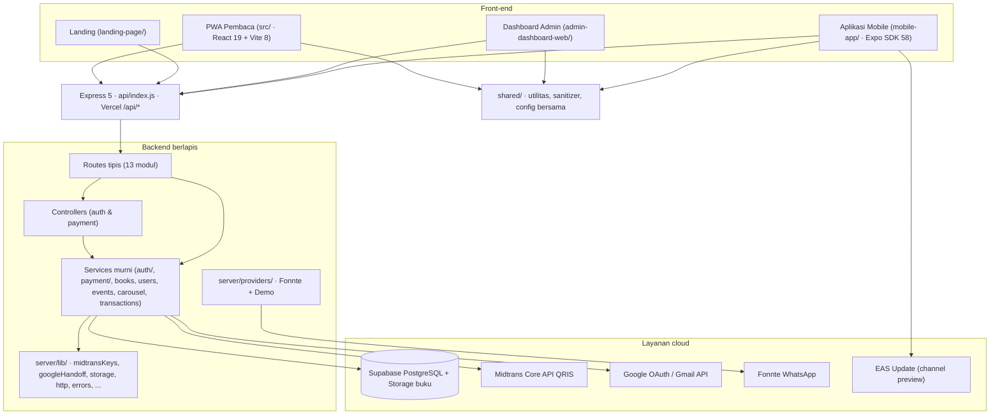

# 📖 Wahidiyah Book — Perpustakaan Digital, QRIS Midtrans & Aplikasi Mobile Expo

## 🧠 Master Memory Workflow & Dokumentasi Teknis Sistem Terpadu (Single Source of Truth)

[](https://nodejs.org/)
[](https://react.dev/)
[](https://expo.dev/)
[](https://expressjs.com/)
[](https://vite.dev/)
[](https://tailwindcss.com/)
[-emerald.svg)](https://supabase.com/)
[-0052cc.svg)](https://midtrans.com/)
[](https://vercel.com/)

> **Terakhir diperbarui:** 14 November 2026, 09:25 WIB. Acuan kode: `main` = `48bd013` (penuntasan tes + penyelarasan dokumen) ditambah perubahan working tree sesi ini. **Unduhan live masih 0.1.8 / versionCode 10**, sementara kode sudah disiapkan untuk **0.1.9 / versionCode 11** (proteksi screenshot reader) yang APK-nya belum dibangun.

> 🎯 **FUNGSI UTAMA BERKAS INI:** satu-satunya sumber kebenaran teknis untuk arsitektur monorepo (PWA pembaca, landing page, dashboard admin, aplikasi mobile Expo, backend Express), spesifikasi REST API, alur QRIS Midtrans, gateway WhatsApp/Fonnte, skema Supabase, standar keamanan & CSP, prosedur rilis APK + EAS Update, quality gate, dan konteks akademik skripsi.
>
> Spesifikasi produk rinci ada di `docs/specifications/MOBILE_APP_SPEC.md`. Catatan harian sesi ada di `.workbuddy-ai/memory/`. **Bila dokumen ini berbeda dengan kode aktif atau `full_setup.sql`, kode/skema yang berlaku — lalu dokumen ini diperbaiki.** Riwayat rinci tetap di `git log`; di sini hanya disimpan keputusan yang masih mengikat.

---

## ⛔ ATURAN KERAS 0 — HERMES V1 WAJIB, JSC DILARANG SELAMANYA

> Berlaku selama proyek memakai **Expo SDK 58 / React Native 0.88.1**. Baca sebelum menyentuh `app.json`, `eas.json`, config plugin, atau build Android. Regresi 9 November 2026: dialog "Mobile-app-ebook terus berhenti" pada Samsung Galaxy J7 Prime (32-bit `armeabi-v7a`).

**DILARANG KERAS**, dengan alasan apa pun (termasuk "kompatibilitas kernel lama"):

- `"jsEngine": "jsc"` di `app.json` / `eas.json`.
- Config plugin yang menyuntik `hermesEnabled=false` (`withJscEngine.cjs` sudah dihapus).
- Membuat ulang plugin sejenis, menyertakan `libjsc.so`, atau memakai bundel JS polos (magic `76617220`).
- Mendistribusikan APK ber-engine JSC.

**Mengapa:** SDK 58 / RN 0.88.1 hanya mendukung **Hermes V1** (`useHermesV1: true`). `jsEngine: "jsc"` diabaikan skema, sedangkan `hermesEnabled=false` benar-benar menghasilkan APK JSC — satu-satunya build yang force close (`versionCode 4`). Anggapan "Hermes crash di kernel 3.18" terbukti keliru; yang memperbaiki crash lama adalah guard `window.location` khusus web (commit `1b83232`), bukan JSC. Semua build sehat memuat `armeabi-v7a` + `arm64-v8a` dengan `minSdk 24`.

**Konfigurasi benar (`expo-build-properties` di `app.json`):** `buildArchs: ["armeabi-v7a","arm64-v8a"]`, `minSdkVersion: 24`, `useHermesV1: true`, `usesCleartextTraffic: true`. Saat ini `version 0.1.8`, `versionCode 10`, `runtimeVersion.policy = "appVersion"`, **tanpa** `jsEngine` dan **tanpa** plugin JSC. Plugin lain: `expo-font`, `expo-splash-screen` (polos, tanpa image), `@react-native-google-signin/google-signin`, `expo-secure-store`, `expo-status-bar`, `expo-web-browser`.

**Cek biner wajib sebelum publish:** `libhermesvm.so` ADA di kedua ABI; `libjsc.so` TIDAK BOLEH ADA; magic `assets/index.android.bundle` = `c61fbc03` (HBC); `minSdkVersion` 24; `versionCode` selalu naik. Dikunci otomatis oleh `tests/jsc_engine_plugin.test.mjs` — jangan dilonggarkan.

**Rilis & tanda tangan (berlaku sejak 13 November 2026):**

| Item | Nilai |
|---|---|
| APK aktif | `public/unduh/wahidiyah-v0.1.8-hermes-32bit.apk`, 44.576.049 byte |
| SHA-256 APK | `ac33d95c…e5337c0` |
| SHA-1 penandatangan | `E6:89:5B:E7:CC:70:D2:5E:80:96:28:C5:49:81:8A:32:26:1D:8E:29` (personal, keystore `Z7jJbQPNw0`) |
| Proyek EAS | personal `jualendfield1610` / `504e9a89-a47e-4146-8731-8e31eb35c744` |
| OTA aktif | channel/branch `preview`, runtime 0.1.8, update `01a1d5f8-fd5b-74e1-86fd-a8e731de6e36`, sinkron ke `b5107ba` |
| Upgrade dari 0.1.7 | **WAJIB uninstall dulu** — SHA-1 berbeda (tim `5F:F7:BC:…:B3:B6`), tanda tangan tidak bisa menimpa |

Unduhan **wajib same-origin**: `DIRECT_APK_URL = /unduh/wahidiyah-v0.1.8-hermes-32bit.apk`, header `Content-Disposition: attachment` di `vercel.json`, `/download` dan `/download/apk` hanya redirect internal, dan `/api/download/apk` ada di `health_routes.js`. Tautan langsung ke `github.com` membuat atribut HTML `download` diabaikan (cross-origin). GitHub Release `v0.1.5` tetap arsip kanonik, bukan tujuan unduh pengguna. Rilis lama 0.1.1/0.1.3/0.1.4/0.1.6/0.1.7 sengaja tidak dikirimi OTA; **jangan publish OTA runtime 0.1.1/0.1.2**. Build EAS #2 `52fe9675…` (doctor 20/20) adalah artefak final; branch `release/0.1.8-splash` @ `0a4454d` hanya cadangan, jangan di-merge.

**Prefiks kunci Midtrans BUKAN penentu lingkungan** (koreksi 10 November 2026): `SB-Mid-…` pasti sandbox, tetapi kunci tanpa prefiks (`Mid-server-…`) bisa berasal dari akun sandbox lama — terukur: `Mid-server-Ela…` → 201 di sandbox, 401 di produksi. Guard hanya memblokir `SB-Mid-…` + `MIDTRANS_IS_PRODUCTION=true`; selainnya lingkungan mengikuti flag. Jangan kembalikan aturan lama yang menganggap semua kunci non-`SB-` produksi.

> ⚠️ Catatan di `.agents/teamwork/**/handoff.md`, `DISPATCH.md`, dan `PROJECT.md` yang memuji plugin JSC sebagai "PASS / kompatibel 32-bit" adalah **dokumen usang dan SALAH**. Abaikan.

---

## ⛔ ATURAN KERAS 1 — INVARIAN RILIS 0.1.8 (JANGAN DILANGGAR)

| Area | Aturan yang mengikat | Penjaga regresi |
|---|---|---|
| **Auth tamu + soft gate** | `App.js` menyediakan satu `requireAuth(message, action)` → `AuthModal`; `pendingActionRef` **harus** `useRef`; aksi diulang lewat effect `[user]` + `setTimeout(0)`. 401 hanya memicu auto-logout bila ada token; tamu tidak boleh terjebak logout loop. `BookContext` memanggil `/subscriptions/my` hanya bila ada `sessionToken`. `/api/books` **jangan** dimasukkan `SESSION_FREE_ENDPOINTS`. | `tests/auth_gate_and_logout.test.mjs` |
| **Endpoint publik vs terproteksi** | Publik: `books/:id`, `events`, `carousel`, `thumbnail`. Terproteksi: `/html`, `/content`, `/content-url`, `/subscriptions/my`, `/qris/*`. | `tests/auth_gate_and_logout.test.mjs` |
| **Login Google** | `startGoogleLogin()` → `mobile-app/src/lib/googleNative.js` (`configure` → `hasPlayServices` → `signOut()` → `signIn()`) → `POST /api/auth/google/native`. Fallback browser `startGoogleMobile`: `prompt=select_account`, tukar kode + dedup + `onAuthSuccess`, **jangan 302 ke skema custom**. Handoff `server/lib/googleHandoff.js` (`intent://`, CSP identik, `no-store`), state berawalan `mob.`, timeout 120 detik. **AuthScreen TANPA teks tunggu apa pun**, termasuk saat sukses. Picker akun tanpa browser hanya lewat SDK native → butuh APK, jangan dijanjikan lewat OTA. | `google_native_signin`, `google_mobile_handoff`, `auth_gate_and_logout`, `ota_small_update_optimizations` |
| **OTA** | `mobile-app/src/lib/ota.js` (murni) → `hooks/useOtaUpdate.js` → `components/OtaUpdatePrompt.js` (tanpa impor `expo-updates`); `App.js` hanya memasang prompt. Modul/resource native **tidak bisa** lewat OTA → APK baru + `runtimeVersion` naik. Tanpa APK dilarang memakai `expo-clipboard` / `expo-media-library` / `expo-sharing`; gunakan `Clipboard` + `ToastAndroid` dari RN lewat `mobile-app/src/lib/clipboard.js` (toast "berhasil di salin"). | `tests/ota_small_update_optimizations.test.mjs` |
| **Kartu QRIS mobile** | Hanya QR, timer, nominal, **Salin Tautan** + toast, dan **X** yang langsung membatalkan order tanpa dialog. DILARANG memunculkan simulator, petunjuk tempel, Unduh QR, "Saya Sudah Bayar", atau "Batalkan & Buat Kode Baru". | `tests/qris_simulator_link.test.mjs` |
| **CSP + nonce OIDC** | Produksi **enforced** (`CSP_REPORT_ONLY=false` saat `NODE_ENV=production`/`VERCEL`), dev report-only, jalur mundur `CSP_ENFORCE=0`. Helmet hanya untuk `/api/*`; halaman statis memakai header di `vercel.json` + `vercel.admin.json` dengan `source: "/((?!api/).*)"` agar tidak menimpa `default-src 'none'` milik handoff. Tiga policy identik dengan `CSP_DIRECTIVES`; `img-src` mengizinkan `https://*.supabase.co`. **DILARANG skrip inline.** Nonce 128-bit jalur browser dibandingkan constant-time; state mobile tanpa nonce **DITOLAK**; cookie web sengaja tanpa nonce; native cukup `iat` ≤ 10 menit + rate limit. | `tests/csp_enforced_and_oauth_nonce.test.mjs` + `scripts/csp-browser-check.mjs` |
| **PDF native in-app** | `ReaderScreen.js` memakai `react-native-pdf` 7.0.5 + `react-native-blob-util` 1.1.1, `source={{uri}}` dari `/api/books/:id/content-url` (signed URL Supabase TTL 300 detik). **DILARANG** `expo-web-browser`/Custom Tab untuk membaca buku. `trustAllCerts={false}` **WAJIB** — default `true` memicu `IllegalStateException: Use of own trust manager but none defined`. Cabang PDF tanpa judul/unduh/A−/A+; `horizontal={false}`, `enablePaging={false}`, `fitPolicy={0}`, `minScale=1`, `maxScale=5`. Teks (DOCX/TXT) tetap `setFontSize`. | `tests/pdf_native_reader.test.mjs` |
| **Aset bawaan Expo** | DILARANG splash grid & `adaptiveIcon.monochromeImage`. Plugin `expo-splash-screen` tanpa `image` → polos `#FBF8F3`. Perubahan ini bersifat native ⇒ butuh APK. | `tests/jsc_engine_plugin.test.mjs` |
| **Ruang atas bilah Kembali** | Semua bilah atas bertombol Kembali wajib ruang ekstra ≈ +12 px agar tidak menempel status bar/poni. Mobile: `ReaderScreen` `paddingTop: 24` + `paddingBottom: 12`, `SubscriptionHistoryScreen`/`ProfileScreen` `contentContainer.paddingTop: 28`. Web: `DeviceFrame` header `pt-6 pb-2.5 sm:pt-5 sm:pb-3.5`, `ReaderTopBar` `h-14 pt-2`. Jangan kembalikan ke padding lama. | suite artefak + tinjauan visual |
| **Konfigurasi Supabase** | Satu sumber `shared/supabaseConfig.js`, **env-driven**, tanpa publishable/secret key hardcoded. `server/db.js` membaca `./env.js`; `src/lib/` dan `admin-dashboard-web/src/lib/` hanya re-export. Project ref aktif `pfiowztxlbcclazpdsxe`. | `m1_supabase_database`, `m3_admin_dashboard` |
| **Build & tes** | **Node 24** (`C:/Users/Daffa/Tools/node/node-v24.22.1-win-x64/node.exe`; Node 22 membuat 1 tes versi gagal). Jalankan `npm run build:all` **tepat sebelum** suite penuh; `npm run build` saja mengosongkan `dist/admin` & `dist/landing/mobile_screenshots` ⇒ kegagalan artefak palsu. Bila `build:admin` gagal karena shim, pakai `npx vite build --config vite.config.admin.js --emptyOutDir=false` dengan `CODEBUDDY_SAFE_DELETE_ENABLED=0`. Ekspor EAS **selalu** `--input-dir "C:/Users/Daffa/AppData/Local/Temp/wahidiyah-expo-export"` — `expo export --clear` mengosongkan `dist/` default. | suite penuh |
| **Kuota & identitas EAS** | Tim `jualendfield1610s-team` 15/15 habis (reset 1 Des 2026); personal 0/15. **Proyek tim JANGAN dihapus** — OTA 0.1.6/0.1.7 dan keystore `1sKJ2EOd3u` ikut hilang. `eas init --id` mengubah owner + projectId tetapi membiarkan `updates.url` lama ⇒ samakan manual. Google native butuh SHA-1 terdaftar untuk `id.wahidiyah.book`; tanpa itu `DEVELOPER_ERROR` dan fallback browser yang aman. | `tests/jsc_engine_plugin.test.mjs`, `tests/hardening_ota_016.test.mjs` |
| **Dependensi 2026** | Ekspor Excel **`write-excel-file/browser`** (bukan `exceljs`); Express 5 wildcard `'/{*splat}'` (path-to-regexp v8, tanpa spasi); Vite 8 + plugin-react 6; `react-router` 8; `pdfjs-dist` 6; override `@expo/fingerprint → minimatch ^11.0.1` ⇒ `npm audit` 0 temuan. Jangan naikkan `react`/`react-dom` (kunci SDK 58) atau `@react-native-async-storage` 3 (native ⇒ APK baru). | `npm audit`, `expo-doctor` 20/20 |
| **Midtrans QRIS** | QRIS butuh **URL gambar** dari `actions[]` (`qr-code` / `qr-code-v2`), bukan sekadar `qr_string`; `qrMidtransUrl` hanya dikirim di mode sandbox. | `tests/qris_simulator_link.test.mjs` |
| **Proteksi isi buku (0.1.9)** | `usePreventScreenCapture('wahidiyah-reader')` dipanggil di **level `ReaderScreen`** sebelum cabang `isPdf`, jadi PDF maupun DOCX/TXT kelak terlindungi. Hook resmi melepas `FLAG_SECURE` otomatis saat unmount. Layar lain (Auth, OAuth, QRIS, Profil) **tidak boleh** dipasang guard. Hanya memblokir — tanpa config plugin, tanpa `READ_MEDIA_IMAGES`, tanpa `addScreenshotListener`. Modul native ⇒ APK + runtime baru, tidak boleh OTA. | `tests/reader_screen_capture_guard.test.mjs` |

---

## 📑 Daftar Isi

> ⛔ **Baca dulu "ATURAN KERAS 0" dan "ATURAN KERAS 1" tepat di atas** sebelum mengikuti bagian mana pun di bawah.

0. [Aturan Keras 0 — Hermes V1 / JSC](#-aturan-keras-0--hermes-v1-wajib-jsc-dilarang-selamanya) · [Aturan Keras 1 — Invarian 0.1.8](#-aturan-keras-1--invarian-rilis-018-jangan-dilanggar)
1. [Ringkasan Eksekutif & Tech Stack](#1-ringkasan-eksekutif--tech-stack)
2. [Fitur Unggulan Sistem](#2-fitur-unggulan-sistem)
3. [Arsitektur Sistem & Rekayasa Perangkat Lunak](#3-arsitektur-sistem--rekayasa-perangkat-lunak-modular-layered-monolith)
4. [Spesifikasi Lengkap Design System & Standar Visual UI](#4-spesifikasi-lengkap-design-system--standar-visual-ui)
5. [Spesifikasi Lengkap REST API (/api/*)](#5-spesifikasi-lengkap-rest-api-api)
6. [Mekanisme & Alur Pembayaran Real Midtrans QRIS](#6-mekanisme--alur-pembayaran-real-midtrans-qris)
7. [Arsitektur Provider WhatsApp Gateway](#7-arsitektur-provider-whatsapp-gateway)
8. [Panduan Setup & Skema Database Supabase Cloud](#8-panduan-setup--skema-database-supabase-cloud)
9. [Standar Keamanan Sistem](#9-standar-keamanan-sistem-30-indikator-software-quality--security-hardening)
10. [Panduan Pengembangan & Penambahan Fitur Baru](#10-panduan-pengembangan--penambahan-fitur-baru)
11. [Panduan Akademik & Integrasi Sitasi Zotero SINTA](#11-panduan-akademik--integrasi-sitasi-zotero-sinta)
12. [Prasyarat & Konfigurasi Lingkungan (.env)](#12-prasyarat--konfigurasi-lingkungan-env)
13. [Panduan Instalasi & Katalog NPM Scripts](#13-panduan-instalasi--katalog-npm-scripts)
14. [Struktur Direktori Repositori Terpadu](#14-struktur-direktori-repositori-terpadu)
15. [Riwayat Singkat](#15-riwayat-singkat)
16. [Status Terkini & Rencana Mendatang](#16-status-terkini--rencana-mendatang)
17. [Informasi Pengembang & Identitas Skripsi](#17-informasi-pengembang--identitas-skripsi)

---

## 1. Ringkasan Eksekutif & Tech Stack

**Wahidiyah Book** kini berupa **monorepo empat front-end + satu backend** di satu repositori: PWA pembaca (`src/`), landing page unduh APK (`landing-page/`), dashboard admin (`admin-dashboard-web/`), aplikasi mobile native (`mobile-app/`), dan API Express (`server/` + `api/index.js`). Kode yang dipakai bersama hidup di `shared/`; aturan bisnis tetap terpusat di service layer murni.

| Lapisan | Teknologi (per 14 November 2026) |
|---|---|
| Mobile | Expo SDK 58.0.25 / React Native 0.88.1, Hermes V1, `react-native-pdf` 7.0.5, `react-native-blob-util` 1.1.1, `expo-updates` ~58, `@react-native-google-signin/google-signin` 17, `@react-native-async-storage/async-storage` 2.2.0 |
| Web (PWA / landing / admin) | React 19.3.0, Vite 8.3.8 + `@vitejs/plugin-react` 6.3, `react-router` 8.5.1, Tailwind CSS 4.3.5 + `@tailwindcss/vite`, Headless UI, Lucide, Sonner, Recharts |
| Mesin dokumen web | `pdfjs-dist` 6.5.438 (`PdfDocumentViewer.jsx`), `docx-preview` 0.4.1 (`DocxDocumentViewer.jsx`), `jspdf` 4.2.1 untuk kwitansi |
| Ekspor Excel admin | `write-excel-file` 4.1.1 (`/browser` di UI, `/node` di tes E2E) — menggantikan `exceljs` |
| Backend | Node.js 24.x, **Express 5.3.0** (ESM), `helmet` 8.3, `zod` 4.6, `express-rate-limit` 8.7, `sharp` 0.35, adapter serverless `api/index.js` |
| Database & BaaS | Supabase PostgreSQL, RLS fail-closed, timezone `Asia/Jakarta`, bucket privat `buku` |
| Pembayaran | Midtrans Core API QRIS (sandbox), Fonnte sebagai gateway WhatsApp |
| Distribusi | Vercel (3 target statis + serverless) untuk web; APK sideload same-origin + EAS Update channel `preview` untuk mobile |

**Quality harness (status 14 November 2026):** `npm run build:all` (3 target Vite), `npm run check` (Prettier + `npm run health` 7/7), `npm test` (E2E 4 tier, **67/67**), dan suite penuh Node 24 `node --test --test-concurrency=1 tests/*.mjs` → **387/387, 0 gagal** (36 berkas `tests/*.mjs` + 5 berkas `tests/e2e/`). `npm audit` 0 temuan; `expo-doctor` 20/20. Klaim lama "tidak ada suite unit test aktif, verifikasi manual" **sudah tidak berlaku**.

---

## 2. Fitur Unggulan Sistem

### 2.1. Katalog Buku & Dua Mesin Pembaca

- **Katalog:** desain e-reader editorial, sampul dominan, pencarian instan, badge akses *free* / *Pro*. Tiga naskah PDF ada di bucket `buku/naskah/<folder>/<file>.pdf` (3 / 20 / 62 halaman); yang pertama adalah PDF pindai sehingga ekstraksi teksnya memang kosong — bukan salah unggah.
- **Pembaca web (PWA):** PDF.js viewer resmi (`PdfDocumentViewer.jsx` + `pdfWorkerSetup.js`) dengan virtualisasi halaman, gulir vertikal, dan zoom peramban alami; DOCX dirender ke lembar A4 terpaginasi via `docx-preview`; TXT/HTML lewat `TextDocViewer.jsx`. Top bar minimalis, posisi baca tersimpan di `localStorage`, tiga mode latar (Terang / Sepia / Malam) **khusus reader**. Proteksi berupa `select-none` + konten terotorisasi JWT; tanda air dinamis dan blokir klik kanan **memang tidak ada di kode** — keputusan terbuka untuk Bab IV.
- **Pembaca mobile (0.1.7+):** PDF dibuka **di dalam aplikasi** memakai `react-native-pdf` dengan `source={{ uri }}` dari endpoint terproteksi `/api/books/:id/content-url` (signed URL Supabase TTL 300 detik). DILARANG memakai `expo-web-browser` / Chrome Custom Tab. `trustAllCerts={false}` wajib. Tidak ada judul, tombol unduh, atau kontrol A−/A+ pada cabang PDF; teks DOCX/TXT tetap memakai `setFontSize`.
- **Proteksi screenshot (0.1.9, kode siap / APK menyusul):** `expo-screen-capture ~58.0.6` memasang `FLAG_SECURE` selama `ReaderScreen` terbuka, untuk semua format naskah. Preview *recent apps* ikut kosong di Android. Batas jujur untuk Bab IV: ini menaikkan biaya menyalin santai, **tidak** menahan kamera kedua, perangkat root, atau APK yang di-patch; perlindungan isi tetap dari paywall server + signed URL 300 detik.

### 2.2. Autentikasi: Tamu, Soft Gate, dan Google

- **Mode tamu + soft gate:** beranda, agenda, dan halaman Pro langsung terbuka tanpa akun. Aksi beridentitas (membaca naskah, riwayat langganan, membuat tagihan QRIS) melewati **satu** `requireAuth()` terpusat di `App.js` yang memunculkan bottom sheet `AuthModal`; setelah login aksi yang tertunda dijalankan ulang otomatis. 401 hanya memicu auto-logout bila ada token tersimpan.
- **Registrasi/OTP:** email melalui Gmail API OAuth2 tetap jalur utama (`deliveryMethod` dikunci `email`), dengan anti-flooding dan cooldown 60 detik; WhatsApp/Fonnte menjadi kanal pemulihan sekunder. Nomor Indonesia saja, dinormalisasi `62xx`.
- **Login Google:** dua jalur — SDK native (`POST /api/auth/google/native`, `id_token` + `iat` ≤ 10 menit + rate limit) dan fallback browser OAuth (`POST /api/auth/google/mobile-start` → state `mob.` + nonce 128-bit → halaman handoff `intent://` → `POST /api/auth/exchange`). **AuthScreen sengaja tanpa teks status tunggu**, termasuk saat berhasil. Picker akun tanpa browser hanya tersedia lewat SDK native, jadi membutuhkan APK (tidak bisa dikirim lewat OTA).
- **Sesi:** `bcryptjs` 12 rounds, JWT (`JWT_SECRET`), `requireAdmin` diverifikasi ke database, dan pencegahan *self-demotion*.

### 2.3. Keanggotaan Pro & QRIS Midtrans

- Paket tunggal `monthly` Rp 25.000 + biaya admin Rp 3.000 = **Rp 28.000**, dihitung server.
- **Web:** `QrisPaymentCard.jsx` menampilkan gambar QR resmi Midtrans (proxy `/qris/:orderId/qr.png`) dengan fallback `QRCodeSVG`, timer 15 menit, tautan siap-tempel untuk simulator sandbox, simpan PNG, kwitansi A4 `jspdf`, polling 3 detik, webhook idempoten SHA512, dan `POST /qris/reconcile`. **Transfer manual masih terpasang** (`ManualPaymentForm.jsx`, `POST /api/transactions`) — tidak dihapus, hanya tidak otomatis.
- **Mobile (0.1.6+):** kartu **minimal** — QR, timer, nominal, **Salin Tautan** (Clipboard + `ToastAndroid` RN → "berhasil di salin"), dan **X** yang langsung membatalkan order tanpa dialog. Tidak ada simulator, petunjuk tempel, unduh QR, "Saya Sudah Bayar", maupun "Batalkan & Buat Kode Baru".
- **Satu-satunya sumber kebenaran pelunasan adalah Midtrans.** Frontend tidak pernah menyatakan "lunas" sendiri.

### 2.4. Dashboard Admin (workspace terpisah)

Panel admin **bukan lagi** `src/features/admin` (dihapus saat pembersihan M1); ia hidup mandiri di `admin-dashboard-web/` dan di-deploy ke proyek Vercel terpisah lewat `vercel.admin.json`.

- `AdminLogin.jsx` (tema ivory/emas), `AdminSidebar` / `AdminHeader` / `StatCard`, dan `OverviewTab.jsx` dengan 4 kartu KPI.
- `BooksTab.jsx` + `BookModal.jsx`: CRUD katalog, unggah naskah lewat signed upload, kompresi sampul WebP (`sharp`), toggle Pro, pencarian & filter.
- `UsersTab.jsx`, `EventsTab.jsx` (+ `events/`), `LogsTab.jsx`: pengguna, agenda, dan log aktivitas.
- **Ekspor XLSX 1-klik** memakai `write-excel-file/browser` — 5 sheet, header hijau, zebra cream, lebar kolom otomatis, dan rumus `SUM` bertipe `Formula`.
- Klaster `CarouselTab.jsx`, hook `useAdminCarouselEditor`, `PushStatusBanner`, serta portal admin duplikat di PWA sudah dihapus sebagai dead code.

### 2.5. Landing Page & Distribusi APK

`landing-page/` adalah satu halaman showcase (`LandingNavbar`, `HeroSection`, `FeaturesSection`, `PreviewSection`, `LandingFooter`) dengan satu tombol **"Unduh Apk 0.1.8"** yang menunjuk `DIRECT_APK_URL`. Meta, hero, `vercel.json`, `health_routes.js`, dan konstanta tes semuanya mengikuti versi aktif. Aset APK disajikan same-origin dari `public/unduh/` dengan `Content-Disposition: attachment`.

### 2.6. Aplikasi Mobile (Expo SDK 58)

- **Navigasi 4 tab:** Beranda, Kalender, Pro, Profil — plus `AuthModal`, `AuthScreen`, `VerificationScreen`, `ReaderScreen`, `SubscriptionHistoryScreen`. `DownloadsScreen.js` sudah dihapus (tidak pernah dirujuk).
- **OTA:** `mobile-app/src/lib/ota.js` (murni) → `hooks/useOtaUpdate.js` → `components/OtaUpdatePrompt.js`; `App.js` hanya memasang prompt. Dialog memberi dua pilihan eksplisit (perbarui / tidak); Profil tamu menyediakan **Cek Pembaruan OTA** manual. Perubahan modul native tidak bisa lewat OTA.
- **Bilah atas:** semua header bertombol Kembali diberi ruang ekstra ≈ +12 px agar tidak menempel status bar/poni.
- **Anti-screenshot:** guard dipasang sekali di `ReaderScreen` (bukan per cabang PDF), sehingga format buku baru otomatis terlindungi.
- **Tanda tangan & rilis:** lihat Aturan Keras 0/1. Pengguna 0.1.7 wajib uninstall sebelum memasang 0.1.8.

---

## 3. Arsitektur Sistem & Rekayasa Perangkat Lunak (Modular Layered Monolith)

Monorepo tetap memakai **Modular Layered Monolith**: satu backend Express, empat front-end yang berbagi `shared/`, dan aturan bisnis yang hanya boleh hidup di service layer murni.



### 3.1 Konvensi Kode & Pembagian Tanggung Jawab 4 Lapisan

Pemisahan ketat untuk *loose coupling*, *high cohesion*, dan *testability*:

1. **Routes Layer (`server/routes/`)** — tipis: URL, metode HTTP, middleware (`requireAuth`, `requireAdmin`, `authRateLimiter`, `paymentRateLimiter`), lalu memetakan hasil service ke respons. Tidak memuat aturan bisnis. Modul **books, users, transactions, events, carousel, auth, payments** sudah nol referensi `supabaseServer`; tiga pengecualian yang diketahui tetap: `subscriptions_routes.js`, `admin_routes.js`, `health_routes.js`.
2. **Controllers Layer (`server/controllers/`)** — hanya `auth_controller.js` dan `payment_controller.js` (skema `zod`, ekstraksi `req`, amplop respons khusus). Modul lain langsung route → service.
3. **Services Layer Murni (`server/services/`)** — seluruh aturan bisnis + query Supabase, bebas `req`/`res`. Lima service satu berkas (`books_service`, `events_service`, `carousel_service`, `users_service`, `transactions_service`) dan dua paket: `auth/` (`messages`, `session`, `registration`, `password_reset`, `otp_resend`, `google_oauth`) serta `payment/` (`constants`, `order`, `settlement`, `status`, `notification`). Kegagalan aturan bisnis dilempar lewat `createServiceError()` dari `server/lib/errors.js`.
4. **Helper & Database (`server/lib/`, `server/db.js`)** — `errors`, `midtrans`, `midtransKeys`, `time`, `validate`, `images`, `http`, `otp`, `oneTimeCode`, `membership`, `constants`, `storage`, `sniff`, `origin`, `push*`, `eventReminder`, `sanitizeHtml` (re-export `shared/`), `pdfPages`, **`googleHandoff.js`** (halaman serah-terima OAuth mobile), **`db.js`** (klien service-role, RLS fail-closed).

### 3.2 Evaluasi Kritis 30 Prinsip Kualitas Perangkat Lunak

- **Tier 1 (P1):** *Separation of Concerns*; *Idempotency* (klaim UPDATE bersyarat atomik untuk webhook/aktivasi Pro); *Security by Design* (RLS fail-closed, `bcryptjs` 12 rounds, CSP enforced, nonce OIDC); *Testability* — **kini ditegakkan 387 tes otomatis**, bukan lagi verifikasi manual; *KISS/YAGNI*; *High Cohesion & Loose Coupling*.
- **Tier 2 (P2):** *Maintainability* (ESM, Prettier `printWidth: 100`, dokumen ini); *DRY* (helper terpusat + `shared/`); *Extensibility* (Strategy Pattern WhatsApp); *Robustness* (polling QRIS tahan fluktuasi jaringan, global error handler); *Performance* (manual chunks Vite: `charts`, `excel`, `pdfjs`, `supabase-sdk`, `vendor`, `icons`); *Observability* (logger `picocolors` berpenanda WIB).
- **Tier 3 (P3, anti-pattern yang dihindari):** microservices, event sourcing/CQRS, dan message broker terdistribusi — overheadnya tidak sepadan untuk sistem perpustakaan skala skripsi.

### 3.3 Dukungan Lingkungan, Vercel & EAS

- **Development:** `npm run dev` menyalakan Express + middleware Vite HMR dalam satu port `http://localhost:3000` (`VITE_PORT`); `PORT=5000` untuk mode API/produksi. `npm run dev:landing` / `dev:admin` memakai config Vite masing-masing dengan proxy `/api` ke port 5000.
- **Vercel Serverless:** `api/index.js` membungkus aplikasi Express; rewrite `/api/(.*)` ke function; `regions: ["sin1"]` (Singapura) menurunkan latensi `/api/health` dari 1,2–1,8 dtk menjadi 0,13–0,77 dtk. Node dipatok `24.x` via `engines`. **Express 5** menggantikan wildcard `'*'` dengan `'/{*splat}'` (`path-to-regexp` v8).
- **Dua konfigurasi deploy, tiga target build:** `vercel.json` (landing + PWA + API) dan `vercel.admin.json` (dashboard admin, `buildCommand: npm run build:admin`, `outputDirectory: dist/admin`); `build:all` menghasilkan `dist/`, `dist/landing`, dan `dist/admin`. Keduanya memasang header CSP enforced untuk **semua** rute UI lewat `source: "/((?!api/).*)"` sehingga tidak menimpa `/api/*`.
- **CSP:** `CSP_DIRECTIVES` di `server/config.js`; produksi enforced, dev report-only, override `CSP_ENFORCE`. Helmet hanya melekat pada respons `/api/*`; halaman handoff Google menimpa policy dengan hash sendiri. `img-src` mengizinkan `https://*.supabase.co` untuk thumbnail. Tidak ada skrip inline (`sw-cleanup.js` eksternal).
- **Naskah di Supabase Storage:** Vercel menolak body > 4,5 MB, sehingga naskah dikirim peramban langsung ke bucket privat `buku` lewat `POST /api/books/upload-intent`; `content_url` hanya menyimpan penanda `storage://buku/<path>`. Pembaca mobile meminta `/api/books/:id/content-url` untuk signed URL TTL 300 detik.
- **Atribusi IP klien:** `TRUST_PROXY` wajib diisi jumlah hop; di Vercel `1`. Tanpa itu `req.ip` jatuh ke `127.0.0.1` dan rate limiter menyatu untuk semua pengguna.
- **Rate limit & OAuth:** endpoint sensitif memakai MemoryStore bawaan `express-rate-limit` (store bersama Supabase sudah dilepas; tabel/RPC-nya masih ada di `full_setup.sql`). Kode sesi OAuth sekali-pakai disimpan ter-hash di `email_verifications` (60 detik) dan dihapus atomik saat ditukar; jalur mobile menambah `state` berawalan `mob.` + nonce 128-bit.
- **OTA & kuota:** `eas update` SDK 58 wajib `--environment preview` + `--branch` + `--platform android`; `update:list` tidak punya `--channel`. EAS memfilter manifest per `runtimeVersion`, jadi beberapa runtime aman bercampur dalam satu channel. Build cloud ±54 menit antre + ±8 menit build; build lokal tidak mungkin di mesin ini (tanpa Android SDK/WSL/Docker, hanya JDK 21).

---

## 4. Spesifikasi Lengkap Design System & Standar Visual UI

### 4.1 Visual Atmosphere & Design POV
Wahidiyah Book adalah platform perpustakaan digital dan komunitas spiritual untuk pengamal Sholawat Wahidiyah. Antarmukanya mencerminkan nilai-nilai:
* **Berwibawa & Teduh (Sacred & Serene):** Tidak berisik seperti SaaS modern generik, melainkan memiliki ketenangan manuskrip klasik dan kehangatan ruang baca perpustakaan pesantren.
* **Presisi Akademis (Academic Rigor):** Tipografi teks dan sitasi yang rapi, layout hierarkis terstruktur, keterbacaan tinggi untuk membaca PDF kitab tebal berjam-jam tanpa kelelahan mata.
* **Kepercayaan Transaksi Finansial (Midtrans Trust):** Alur checkout QRIS dan keanggotaan Pro yang transparan, aman, responsif, dan memberikan umpan balik instan.

### 4.2 Tiga Dial Desain (Core Configuration)
* **`DESIGN_VARIANCE: 6`** — Keseimbangan antara keteraturan editorial katalog buku dan dinamika kartu asimetris pada hero section.
* **`MOTION_INTENSITY: 4`** — Gerakan halus, berpijak pada spring physics alami (`stiffness: 120, damping: 20`). Tanpa animasi berulang yang mengganggu kekhusyukan membaca.
* **`VISUAL_DENSITY: 5`** — Ruang bernapas yang cukup pada halaman bacaan dan katalog, namun ringkas dan efisien pada tabel administrasi dan data transaksi.

### 4.3 3 Color Key & Prinsip 60-30-10 (Wajib Semua Route)
Seluruh rute antarmuka wajib menerapkan TIGA color key dari Tema 1 "Editorial Elegan" dengan proporsi **60-30-10**:

| Peran | Proporsi | Warna | Token Tailwind | Pemakaian |
|---|---|---|---|---|
| **Dominan** | ±60% | Krem Hangat `#FBF8F3` | `cream-*`, `ui-bg/surface/card`, `ink-*` | Latar kanvas, kartu, panel, teks, border |
| **Sekunder** | ±30% | Hijau Zamrud Tua `#14523A` | `brand-*`, `primary` | Sidebar, tombol aksi, header, ikon, state aktif |
| **Aksen** | ±10% | Emas Antik `#B8860B` | `gold-*`, `accent-gold` | Lencana PRO, highlight, ornamen, detail premium |

**Aturan Penerapan:**
1. **Status Fungsional:** Menggunakan token semantik `semantic-success/warning/danger/info` (bukan warna dekoratif, tidak dihitung dalam 60-30-10).
2. **Larangan Palet Mentah:** Dilarang keras memakai kelas warna Tailwind mentah (`slate-*`, `gray-*`, `zinc-*`, `indigo-*`, `rose-*`, `emerald-*`, dll.) untuk elemen struktural. Seluruh warna wajib melalui CSS variable token.
3. **Pengecualian Resmi:** Logo Google multicolor pada tombol OAuth, logo resmi QRIS di `public/payments/` (`qris.svg` dan `qris-putih.svg`), serta token merah resmi QRIS `qris-600/700` (`#E30613`/`#C00511` — kemasan merah baku QRIS Indonesia). Wordmark QRIS satu warna tampil apa adanya di atas kartu terang; tidak lagi dibalik, karena penanda `mono` dan varian invert tema gelap sudah ikut dihapus bersama mode malam. Bukan memakai pelat putih, karena pelat menciptakan kotak putih yang tidak menyatu dengan kartu.
4. **Satu Tema Terang:** Aplikasi tidak lagi punya mode malam. Seluruh warna mengalir dari CSS variable palet "Editorial Elegan" versi terang, dan proporsi 60-30-10 dijaga pada palet itu saja.

### 4.4 Palet Tunggal "Editorial Elegan" (Terang)
Sumber kebenaran warna ada di `component.json` (`colors`) dan disuntikkan ke CSS variables oleh `src/theme/themeInjector.js`. Hanya ada **satu palet untuk satu tema terang**: mode malam dan pilihan tema sudah dibuang, jadi tidak ada kelas `dark` di `<html>`, tidak ada `ThemeProvider`/`themeMode.js`, tidak ada tombol ganti tema, dan tidak ada skrip pra-cat di `index.html`.

| Peran | Nilai | Token |
|---|---|---|
| **Brand / Sekunder** | Hijau Zamrud Tua `#14523A` (brand-700), hover `#0E3D2C` | `brand-*` |
| **Latar Dominan** | Krem Hangat `#FBF8F3`, surface `#F7F2E9`, card `#FFFDFA` | `cream-*`, `ui-*` |
| **Teks / Ink** | Tinta Arang `#1D1B17`, sekunder `#5A554E`, muted `#7C766E` | `ink-*`, `ui-text-*` |
| **Aksen** | Emas Antik `#B8860B` (gold-500), highlight `#D4AF4F` | `gold-*`, `accent-gold` |
| **Border** | `#E4D9C6` | `ui-border`, `cream-300` |

Permukaan yang memang gelap secara desain (sidebar admin) memakai token `semantic-dangerOnDark` dan `semantic-mutedOnDark`. Dua token itu bertahan karena ia menerangkan makna "teks di atas permukaan gelap", bukan bagian dari mode malam. Konsekuensi lain: `script-src` cukup `'self'` — semua skrip inline sudah dipindah ke berkas eksternal (`public/sw-cleanup.js`). Sejak 12 November 2026 policy ini **ditegakkan** (bukan report-only) di produksi lewat `server/config.js`, `vercel.json`, dan `vercel.admin.json`; lihat Aturan Keras 1.

### 4.5 Tipografi & Hirarki Skala
> Keputusan akhir (revisi R29): seluruh font kustom dihapus — Google Fonts →
> `@fontsource` self-host → kini **full font bawaan OS** (unduhan font = 0 KB,
> tanpa FOUT). Identitas serif & Arab dipertahankan lewat stack bawaan OS.
* **Display / Judul:** stack serif bawaan OS (`Georgia, Cambria, 'Times New Roman', serif`) lewat `.font-display`.
* **Body / Teks Bacaan:** stack sans bawaan OS (`system-ui, 'Segoe UI', Roboto, …`), `line-height: 1.65`, batas maksimal paragraf `65ch`.
* **Ayat & Kaligrafi Arab:** stack Arab bawaan OS (`'Traditional Arabic'` Windows, `'Geeza Pro'` macOS/iOS, `'Noto Naskh Arabic'` Android) lewat `.font-arabic`, ukuran proporsional lebih besar dengan ruang harakat yang lapang.
* **Angka Finansial & Kode:** `font-mono` bawaan sistem untuk nominal QRIS dan nomor referensi; tidak ada font kustom yang diunduh sama sekali (0 KB).

### 4.6 Arsitektur Navigasi Terpadu (Responsive Design)
* **Desktop Sidebar (Ramping & Fokus):**
  - Lebar Terbuka: `218px` (proporsional dengan kanvas konten)
  - Lebar Ciut (Collapsed): `68px` (ikon + tooltip cerdas)
  - Menu Pengguna — Utama: Beranda, Kalender, Pro. Akun: Profil, Log Out. (Riwayat Langganan, Pusat Bantuan, dan Tentang dijangkau dari Hub Profil.)
  - Menu Admin: saat pengguna ber-role admin, sidebar hanya menampilkan section **Administrasi** berisi Beranda (overview), Koleksi, Pengguna, Agenda, dan Log Aktivitas — menu pengguna digantikan. Tab *Carousel* sudah dihapus sebagai dead code; panel admin kini berada di workspace `admin-dashboard-web/`.
  - Label mengikuti `src/components/layout/navigationConfig.jsx`; tombol badge EB yang mengganggu telah dihilangkan.
* **Universal Sticky Top Back Button Header (`DeviceFrame.jsx`):**
  - Hadir seragam di **Desktop, Tablet, dan Mobile** (`← [Judul]`) untuk sub-halaman: `/about` (Tentang Aplikasi), `/help` (Pusat Bantuan), `/riwayat` (Riwayat Langganan), dan `/profile` (Profil).
  - Margin dinamis terhadap sidebar desktop (`md:ml-[218px]` saat terbuka, `md:ml-[68px]` saat ciut) sehingga tidak saling bertumpuk.
  - *Smart Fallback Navigation:* Mengutamakan `window.history.back()`, jika riwayat kosong otomatis kembali ke Hub Profil atau Beranda.
* **Mobile Bottom Dock Bar:**
  - Bar melayang di bagian bawah dengan radius `20px` dan bayangan lembut.
  - Pengguna: 4 tombol — Beranda, Kalender, Pro (lencana bintang emas), Profil. Admin: Ringkasan, Koleksi, Pengguna, Agenda, dan tombol **Menu**.
  - Target sentuh minimal `44px × 44px` memenuhi standar aksesibilitas mobile WCAG.

### 4.7 Spesifikasi Wireframe & Layout Layar Inti

1. **Katalog & Beranda:** hero carousel dinamis, kartu buku Moco-style (sampul dominan, tanpa penulis generik), pencarian instan, filter akses (Semua / Gratis / Pro).
2. **Pembaca dokumen:**
   - **Web:** PDF.js viewer resmi, scroll-spy halaman aktif, virtualisasi double-buffered, zoom peramban alami, top bar minimalis (kembali, `Halaman X / Total`, layar penuh); DOCX terpaginasi A4 via `docx-preview`; `select-none` + konten berotorisasi JWT.
   - **Mobile:** `react-native-pdf` dengan `trustAllCerts={false}`, gulir vertikal, pinch zoom 1×–5×, `fitPolicy={0}`, tanpa judul/unduh/kontrol huruf pada cabang PDF. Teks DOCX/TXT memakai `setFontSize`. Semua bilah atas bertombol Kembali diberi `paddingTop: 24` + `paddingBottom: 12`.
3. **Membership Pro & QRIS Midtrans:**
   - **Web:** gambar QR resmi Midtrans via `/api/payments/qris/:orderId/qr.png`, fallback `QRCodeSVG`, timer 15 menit, simpan PNG, Salin Kode QR untuk simulator sandbox, kwitansi A4 `jspdf`, dan **Batalkan & Buat Kode Baru**. Tidak ada flag `ALLOW_PAYMENT_SIMULATION`.
   - **Mobile:** kartu minimal — QR, timer, nominal, **Salin Tautan** (Clipboard + `ToastAndroid`), dan **X** yang langsung membatalkan order tanpa dialog. DILARANG menambahkan simulator, petunjuk tempel, unduh QR, atau tombol "Saya Sudah Bayar".
4. **Kalender Kegiatan Mujahadah:** matriks bulanan interaktif zona `Asia/Jakarta`, nama lokasi terpisah dari tombol rute Google Maps.
5. **Dashboard Admin (workspace `admin-dashboard-web/`):** `OverviewTab` (4 KPI + donut + pendapatan + ekspor XLSX `write-excel-file`), `BooksTab` + `BookModal`, `UsersTab`, `EventsTab` + `events/`, `LogsTab`. `CarouselTab` dan portal admin duplikat di PWA sudah dihapus.
6. **Profil:** gaya Cupertino inset grouped, Data Akun di paling atas, tombol ganti kata sandi, sub-halaman Riwayat Langganan / Pusat Bantuan / Tentang, dan logout aman. **Tidak ada toggle tema gelap** — satu tema terang (lihat §4.3–4.4).
7. **Autentikasi & gerbang tamu:** formulir login/daftar/pulih sandi bersih, tombol *"Daftar"*, OTP email. Aplikasi mobile langsung membuka beranda/agenda/Pro tanpa akun; aksi beridentitas melewati **satu** `requireAuth()` terpusat → bottom sheet `AuthModal` dengan **ikon X tanpa tombol "Nanti" dan tanpa kotak pesan kontekstual**; aksi tertunda dijalankan ulang setelah login. Tab Profil tamu memuat **Masuk / Daftar**, nomor versi, **Cek Pembaruan OTA**, bantuan, dan tentang. `apiRequest` hanya auto-logout pada 401 bila ada token tersimpan. Endpoint publik: `books/:id`, `events`, `carousel`, `thumbnail`; terproteksi: `/html`, `/content`, `/content-url`, `/subscriptions/my`, `/qris/*`.

### 4.8 Anti-Patterns & Banned Clichés

* **DILARANG:** Gradien ungu-neon/biru AI, hitam pekat `#000000` atau putih silau `#FFFFFF` sebagai kanvas, tiga kartu identik tanpa ritme, *Lorem Ipsum* / *John Doe* / *Acme Corp*, animasi tak beralasan, dan kelas warna Tailwind mentah di luar token.
* **WAJIB:** kontras teks ≥ 4.5:1 (3:1 untuk teks besar), dan tripel RGB CSS variables yang kompatibel dengan `rgb(var(--brand-700) / <alpha>)`.
* **DILARANG (mobile, keputusan pemilik):** teks status tunggu pada `AuthScreen`, splash grid bawaan Expo, `adaptiveIcon.monochromeImage`, serta bilah atas yang menempel status bar.
* **DILARANG (keamanan):** skrip inline pada halaman statis, kunci Supabase hardcoded di berkas klien, dan mengirim `qrMidtransUrl` di luar mode sandbox.

---

## 5. Spesifikasi Lengkap REST API (`/api/*`)

* **Base URL:** `http://localhost:3000/api` saat `npm run dev` (satu port Vite middleware); `http://localhost:5000/api` untuk produksi lokal; `/api` di Vercel. Klien mobile memakai `EXPO_PUBLIC_API_URL` dari `eas.json` (`https://mobile-app-ebook.vercel.app/api`). `npm run dev:frontend`, `dev:landing`, `dev:admin` memakai proxy Vite ke `http://localhost:5000`.
* **Format Request/Response:** `application/json` (kecuali upload multipart). Sukses selalu `{ "success": true, ...data }`; kegagalan `{ "success": false, "message": "..." }`.
* **Otentikasi:** Header `Authorization: Bearer <JWT_TOKEN>` untuk rute terproteksi. Rute admin menambah `requireAdmin` (verifikasi role langsung ke database).
* **Kegagalan service:** `createServiceError(pesan, { statusCode, code })` di `server/lib/errors.js`; `fail()` di `server/lib/http.js` menerjemahkan `statusCode` menjadi respons HTTP.

**Ringkasan 59 endpoint aktif** (bertambah 4 sejak 5 November 2026: `google/mobile-start`, `google/native`, `books/:id/content-url`, `download/apk`):

| Modul | Jumlah | Modul | Jumlah |
|---|---:|---|---:|
| Auth | 12 | Books | 11 |
| Payments | 6 | Users | 6 |
| Transactions | 3 | Subscriptions | 1 |
| Events | 5 | Carousel | 6 |
| Notifications | 4 | Health & Stats | 3 |
| Admin logs | 1 | Cron | 1 |

### 5.1. Otentikasi (`/api/auth`)

| Metode | Path | Akses | Body utama |
|---|---|---|---|
| POST | `/login` | Publik | `{ identifier \| email, password }` |
| POST | `/register` | Publik | `{ name, email, phone, password }` |
| POST | `/verify-registration` | Publik | `{ identifier \| email \| phone, code }` |
| POST | `/request-password-reset` | Publik | `{ method: 'email' \| 'whatsapp', email \| phone }` |
| POST | `/reset-password` | Publik | `{ method, identifier \| email \| phone, code, password }` |
| POST | `/resend-verification` | Publik | `{ method, identifier, purpose: 'register' \| 'reset' }` |
| POST | `/google-supabase` | Publik | `{ accessToken, googleName?, googleEmail? }` |
| GET | `/google/callback` | Publik | Redirect OAuth (query `code`) |
| POST | `/exchange` | Publik | `{ code }` — kode sesi sekali-pakai, berlaku 60 detik |
| GET | `/me` | Bearer | — |

#### `POST /api/auth/login`
Masuk dengan kredensial email dan password.
* **Body:**
  ```json
  {
    "identifier": "user@email.com",
    "password": "password123"
  }
  ```
* **Response (200 OK):**
  ```json
  {
    "success": true,
    "message": "Login berhasil",
    "token": "eyJhbGciOi...",
    "user": {
      "id": "usr-12345678",
      "name": "Nama User",
      "email": "user@email.com",
      "role": "user",
      "isPro": false
    }
  }
  ```

#### `POST /api/auth/register`
Mendaftarkan akun baru. Registrasi **selalu** mengirim OTP ke email (`deliveryMethod` dikunci `email` di server), dengan proteksi cooldown dan anti-flooding.
* **Body:**
  ```json
  {
    "name": "Nama Lengkap",
    "email": "user@email.com",
    "phone": "6281234567890",
    "password": "password123"
  }
  ```
  *(Catatan: `phone` wajib dan dinormalisasi ke format `62xxx` tanpa tanda plus.)*
* **Response (202 Accepted):**
  ```json
  {
    "success": true,
    "message": "Kode verifikasi telah dikirim ke email user@email.com dan berlaku 10 menit.",
    "email": "user@email.com",
    "phone": "6281234567890",
    "identifier": "user@email.com",
    "deliveryMethod": "email",
    "deliveredBy": "email"
  }
  ```
  *(Bila pengiriman gagal, mis. mode demo, `devOtp` hanya muncul saat `EXPOSE_DEV_OTP=1` di lingkungan non-produksi.)*

#### `POST /api/auth/verify-registration`
Memvalidasi kode OTP 6-digit untuk menyelesaikan pembuatan akun.
* **Body:**
  ```json
  {
    "identifier": "user@email.com",
    "code": "123456"
  }
  ```
* **Response (201 Created):**
  ```json
  {
    "success": true,
    "message": "Akun berhasil dibuat.",
    "token": "eyJhbGciOi...",
    "user": {
      "id": "usr-12345678",
      "name": "Nama Lengkap",
      "email": "user@email.com",
      "phone": "6281234567890",
      "role": "user",
      "isPro": false
    }
  }
  ```

#### `POST /api/auth/resend-verification`
Meminta pengiriman ulang kode verifikasi pendaftaran atau reset password dengan proteksi cooldown 60 detik.
* **Body:**
  ```json
  {
    "method": "email",
    "identifier": "user@email.com",
    "purpose": "register"
  }
  ```
  *(Pilihan `method`: `"email"` atau `"whatsapp"`; `purpose`: `"register"` atau `"reset"`)*
* **Response (200 OK):**
  ```json
  {
    "success": true,
    "message": "Kode OTP baru telah dikirimkan."
  }
  ```

#### `POST /api/auth/request-password-reset`
Meminta OTP reset password ke email atau nomor WhatsApp terdaftar. Respons selalu seragam untuk mencegah enumerasi akun.
* **Body:** `{ "method": "whatsapp", "phone": "6281234567890" }`
* **Response (200 OK):** `{ "success": true, "message": "Jika data cocok, kode reset password telah dikirim." }`

#### `POST /api/auth/reset-password`
Mereset password dengan OTP yang valid.
* **Body:** `{ "method": "email", "identifier": "user@email.com", "code": "123456", "password": "newpassword123" }`
* **Response (200 OK):** `{ "success": true, "message": "Password berhasil diperbarui." }`

#### `GET /api/auth/me`
Mengambil data profil pengguna yang sedang login.
* **Header:** `Authorization: Bearer <TOKEN>`
* **Response (200 OK):** Mengembalikan objek `user` aktif.

---

### 5.2. Katalog Buku (`/api/books`)

| Metode | Path | Akses | Keterangan |
|---|---|---|---|
| GET | `/books` | Publik | Query `search`, `sort` |
| GET | `/books/:id` | Publik | Detail metadata buku |
| GET | `/books/:id/thumbnail` | Publik | Data URL WebP atau `302` ke Storage |
| GET | `/books/:id/html` | Bearer | HTML DOCX ter-sanitasi; paywall Pro berlaku |
| GET | `/books/:id/content` | Bearer | PDF inline / DOCX-TXT attachment; Pro wajib untuk `is_locked` |
| POST | `/books` | Admin | Metadata saja. **Body wajib memuat `author` dan `category`** karena `bookInputSchema` (`server/lib/validate.js:52-56`) menuntut keduanya non-kosong — nilainya lalu dibuang, sebab tabel `books` tidak punya kolom itu. Payload tanpa keduanya dijawab 400. |
| POST | `/books/upload-intent` | Admin | Tanda unggah sekali-pakai ke bucket `buku` |
| POST | `/books/upload` | Admin | Multipart: metadata + `content_path` + `thumbnail` (≤5 MB) |
| PUT | `/books/:id` | Admin | Perbarui metadata / sampul / naskah |
| DELETE | `/books/:id` | Admin | Hapus buku beserta objek penyimpanannya |

#### `GET /api/books`
Mengambil daftar buku (terbuka untuk publik).
* **Response (200 OK):**
  ```json
  {
    "success": true,
    "books": [
      {
        "id": "buku-123",
        "title": "Buku Wahidiyah",
        "pages": 120,
        "content_name": "buku.pdf",
        "content_extension": "pdf",
        "content_size": 1048576,
        "is_locked": true,
        "has_thumbnail": true,
        "has_content": true
      }
    ]
  }
  ```

#### `POST /api/books/upload-intent`
Minta tanda unggah sekali-pakai agar berkas naskah dikirim peramban langsung ke Supabase Storage.
* **Header:** `Authorization: Bearer <ADMIN_TOKEN>`, `Content-Type: application/json`
* **Body:** `{ "filename": "terjemah-al-hikam.pdf" }` — ekstensi harus termasuk `CONTENT_EXTENSIONS`
* **Response (200):** `{ "success": true, "bucket": "buku", "path": "naskah/tmp-<hex>/<nama-aman>.pdf", "token": "<sekali-pakai>", "maxBytes": 52428800 }`
* Peramban melanjutkan `uploadToSignedUrl(path, token, berkas)` dengan kunci anonim; byte tidak pernah melewati function.

#### `POST /api/books/upload`
Mencatat buku baru setelah naskahnya ada di penyimpanan.
* **Header:** `Authorization: Bearer <ADMIN_TOKEN>`
* **Content-Type:** `multipart/form-data`
* **Fields:** `title`, `pages`, `is_locked`, `content_path` (hasil intent), `content_name` (nama asli untuk tampilan)
* **Files:** `thumbnail` saja (gambar max 5 MB, dikompres ke WebP 600 px dan disimpan sebagai data URL)
* **Pemeriksaan:** path harus cocok `naskah/<id>/<berkas>`, ukuran dibaca dari penyimpanan (maks 50 MB), dan beberapa byte pertama diuji magic byte terhadap ekstensinya (VULN-11).
* **`pages` untuk PDF diabaikan:** jumlah halaman dihitung dari berkasnya lewat `server/lib/pdfPages.js` (pdfjs di sisi server) dan nilai itulah yang disimpan; angka dari formulir hanya dipakai untuk non-PDF (DOCX/TXT tidak punya halaman yang bisa dibaca tanpa tata letak). Pada `PUT /books/:id`, bila berkas tidak diganti dan ekstensinya PDF, `pages` dari klien **tidak ditulis sama sekali** — menyunting judul tidak boleh menimpa hasil hitungan. Berkas di atas 25 MB tidak di-probe (dibatasi agar tidak menelan memori function), dan kegagalan hitungan hanya dicatat di log, tidak menolak unggahan.
* **Response (201 Created):** `{ "success": true, "message": "Buku berhasil diunggah", "bookId": "buku-..." }`

#### `GET /api/books/:id/content`
Membaca/mengunduh isi buku.
* **Header:** `Authorization: Bearer <TOKEN>`
* **Rules:** Pengguna biasa hanya dapat mengakses buku yang `is_locked: false`. Buku `is_locked: true` membutuhkan akun Pro atau role Admin (403 jika tidak Pro).
* **Response:** buku lama berupa data URL dialirkan langsung (`200`, `Content-Disposition: inline`); buku di penyimpanan dialihkan `302` ke URL bertanda berumur pendek dengan `Cache-Control: no-store` agar alamat itu tidak ikut tersimpan di tepi CDN.

---

### 5.3. Pembayaran QRIS Midtrans (`/api/payments`)

| Metode | Path | Akses | Pembatas |
|---|---|---|---|
| POST | `/qris/charge` | Bearer | 20 / 5 menit |
| GET | `/qris/:orderId/status` | Bearer | 150 / 5 menit per akun |
| POST | `/qris/reconcile` | Bearer | 150 / 5 menit per akun |
| POST | `/qris/:orderId/cancel` | Bearer | 20 / 5 menit |
| GET | `/qris/:orderId/qr.png` | Bearer | 60 / menit |
| POST | `/midtrans/notification` | Publik | Verifikasi signature SHA512 |

#### `POST /api/payments/qris/charge`
Membuat invoice pembayaran QRIS ke Midtrans Core API.
* **Header:** `Authorization: Bearer <TOKEN>`
* **Body:** `{ "planId": "monthly", "phone": "6281234567890" }`
* **Response (201 Created):**
  ```json
  {
    "success": true,
    "orderId": "tx-123456",
    "refNo": "000012345678",
    "qrString": "00020101021226600016ID.CO.GOPAY.WWW0118...",
    "qrImageUrl": "/api/payments/qris/tx-123456/qr.png",
    "qrMidtransUrl": "https://api.sandbox.midtrans.com/v2/qris/.../qr-code",
    "planName": "Paket Bulanan",
    "amount": 25000,
    "adminFee": 3000,
    "totalPaid": 28000,
    "status": "pending",
    "expiredAt": "2026-10-07T22:30:00.000Z"
  }
  ```
  *(Bila ada order pending yang masih valid untuk paket sama, respons `200` memuat `reused: true`. Bila pengguna sudah Pro, respons `200` memuat `alreadyPro: true`.)*

#### `GET /api/payments/qris/:orderId/status`
Mengecek status pembayaran (polling berkala tiap 3 detik).
* **Header:** `Authorization: Bearer <TOKEN>`
* **Response (200 OK):**
  ```json
  {
    "success": true,
    "orderId": "tx-123456",
    "status": "settlement",
    "isPaid": true,
    "totalPaid": 28000,
    "expiredAt": "2026-10-07T22:30:00.000Z"
  }
  ```

#### `POST /api/payments/qris/reconcile`
Menagih ulang maksimal 5 order QRIS `pending` **milik pemanggil sendiri** — penutup celah "bayar setelah polling berhenti". Dipanggil klien saat sesi dipulihkan dan saat tab kembali fokus, bukan dari cron.
* **Header:** `Authorization: Bearer <TOKEN>`
* **Response (200 OK):** `{ "success": true, "checked": 2, "settled": 1, "closed": 1 }`
* Transisi status tetap lewat `settlement_service` (jalur yang sama dengan polling dan webhook), jadi tidak ada logika settle kedua.
* Order yang ternyata lewat masa berlaku ikut ditutup ke `rejected` oleh jalur yang sama.
* Kegagalan satu order tidak membatalkan sisanya; klien sengaja diam terhadap galat endpoint ini.

#### `POST /api/payments/qris/:orderId/cancel`
Membatalkan order aktif di Midtrans (expire lalu cancel) dan menandai baris lokal. Bila Midtrans menolak pembatalan QRIS, server hanya menghentikan order lokal dan mengembalikan `warning` agar pengguna tidak membayar QR lama.
* **Header:** `Authorization: Bearer <TOKEN>`
* **Response (200 OK):** `{ "success": true, "cancelled": true, "voidedByMidtrans": true, "orderId": "tx-123456" }`

#### `GET /api/payments/qris/:orderId/qr.png`
Proxy gambar QR resmi Midtrans (PNG).
* **Header:** `Authorization: Bearer <TOKEN>`
* **Proteksi:** Anti-SSRF whitelist domain `*.midtrans.com` dan protokol HTTPS; `404` bila transaksi hanya punya `qr_string`.

#### `POST /api/payments/midtrans/notification`
Webhook endpoint untuk menerima HTTP Notification dari server Midtrans.
* **Header:** `Content-Type: application/json`
* **Keamanan:** Verifikasi `signature_key = SHA512(order_id + status_code + gross_amount + ServerKey)`.
* **Response (200 OK):** `{ "success": true, "alreadyProcessed": false }`

---

### 5.4. Layanan Pendukung

**Pengguna (`/api/users`):**
| Metode | Path | Akses | Keterangan |
|---|---|---|---|
| PUT | `/users/profile` | Bearer | Ubah nama profil sendiri |
| GET | `/users` | Admin | Daftar seluruh pengguna |
| PUT | `/users/:id/role` | Admin | `{ role: 'user' \| 'admin' }`; menolak self-demotion |
| PUT | `/users/:id/pro` | Admin | `{ isPro: boolean }` |
| POST | `/users` | Admin | Buat akun manual + password sementara |
| DELETE | `/users/:id` | Admin | Hapus akun; menolak self-delete |

**Transaksi (`/api/transactions`):**
| Metode | Path | Akses | Keterangan |
|---|---|---|---|
| GET | `/transactions` | Admin | `?limit=` 1–200, default 50 |
| PUT | `/transactions/:id/verify` | Admin | `{ action: 'approve' \| 'reject' }`, aktivasi/rollback |
| POST | `/transactions` | Bearer + rate limit | Transaksi transfer manual; harga dihitung server |

**Langganan:** `GET /api/subscriptions/my` (Bearer) — riwayat langganan; fallback ke `transactions` bila tabel kosong.

**Agenda (`/api/events`):**
| Metode | Path | Akses |
|---|---|---|
| GET | `/events` | Publik |
| POST | `/events` | Admin |
| PUT | `/events/:id` | Admin |
| DELETE | `/events/:id` | Admin |
| POST | `/events/:id/send-reminder` | Admin |

**Carousel (`/api/carousel`):**
| Metode | Path | Akses |
|---|---|---|
| GET | `/carousel` | Publik (hanya slide aktif) |
| GET | `/carousel/all` | Admin |
| POST | `/carousel` | Admin |
| PUT | `/carousel/:id` | Admin |
| DELETE | `/carousel/:id` | Admin |
| POST | `/carousel/:id/image` | Admin (multipart gambar) |

**Notifikasi Web Push (`/api/notifications`, publik dengan rate limit 20 / 15 menit):**
| Metode | Path | Keterangan |
|---|---|---|
| GET | `/notifications/public-key` | Kunci VAPID publik; `null` bila push nonaktif |
| POST | `/notifications/subscribe` | Simpan endpoint + kunci perangkat |
| POST | `/notifications/unsubscribe` | Hapus langganan |
| GET | `/notifications/status` | Jumlah pelanggan aktif |

**Kesehatan, statistik, log, dan cron:**
| Metode | Path | Akses | Keterangan |
|---|---|---|---|
| GET | `/health` | Publik | Status server + koneksi database |
| GET | `/stats` | Admin | KPI dashboard + 5 transaksi terbaru |
| GET | `/admin/logs` | Admin | `?limit` ≤ 200, default 50 |
| GET | `/cron/daily-maintenance` | `Authorization: Bearer CRON_SECRET` | Kirim pengingat agenda + sapu langganan kedaluwarsa (Vercel cron 01:00 UTC) |

### 5.5. Endpoint yang ditambahkan sejak November 2026

| Metode | Path | Akses | Kegunaan |
|---|---|---|---|
| POST | `/api/auth/google/mobile-start` | Publik + rate limit | Inisialisasi OAuth browser untuk mobile: menerbitkan `state` berawalan `mob.` + nonce 128-bit, lalu mengarahkan ke Google dengan `prompt=select_account`. |
| POST | `/api/auth/google/native` | Publik + rate limit | Menukar `id_token` dari SDK Google Sign-In native; memeriksa `iat` ≤ 10 menit. |
| GET | `/api/auth/google/callback` | Publik | Ujung OAuth: cookie state untuk web, halaman handoff `intent://` untuk mobile (CSP hash sendiri, `no-store`). |
| POST | `/api/auth/exchange` | Publik | Menukar kode sesi sekali-pakai (60 detik) menjadi JWT; penukaran ganda ditolak. |
| GET | `/api/books/:id/content-url` | Bearer | Signed URL Supabase TTL 300 detik untuk reader PDF native; paywall Pro tetap berlaku. |
| GET | `/api/download/apk` | Publik | Redirect internal ke APK same-origin aktif. |
| GET | `/download`, `/download/apk` | Publik | Alias redirect di `vercel.json` (bukan endpoint Express). |

**Pemisahan akses (dikunci tes):** endpoint publik = `books/:id`, `events`, `carousel`, `thumbnail`. Endpoint terproteksi = `/html`, `/content`, `/content-url`, `/subscriptions/my`, `/qris/*`. `/api/books` **tidak** boleh masuk `SESSION_FREE_ENDPOINTS` di klien mobile.

---

## 6. Mekanisme & Alur Pembayaran Real Midtrans QRIS

### 6.1. Alur Transaksi Lengkap
```
Pengguna (non-Pro)
  │ pilih paket
  ▼
PaymentConfirmScreen
  │ panggil hook useQrisPayment
  ▼
POST /api/payments/qris/charge        ──► server hitung harga dari SUBSCRIPTION_PLANS
  │                                        server charge ke Midtrans Core API (payment_type: qris)
  ▼                                        simpan transaksi status = pending
Midtrans balas qr_string + actions[]   simpan payload QR + URL gambar resmi + waktu kedaluwarsa
  │
  ▼
   ──► gambar QR resmi Midtrans (proxy server)
  │                                                 fallback: <QRCodeSVG value={qrString}>
  │
  │  pengguna memindai QR / membayar lewat simulator sandbox
  ▼
Polling tiap 3 detik: GET /api/payments/qris/:orderId/status
  │  server menanyakan status langsung ke Midtrans
  ▼
isTransactionSettled(transaction_status, fraud_status) == true
(transaction_status = settlement, fraud_status kosong pada QRIS/GoPay atau accept pada CC)
  │
  ▼
server mengaktifkan membership Pro (activatePaidMembership) — SEKALI SAJA (IDEMPOTEN)
```

**Satu-satunya sumber kebenaran adalah Midtrans.** Frontend tidak pernah boleh menyatakan "lunas"; ia hanya menerima `isPaid: true` dari server. Tombol batal memanggil endpoint `cancel`; bila Midtrans menolak membatalkan QRIS, UI menampilkan peringatan bahwa QR lama masih berlaku sampai kedaluwarsa.

> **Perbedaan mobile (0.1.6+):** alur transaksi dan delapan prinsip ketahanan di atas tetap sama di server, tetapi kartu QRIS mobile sengaja **minimal** — QR, timer, nominal, Salin Tautan, dan X (langsung batalkan order tanpa dialog). Tidak ada kotak simulator, tombol simpan PNG, maupun "Batalkan & Buat Kode Baru". Semua penyederhanaan itu adalah keputusan pemilik dan dikunci `tests/qris_simulator_link.test.mjs`.

### 6.2. 8 Prinsip Ketahanan Transaksi Midtrans QRIS
1. **Insert Pending Sebelum Charge:** Transaksi status `pending` dicatat ke database sebelum request HTTP charge dikirim ke Midtrans. Jika charge gagal, transaksi segera ditandai `rejected`.
2. **Idempotensi Aktivasi Pro:** Klaim status transaksi memakai perubahan bersyarat agar webhook/polling ulang tidak mengaktifkan paket dua kali. Jika aktivasi gagal, server mencoba mengembalikan status transaksi ke `pending`. Pembaruan pengguna dan penyisipan langganan masih dua operasi Supabase terpisah, jadi belum atomik; gunakan satu fungsi SQL/RPC sebagai tindak lanjut sebelum mengandalkan jaminan transaksi penuh.
3. **Pembatasan Laju (Rate Limiting):** `POST /qris/charge` dan `POST /qris/:orderId/cancel` dibatasi 20 permintaan / 5 menit; polling status 150 / 5 menit per akun; proxy gambar QR 60 permintaan / menit.
4. **Proteksi Anti-SSRF pada Proxy QR:** Pengambilan gambar QR Midtrans dibatasi ketat ke host `*.midtrans.com`, protokol wajib HTTPS, penanganan redirect manual, dan batas waktu respons (timeout) 10 detik.
5. **Validasi Waktu Kedaluwarsa (15 Menit):** Server memeriksa `expires_at` saat polling status. Jika waktu lewat, transaksi otomatis ditandai `rejected` dan status `expire` dikembalikan ke klien.
6. **Pencegahan Akumulasi Order (Pending Reuse):** Saat pengguna membuka ulang layar pembayaran untuk paket yang sama dan masih memiliki transaksi `pending` yang valid/belum kedaluwarsa, sistem otomatis menggunakan kembali order tersebut (`reused: true`) tanpa menumpuk baris baru.
7. **Penyembunyian URL Internal Merchant:** Properti internal `qrMidtransUrl` hanya dikirimkan pada mode Sandbox (`MIDTRANS_IS_PRODUCTION=false`).
8. **Pembatalan yang Tidak Menelan Uang:** Order hanya ditutup ke `rejected` bila Midtrans benar-benar mematikan order. Bila QRIS menolak pembatalan (umumnya 412), baris lokal hanya kehilangan `expires_at`; pembayaran yang terlanjur masuk tetap bisa menyelesaikan langganan lewat polling/webhook.

### 6.3. Panduan Pengujian di Sandbox Midtrans
1. Login sebagai pengguna yang **belum Pro**.
2. Masuk ke halaman berlangganan → pilih paket Pro → lanjut ke pembayaran.
3. Gambar QR resmi Midtrans akan muncul (proxy `/api/payments/qris/:orderId/qr.png`).
4. Buka simulator: **https://simulator.sandbox.midtrans.com/v2/qris/index**
5. **Khusus PWA web:** klik **Salin Kode QR** di kotak *"Simulator QRIS Midtrans"*, lalu tempel tautan itu ke kolom **"QR Code Image Url"** simulator dan klik **Bayar**. Aplikasi mobile tidak memuat kotak ini (lihat Aturan Keras 1).
6. Tunggu maksimal ~3 detik. Polling otomatis mendeteksi `settlement` dan akun menjadi Pro seketika.

#### Simulasi Pengujian Webhook via cURL:
```bash
# signature_key = SHA512(order_id + status_code + gross_amount + ServerKey)
ORDER_ID=tx-test123
STATUS_CODE=200
GROSS=28000.00
SERVER_KEY=SB-Mid-server-xxxxxxxx
SIG=$(printf "%s%s%s%s" "$ORDER_ID" "$STATUS_CODE" "$GROSS" "$SERVER_KEY" | sha512sum | cut -d' ' -f1)

curl -X POST http://localhost:3000/api/payments/midtrans/notification \
  -H 'Content-Type: application/json' \
  -d "{\"order_id\":\"$ORDER_ID\",\"status_code\":\"$STATUS_CODE\",\"gross_amount\":\"$GROSS\",\"transaction_status\":\"settlement\",\"fraud_status\":\"accept\",\"signature_key\":\"$SIG\"}"
```
*Catatan: Kirim dua kali berturut-turut — respons harus tetap sukses dan masa aktif Pro **tidak bertambah ganda** (bukti idempoten).*

### 6.4. Troubleshooting Pembayaran Midtrans
| Gejala | Kemungkinan Penyebab | Tindakan Perbaikan |
|---|---|---|
| "Payment gateway Midtrans belum dikonfigurasi" (503) | `MIDTRANS_SERVER_KEY` / `MIDTRANS_CLIENT_KEY` masih kosong di `.env` | Isi kredensial sandbox dari Dashboard Midtrans ke `.env`. |
| "Midtrans tidak mengembalikan kode QR" (502) | Respons charge tidak berisi `qr_string` maupun `actions[]` | Periksa koneksi internet server dan log konsol Express. |
| QR blank / `qrString` null | Migrasi SQL belum lengkap sehingga kolom `midtrans_qr_string` belum ada | Jalankan ulang migrasi skema `supabase_database/full_setup.sql`. |
| Gambar QR gagal dimuat | Proxy `qr.png` menerima 404/502 atau koneksi ke Midtrans terganggu | UI otomatis jatuh ke `QRCodeSVG` dari `qrString`; periksa log `MIDTRANS`. |
| QR muncul tapi tidak pernah lunas | Pembayaran belum dieksekusi di simulator sandbox atau QR kedaluwarsa | Buka simulator sandbox, tempel tautan gambar QR, lalu bayar. |
| Tombol batal memberi peringatan "QR lama masih berlaku" | Midtrans menolak pembatalan order QRIS (umumnya 412) | Jangan bayar QR lama; tunggu kedaluwarsa atau gunakan order baru. |
| Webhook Notifikasi ditolak 401 | `signature_key` salah | Pastikan urutan hash persis: `order_id + status_code + gross_amount + ServerKey`. |
| Webhook Notifikasi 400 | Nominal `gross_amount` tidak sama dengan `total_paid` yang tersimpan | Pastikan nominal yang dikirim sama dengan database (Rp 28.000). |

---

## 7. Arsitektur Provider WhatsApp Gateway

Gateway WhatsApp menggunakan arsitektur **Strategy / Provider Pattern** di folder `server/providers/`:

```
server/providers/
├── base.js         # BaseWhatsAppProvider (kontrak kelas abstrak & format pesan)
├── fonnte.js       # FonnteProvider (Fonnte API - default)
├── demo.js         # DemoProvider (Terminal console fallback untuk dev lokal)
└── index.js        # Provider Registry & Singleton Factory
```

### 7.1. Provider yang Didukung:
1. **`fonnte` (Fonnte API - Default)**:
   * `.env`: `WHATSAPP_PROVIDER=fonnte`, `FONNTE_TOKEN=...`
   * Endpoint: `https://api.fonnte.com/send` dengan `countryCode: '62'` (hanya nomor Indonesia).
2. **`demo` (Local Terminal Fallback)**:
   * Otomatis aktif jika `FONNTE_TOKEN` kosong atau disetel eksplisit `WHATSAPP_PROVIDER=demo`. Mencetak pesan dan kode OTP ke terminal pengembang secara jelas untuk debugging lokal.

### 7.2. Menambahkan Provider Baru:
1. Buat berkas baru di `server/providers/[nama_provider].js`.
2. Warisi kelas `BaseWhatsAppProvider`:
   ```javascript
   import { BaseWhatsAppProvider } from './base.js';

   export class CustomProvider extends BaseWhatsAppProvider {
     constructor() {
       super('custom', 'Custom Gateway');
     }
     async sendOtp(phone, otpCode, extra = {}) {
       const message = this.formatOtpMessage(otpCode, extra);
       // Panggil fetch() ke endpoint API gateway Anda
       return { success: true, messageId: '...' };
     }
   }
   ```
3. Daftarkan kelas provider baru tersebut di `server/providers/index.js`.

---

## 8. Panduan Setup & Skema Database Supabase Cloud

| Item | Nilai resmi (berlaku sejak 7 November 2026) |
|---|---|
| **Project Name** | **Mobile-app-ebook** |
| **Project Ref** | `pfiowztxlbcclazpdsxe` |
| **URL** | `https://pfiowztxlbcclazpdsxe.supabase.co` |
| **Region** | Singapore |
| **Org** | `houikwsopandetarpjai` |

> ⚠️ Ref lama `pdimjmbjutlzjdfjaqgt` (dan `cfpmkwjkqfktagdkmlai` sebelumnya) **sudah tidak berlaku**. Tes `m1_supabase_database` dan `m3_admin_dashboard` secara eksplisit menolak ref usang itu. Konfigurasi kini **env-driven**: `shared/supabaseConfig.js` adalah satu-satunya sumber, `server/db.js` membaca `server/env.js`, dan berkas klien hanya re-export — tidak ada publishable/secret key yang ditanam sebagai literal.

### 8.1. Satu-satunya berkas SQL
Repositori hanya menyimpan `supabase_database/full_setup.sql` sebagai definisi setup database. Skrip ini untuk database baru atau reset yang memang disetujui; bagian awal menjalankan `DROP ... CASCADE` dan menghapus data tabel yang disebut di dalamnya. Jangan jalankan seluruh skrip pada database yang berisi data.

Perubahan untuk database yang sudah berjalan harus ditinjau dan diterapkan sebagai migrasi terkontrol setelah backup. Hardening VULN-02/VULN-16 tercatat sudah dijalankan pada project aktif pada 22 Oktober 2026; aturan grant akhirnya juga ada di setup ini. Skrip pembersihan dan penghapusan avatar tidak lagi disimpan terpisah. Kolom `users.avatar` **sengaja tidak ada** — dikonfirmasi oleh komentar DDL di `full_setup.sql` baris 38 dan tidak dibaca kode aplikasi.

### 8.2. Tabel pada `full_setup.sql`
Setup mendefinisikan **7 tabel aplikasi, 1 tabel Web Push, dan 1 tabel pembatas laju**:
| Tabel | Fungsi & Peran |
|---|---|
| `users` | Akun pengguna (email, nomor WhatsApp `phone`, password hash bcrypt, role `user`/`admin`, `is_pro`, masa aktif `subscription_expires_at`). Tidak ada kolom `avatar`. |
| `books` | Katalog buku, metadata berkas, dan status akses Pro. Tidak ada kolom `category` maupun `author` di tabel ini — keduanya hanya ada di skema validasi input. |
| `events` | Jadwal agenda & mujahadah Wahidiyah (judul, waktu WIB, lokasi, deskripsi). |
| `subscriptions` | Riwayat langganan keanggotaan Pro pengguna (`plan_name` seragam: `"Pro"`). |
| `transactions` | Transaksi pembayaran resmi (`midtrans_transaction_id`, `midtrans_qr_string`, `midtrans_qr_url`, status idempoten). |
| `email_verifications` | Kode OTP 6 digit untuk registrasi dan reset password (berlaku 10 menit, salt hash SHA-256), juga kode sesi OAuth sekali-pakai. |
| `carousel_slides` | Slide banner Hero Carousel di beranda (urutan, gambar, periode tampil, status aktif). |
| `push_subscriptions` | Endpoint dan kunci perangkat untuk pengingat agenda Web Push; hanya diakses server dengan service-role key. |
| `api_rate_limit_buckets` | Sisa infrastruktur pembatas laju bersama; tabel dan RPC `increment/decrement/reset_api_rate_limit` masih ada di cloud, tetapi store bersama sudah dilepas dari server. |

Tabel lama seperti `ads`, `password_resets`, `qris_transactions`, dan `user_bookmarks` tidak dibuat oleh setup baru. `push_subscriptions` **masih digunakan** oleh pengingat agenda dan tidak boleh dihapus. `reading_progress` disimpan di browser, bukan tabel database.

> ℹ️ **Pengingat agenda / Web Push bukan jalur aktif.** Catatan 31 Oktober 2026 menemukan tabel `push_subscriptions` belum terbaca PostgREST di database live, dan cron harian sengaja tidak dipasang (lihat §15). Bila fitur ini dihidupkan kembali, jalankan blok **PATCH Web Push** di akhir `full_setup.sql` pada project `pfiowztxlbcclazpdsxe`, lalu verifikasi dengan query baca. Sampai saat itu, jangan mengklaim pengingat H-1 terkirim.

Di luar skema `public`, blok aditif **PATCH Naskah di Storage** di bagian akhir berkas membuat satu bucket Storage bernama `buku` (privat, batas 50 MB) secara idempoten. Bucket ini prasyarat unggah naskah buku. Ia sengaja tidak diberi kebijakan RLS: unggah berjalan lewat tanda unggah sekali-pakai dan pembacaan lewat peran layanan, sehingga kebijakan tambahan hanya akan membuka isi naskah berbayar.

### 8.3. Standar Zona Waktu Database
Seluruh kolom waktu memakai `TIMESTAMPTZ` dengan `NOW()` polos, dan timezone database di-set ke **`Asia/Jakarta` (WIB, UTC+7)**. Postgres menyimpan waktu dalam UTC secara internal lalu menampilkannya sesuai timezone sesi, sehingga waktu aplikasi selalu sinkron dengan waktu Indonesia bagian barat.

### 8.4. Kueri Verifikasi Database (Checklist SQL):
```sql
-- 1. Harus mengembalikan 9 tabel: 7 aplikasi + push_subscriptions + api_rate_limit_buckets
SELECT table_name FROM information_schema.tables WHERE table_schema = 'public' ORDER BY table_name;

-- 2. Harus 0 baris — tabel ads sudah tidak ada
SELECT table_name FROM information_schema.tables WHERE table_schema = 'public' AND table_name = 'ads';

-- 3. Harus 0 baris — kolom avatar sengaja tidak dibuat
SELECT column_name FROM information_schema.columns
WHERE table_schema = 'public' AND table_name = 'users' AND column_name = 'avatar';

-- 4. Harus rls_aktif = true pada tabel sensitif
SELECT relrowsecurity AS rls_aktif FROM pg_class WHERE relname = 'email_verifications';

-- 5. Timezone harus Asia/Jakarta
SHOW timezone;

-- 6. Hitung baris tabel utama
SELECT 
  (SELECT COUNT(*) FROM public.users) AS total_users,
  (SELECT COUNT(*) FROM public.books) AS total_books,
  (SELECT COUNT(*) FROM public.transactions) AS total_transactions;
```

---

## 9. Standar Keamanan Sistem (30 Indikator Software Quality & Security Hardening)

Sistem telah diaudit dan mengimplementasikan **30 Indikator Standar Kualitas Perangkat Lunak & Keamanan Siber**:

| # | Indikator Keamanan & Kualitas | Implementasi & Mitigasi | Status |
| :---: | :--- | :--- | :--- |
| 1 | **Hashing Password** | `bcryptjs` salt cost 12 rounds pada registrasi & ganti password. | ✅ Lulus |
| 2 | **Stateless JWT** | Token ditandatangani `JWT_SECRET` berkekuatan tinggi (expiry 12 jam). | ✅ Lulus |
| 3 | **Supabase RLS Fail-Closed** | RLS aktif pada 7 tabel inti dan tabel `push_subscriptions`; operasi data privat dilakukan server dengan service-role key. | ✅ Lulus |
| 4 | **Validasi Skema Request** | `zod` memvalidasi payload auth/payment di controller (`registerSchema`, dsb.) dan payload buku di service (`parseBookInput`); modul lain memakai helper `server/lib/validate.js`. | ✅ Lulus |
| 5 | **Rate Limiting Anti-Bruteforce** | `express-rate-limit` hanya pada pemicu charge pembayaran, status QRIS, gambar QR, dan langganan push. Endpoint auth sengaja tidak dibatasi atas keputusan pemilik proyek. | ⚠️ Auth tanpa pembatas |
| 6 | **HTTP Header Hardening + CSP** | `helmet` 8.3 aktif untuk XSS/Clickjacking/MIME-sniffing. CSP **enforced** di produksi: `CSP_DIRECTIVES` untuk `/api/*` + header identik di `vercel.json` / `vercel.admin.json` untuk semua rute UI; tanpa skrip inline. | ✅ Lulus |
| 7 | **Fail-Closed Webhook Guard** | Webhook menolak transaksi tanpa tanda tangan SHA512 yang valid dari Midtrans. | ✅ Lulus |
| 8 | **Proteksi Hak Cipta PDF** | Web: canvas PDF.js + `select-none` + streaming berotorisasi JWT. Mobile: signed URL TTL 300 detik lewat `/content-url` dengan paywall Pro. | ⚠️ Sebagian — tanda air dinamis & blokir klik kanan memang tidak ada di kode; keputusan terbuka untuk Bab IV |
| 9 | **Paywall Buku Pro Server-Side** | PDF buku berstatus Pro mewajibkan validasi `is_pro` aktif sebelum di-stream. | ✅ Lulus |
| 10 | **Anti-SSRF pada Proxy Gambar** | Whitelist domain `*.midtrans.com` dan protokol HTTPS pada fetching gambar QR. | ✅ Lulus |
| 11 | **Idempotensi Transaksi & Webhook** | Klaim `pending` bersyarat mencegah aktivasi ganda; pemulihan status adalah kompensasi best-effort, belum satu transaksi PostgreSQL. | ⚠️ Belum atomik |
| 12 | **Otoritatif Harga di Server** | Nominal harga pesanan dikalkulasi dari konstanta backend, bukan input klien. | ✅ Lulus |
| 13 | **Pembersihan MIME Upload** | Validasi magic-bytes format raster dan konversi otomatis WebP via `sharp`. | ✅ Lulus |
| 14 | **Perlindungan OTP** | Hash SHA-256 kode OTP dengan masa berlaku ketat 10 menit. | ✅ Lulus |
| 15 | **Cooldown OTP 60 Detik** | Pembatasan frekuensi pengiriman ulang kode OTP untuk mencegah spam API. | ✅ Lulus |
| 16 | **Isolasi Role Admin** | Middleware `requireAdmin` memverifikasi peran secara langsung ke database. | ✅ Lulus |
| 17 | **CORS Whitelist Terbatas** | Hanya domain resmi / localhost terdaftar yang diizinkan melakukan request. | ✅ Lulus |
| 18 | **Penanganan Error Terpagar** | Detail stack trace internal hanya ditampilkan pada mode `development`. | ✅ Lulus |
| 19 | **Redaksi Kredensial Sensitif** | `.env` dilindungi `.gitignore` dan pembersihan riwayat git berisiko. | ✅ Lulus |
| 20 | **Audit Dependensi Rutin** | Pemeriksaan berkala via `npm run audit:security` (= `npm audit --audit-level=high`; tidak ada `--ignore-scripts` di repo ini). | ⚠️ Manual |
| 21 | **Proteksi Self-Demotion Admin** | Mencegah administrator mencabut peran admin miliknya sendiri secara sengaja/tidak sengaja. | ✅ Lulus |
| 22 | **Sanitasi Anti-XSS Reader** | Sanitasi ketat naskah HTML Word hasil konversi Mammoth sebelum dirender di layar baca. | ✅ Lulus |
| 23 | **Validasi Kompleksitas Password** | Validasi ketat sandi akun baru dan reset password via skema Zod terpusat. | ✅ Lulus |
| 24 | **Rate Limiter Transaksi QRIS** | Pembatasan frekuensi request pembuatan charge QRIS per IP/pengguna untuk cegah spam order. | ✅ Lulus |
| 25 | **Separation of Concerns (SoC)** | Pemisahan tegas Routes → (Controllers hanya auth & payment) → Services → Supabase. Tiga rute pendukung (`subscriptions`, `admin/logs`, `health/stats`) masih query langsung dan dicatat sebagai pengecualian di §3.1. | ⚠️ 3 pengecualian |
| 26 | **Service Layer Murni** | Logika autentikasi, pembayaran, membership, parsing Midtrans, dan sanitasi berada di service layer tanpa objek `req`/`res`. Diverifikasi otomatis oleh suite 387 tes. | ✅ Lulus |
| 27 | **Kwitansi Digital Mandiri (jsPDF)** | Pembuatan berkas PDF kwitansi A4 di sisi klien tanpa latensi backend dan aman dari injection. | ✅ Lulus |
| 28 | **Single Source of Truth Waktu** | Standarisasi seluruh operasi tanggal/waktu ke zona `Asia/Jakarta` (WIB) via Day.js. | ✅ Lulus |
| 29 | **3 Color Key & WCAG AA** | Token 60-30-10 dan satu palet terang (mode malam dihapus 3 November 2026). Skrip `check-contrast` tidak ada; status ini konvensi yang dijaga tinjauan visual, bukan guard otomatis. | ⚠️ Manual |
| 30 | **Vercel Serverless Isolation** | Dukungan deployment serverless terisolasi (`api/index.js`) dengan env runtime terkelola. | ✅ Lulus |

### 9.1 Hardening & Quality Gate 2026

| Lapisan | Perlindungan | Penjaga otomatis |
|---|---|---|
| OAuth Google browser | Nonce 128-bit di `state mob.`, dibandingkan `timingSafeEqual`; state mobile tanpa nonce ditolak; kode sesi sekali-pakai 60 detik | `csp_enforced_and_oauth_nonce.test.mjs` |
| OAuth Google native | `id_token` + `iat` ≤ 10 menit + rate limit khusus; tanpa `DEVELOPER_ERROR` fallback browser tetap aman | `google_native_signin.test.mjs` |
| Halaman statis | CSP enforced untuk `dist/`, `dist/landing`, `dist/admin`; skrip inline nol; `img-src` mengizinkan `https://*.supabase.co` | `csp_enforced_and_oauth_nonce.test.mjs` + `scripts/csp-browser-check.mjs` |
| Gerbang tamu | 401 tanpa token tidak memicu logout; endpoint terproteksi tetap tertutup | `auth_gate_and_logout.test.mjs` |
| APK | `libhermesvm.so` di dua ABI, tanpa `libjsc.so`, HBC `c61fbc03` | `jsc_engine_plugin.test.mjs` |
| Isi buku | `FLAG_SECURE` hanya saat reader terbuka; tanpa izin galeri, tanpa deteksi screenshot | `reader_screen_capture_guard.test.mjs` |
| Dependensi | `npm audit` 0 temuan berkat override `@expo/fingerprint → minimatch ^11.0.1`; 2 paket deprecated tersisa (`crypto-js`, `node-domexception`) berasal dari library induk | `npm audit`, `expo-doctor` 20/20 |

**Status quality gate 14 November 2026:** `build:all` exit 0 · `npm run check` (Prettier + health 7/7) hijau · `npm test` E2E **67/67** · suite penuh Node 24 `--test-concurrency=1 tests/*.mjs` **387/387, 0 gagal**. Baseline lama "27 tes gagal" sudah dituntaskan; jangan melonggarkan tes regresi untuk menaikkan angka.

---

## 10. Panduan Pengembangan & Penambahan Fitur Baru

Alur wajib: **service → route tipis → slice → komponen**. Query Supabase dan aturan bisnis hanya boleh berada di `server/services/`, route hanya mendaftarkan URL + memanggil service, lalu UI memakai `apiJson` lewat slice context.

### Langkah 1: Tambahkan Fungsi di Service Layer (`server/services/`)
```javascript
// Contoh: server/services/books_service.js
import { supabaseServer } from '../db.js';

export async function listLatestBooks() {
  const { data, error } = await supabaseServer
    .from('books')
    .select(BOOK_FIELDS)
    .order('created_at', { ascending: false });

  if (error) throw error;
  return (data || []).map(toBookResponse);
}
```
Kegagalan yang merupakan bagian aturan bisnis (input salah, akses kurang, data tidak ada) dilempar dengan `createServiceError(pesan, { statusCode, code?, extra? })` dari `server/lib/errors.js`. Service tidak boleh menyentuh `req`/`res`.

### Langkah 2: Daftarkan Rute Tipis (`server/routes/`)
Tambahkan endpoint ke file rute modul yang sesuai dan bungkus handler dengan `wrap()` agar `fail()` di `server/lib/http.js` menerjemahkan `statusCode` menjadi respons:
```javascript
// server/routes/books_routes.js
import { wrap } from '../lib/http.js';
import { listLatestBooks } from '../services/books_service.js';

booksRouter.get(
  '/books/latest',
  wrap(async (req, res) => {
    const books = await listLatestBooks();
    res.json({ success: true, books });
  }),
);
```
Router terpasang lewat array `ROUTERS` di `server/routes/index.js` (`mountRoutes`) — file rute baru cukup ditambahkan di sana, tidak ada pendaftaran manual di `server/server.js`. Urutan penting: rute statis seperti `/books/latest` harus didaftarkan **sebelum** `/books/:id`, kalau tidak Express menganggap `latest` sebagai id.

### Langkah 3: Buat Slice Frontend (`src/context/slices/`)
Slice memegang state + pemanggilan HTTP memakai helper `apiJson` / `authHeaders` dari `src/lib/api.js`:
```javascript
// Contoh: src/context/slices/useLatestBooksSlice.js
import { useState, useCallback } from 'react';
import { apiJson } from '@lib/api';

export function useLatestBooksSlice() {
  const [latestBooks, setLatestBooks] = useState([]);

  const refreshLatest = useCallback(async () => {
    const payload = await apiJson('/api/books/latest');
    setLatestBooks(payload.books || []);
  }, []);

  return { latestBooks, refreshLatest };
}
```
Panggil slice di `AppProvider` (`src/context/AppContext.jsx`) dan sebarkan bidangnya ke objek `useMemo` yang dikembalikan `useApp()`.

### Langkah 4: Tampilkan di Komponen (`src/features/`)
```jsx
import { useEffect } from 'react';
import { useApp } from '../../context/AppContext';

export function LatestBookList() {
  const { latestBooks, refreshLatest } = useApp();

  useEffect(() => {
    refreshLatest();
  }, [refreshLatest]);

  return (
    <div className="space-y-2">
      {latestBooks.map((book) => (
        <div key={book.id} className="p-3 bg-cream-50 rounded-lg shadow-sm">
          {book.title}
        </div>
      ))}
    </div>
  );
}
```
Layar baru didaftarkan di `src/lib/navigation.js` (`SCREEN_TO_PATH` / `PATH_TO_SCREEN`) dan di `useNavigationSlice`, bukan dengan menambah cabang acak di `App.jsx`.

Terakhir verifikasi: `npm run build:all` → `npm run check` → `npm test` (E2E 67/67) → suite penuh Node 24 `node --test --test-concurrency=1 tests/*.mjs` (387/387). Untuk perubahan `mobile-app/`, ingat: modul native baru tidak bisa dikirim lewat OTA — naikkan `version`/`versionCode` dan terbitkan APK.

---

## 11. Panduan Akademik & Integrasi Sitasi Zotero SINTA

### 11.1. Status Integrasi Zotero
* **Zotero Desktop**: Local API aktif di `127.0.0.1:23119`.
* **Plugin Word Add-in**: `Zotero.dotm` di `%APPDATA%\Microsoft\Word\STARTUP\`.
* **Library Zotero**: 18 artikel referensi SINTA telah dirapikan metadatanya (nama penulis terpisah dengan benar).

### 11.2. Daftar 18 Referensi SINTA Proposal Skripsi:
| No | Penulis (Tahun) | Zotero Item Key | DOI |
|:--:|---|:---:|---|
| 1 | Alexandro & Parhusip (2025) | `YQYRBJ46` | 10.33197/jitter.vol12.iss1.2025.3250 |
| 2 | Alfilaeni dkk. (2024) | `P3LP8SAD` | 10.22303/csrid-.16.3.2024.27-39 |
| 3 | Gustiegan & Painem (2022) | `C2VDTJXY` | 10.36080/bit.v19i1.1835 |
| 4 | Kusumaningrum dkk. (2023) | `C84SPDEX` | 10.30742/melekitjournal.v9i1.275 |
| 5 | Kusumo dkk. (2021) | `BLNBP7U2` | 10.51998/jsi.v10i2.422 |
| 6 | Minarni & Sigit (2023) | `IVJ4WUTW` | 10.32664/j-intech.v11i1.820 |
| 7 | Muhammad & Paputungan (2024) | `3YZ24G5G` | 10.20885/snati.v3.i2.35 |
| 8 | Mulyani & Hati (2021) | `C3CKIH7Z` | 10.51998/jsi.v9i1.413 |
| 9 | Muttaqin dkk. (2022) | `EUZYFPG3` | 10.33592/jutis.v10i2.2825 |
| 10 | Nariswari dkk. (2023) | `785NYGZN` | 10.30656/jsii.v10i2.8183 |
| 11 | Pudoli dkk. (2023) | `CUERWR7U` | 10.38101/ajcsr.v5i2.9410 |
| 12 | Putri (2022) | `TCKRY67T` | 10.32664/smatika.v12i01.682 |
| 13 | Rachman dkk. (2024) | `4JQGGM8Y` | 10.14421/ekbis.2024.8.1.2134 |
| 14 | Rezkiandra (2024) | `R27HFGQ5` | 10.18495/jsi.v16i2.2 |
| 15 | Richo dkk. (2021) | `X2YSDDRP` | 10.35889/jutisi.v10i2.657 |
| 16 | Suhardi (2023) | `SDSZ37PR` | 10.33395/sinkron.v8i1.11922 |
| 17 | Widya & Wakhidah (2022) | `AQPXGG6H` | 10.32764/newton.v1i3.2064 |
| 18 | Wijana & Prasetio (2023) | `7WPMDFWC` | 10.37424/informasi.v15i2.260 |

### 11.3. Ekspor Daftar Pustaka via Zotero CLI:
```bash
zotero-cli export \
  --item-keys "YQYRBJ46,P3LP8SAD,C2VDTJXY,C84SPDEX,BLNBP7U2,IVJ4WUTW,3YZ24G5G,C3CKIH7Z,EUZYFPG3,785NYGZN,CUERWR7U,TCKRY67T,4JQGGM8Y,R27HFGQ5,X2YSDDRP,SDSZ37PR,AQPXGG6H,7WPMDFWC" \
  --style apa --format bib
```

### 11.4. Batasan Penelitian: Lingkungan Uji Midtrans (ditetapkan 4 November 2026)

Proyek ini berada pada **tahap pengembangan** dan datanya diambil atas nama penelitian di instansi, sehingga akun produksi Midtrans **tidak didaftarkan**. Onboarding produksi menuntut legalisasi lembaga — identitas, rekening penampung untuk settlement — yang tidak sepadan untuk proyek yang bisa saja berhenti setelah lulus.

Konsekuensi yang perlu ditulis apa adanya di naskah:

- Seluruh uji pembayaran berjalan di **Midtrans Sandbox** (`dashboard.sandbox.midtrans.com`). Akun sandbox dibuat dengan email saja, tanpa verifikasi identitas usaha dan tanpa pergerakan uang.
- Yang diuji tetap **Midtrans Core API yang asli, bukan mock**: `payment_type: 'qris'`, payload EMVCo nyata, dan QR-nya dapat di-scan aplikasi dompet sungguhan. Yang berbeda hanya environment (`isProduction=false`) dan pasangan kunci berprefix `SB-Mid-`.
- Setelmen disimulasikan lewat **simulator sandbox**: pada PWA web, tombol `Salin Kode QR` di `src/features/payment/QrisPaymentCard.jsx` menyalin tautan QR untuk ditempel di kolom "QR Code Image Url" simulator. Kartu QRIS **mobile** sengaja tidak memuat kotak simulator — hanya **Salin Tautan** dengan toast (keputusan pemilik, dikunci tes).

Kalimat siap pakai untuk Bab V (Kesimpulan dan Saran):

> Uji coba integrasi pembayaran divalidasi pada lingkungan Midtrans Sandbox karena penelitian berada pada tahap pengembangan, sementara akun produksi memerlukan legalisasi lembaga. Migrasi ke lingkungan produksi hanya menuntut penggantian `MIDTRANS_IS_PRODUCTION` dan pasangan kunci, tanpa perubahan kode.

Catatan istilah, agar tidak salah dibaca penguji: frasa **"Real Midtrans QRIS"** pada judul berkas ini dan nama repositori berarti **API nyata (bukan simulasi di sisi aplikasi)**, BUKAN lingkungan produksi dan BUKAN settlement nyata.

---

## 12. Prasyarat & Konfigurasi Lingkungan (.env)

### 12.1. Prasyarat Sistem
- **Node.js:** Versi `24.x` (tertulis di `engines` pada `package.json`; Vercel juga dipin ke 24.x).
- **NPM:** Versi `>= 10.0.0`
- **Akun Cloud:** Supabase PostgreSQL Cloud, Midtrans Sandbox, Google Cloud Console (Gmail API OAuth2), dan akun Expo/EAS untuk build APK + OTA.
- **Tooling lokal:** Node 24 untuk seluruh tes (Node 22 membuat 1 tes versi gagal); Android SDK/WSL/Docker tidak tersedia, jadi build APK hanya lewat EAS cloud.

### 12.2. Format File Tunggal `.env`
Konfigurasi lingkungan disimpan pada `.env` (dan `.env.local` untuk override lokal) di akar proyek:
```env
# Port & Lingkungan
PORT=5000                    # port API/produksi
VITE_PORT=3000               # port dev terpadu (Express + middleware Vite)
# VITE_MIDDLEWARE=1          # aktif otomatis lewat scripts/dev.js
# SERVE_STATIC=true          # produksi menyajikan dist/
# CORS_ORIGINS=http://localhost:3000,http://localhost:5000
# FRONTEND_ORIGIN=https://domain-anda.tld   # wajib di produksi (redirect OAuth)
# TRUST_PROXY=1              # jumlah hop proxy; kosong = 1 saat middleware Vite

# Konfigurasi Midtrans Sandbox
MIDTRANS_SERVER_KEY=SB-Mid-server-xxxxxxxxxxxxxxxxxxxx
MIDTRANS_CLIENT_KEY=SB-Mid-client-xxxxxxxxxxxxxxxxxxxx
MIDTRANS_IS_PRODUCTION=false        # hanya kata 'true' yang berarti produksi; '1' tidak
MIDTRANS_QRIS_ACQUIRER=gopay
MIDTRANS_QRIS_EXPIRY_MINUTES=15
# Prefix BUKAN penentu lingkungan (koreksi 10 Nov 2026): SB-Mid- pasti sandbox,
# tetapi kunci tanpa prefix bisa tetap sandbox. Guard di server/lib/midtransKeys.js
# hanya memblokir SB-Mid- + MIDTRANS_IS_PRODUCTION=true; selainnya ikut flag.
# Pertentangan mencetak WARN saat boot dan melempar MIDTRANS_ENV_MISMATCH saat charge.
# CATATAN: server/env.js memuat .env dengan `override: true`, jadi variabel yang
# di-set dari baris perintah diabaikan di lingkungan lokal — untuk berpindah
# sandbox/produksi, sunting .env, jangan `MIDTRANS_IS_PRODUCTION=true node server/server.js`.

# Konfigurasi Supabase Cloud
SUPABASE_URL=https://xxxxxxxxxxxxxxxx.supabase.co
SUPABASE_SECRET_KEY=eyJhbGciOi...          # atau SUPABASE_SERVICE_ROLE_KEY
SUPABASE_PUBLISHABLE_KEY=eyJhbGciOi...     # atau VITE_SUPABASE_ANON_KEY

# Keamanan Sesi JWT
JWT_SECRET=rahasia-kunci-jwt-anda-minimal-32-karakter
JWT_EXPIRES_IN=12h
CRON_SECRET=acak-minimal-16-karakter-untuk-vercel-cron

# Google OAuth & Gmail OTP API
GOOGLE_CLIENT_ID=xxxxxxxxxxxx.apps.googleusercontent.com
GOOGLE_CLIENT_SECRET=GOCSPX-xxxxxxxxxxxx
# GOOGLE_OAUTH_REDIRECT_URI=https://domain-anda.tld/api/auth/google/callback
GMAIL_SENDER=email-pengirim@gmail.com
GMAIL_SENDER_NAME=Buku Wahidiyah
GMAIL_REFRESH_TOKEN=1//04xxxxxxxxxxxx

# WhatsApp Gateway (fonnte | demo)
WHATSAPP_PROVIDER=fonnte
FONNTE_TOKEN=your_fonnte_token_here

# Web Push (pengingat agenda H-1) — buat lewat `npm run vapid:keys`
VAPID_PUBLIC_KEY=xxxxxxxxxxxxxxxxxxxxxxxxxxxxxxxxxxxxxxxxxxx
VAPID_PRIVATE_KEY=xxxxxxxxxxxxxxxxxxxxxxxxxxxxxxxxxxxxxxxxxxx
VAPID_SUBJECT=mailto:admin@domain-anda.tld
# PUSH_REMINDER_HOUR=08:00

# Pengembangan & CSP
# EXPOSE_DEV_OTP=1           # tampilkan OTP di layar hanya di non-produksi
# CSP_ENFORCE=1              # paksa enforced; 0 = paksa report-only (jalur mundur)
# ADMIN_TEST_PASSWORD=...      # dipakai tes auth live, harus sinkron dengan hash public.users
```
Bila kunci VAPID kosong, fitur push otomatis nonaktif tanpa menghentikan server. `CSP_REPORT_ONLY` dihitung di `server/config.js`: **enforced** saat `NODE_ENV=production` atau `VERCEL`, report-only di dev, dan dapat ditimpa lewat `CSP_ENFORCE`. `server/env.js` memuat `.env` dengan `override: true`, jadi berpindah sandbox/produksi harus menyunting `.env`, bukan mengirim variabel lewat baris perintah.

---

## 13. Panduan Instalasi & Katalog NPM Scripts

### 13.1. Pemasangan Dependensi
```bash
npm install
```

### 13.2. Katalog Perintah NPM Scripts

| Perintah | Peran |
| :--- | :--- |
| `npm run dev` | Mode harian: `scripts/dev.js` menyalakan Express + middleware Vite HMR dalam **satu port** (`VITE_PORT`, default 3000), server diawasi `--watch-path=server`. |
| `npm start` | Produksi lokal: build `dist/` bila perlu, lalu server di `PORT` (default 5000) dengan `SERVE_STATIC=true`. Flag `--rebuild` / `--no-build`. |
| `npm run build` | Build PWA (`vite.config.js`, `emptyOutDir: false`). **Jangan jalankan ini saja menjelang suite penuh** — ia mengosongkan sebagian artefak `dist/admin` & `dist/landing/mobile_screenshots`. |
| `npm run build:landing` / `build:admin` | Build target `dist/landing` / `dist/admin`. Bila `build:admin` gagal karena shim hapus-aman, pakai `npx vite build --config vite.config.admin.js --emptyOutDir=false` dengan `CODEBUDDY_SAFE_DELETE_ENABLED=0`. |
| `npm run build:all` | **Urutan wajib sebelum suite penuh**: `build` → `build:landing` → `build:admin`. |
| `npm run dev:frontend` / `dev:landing` / `dev:admin` | Vite berdiri sendiri dengan proxy `/api` → `http://localhost:5000`. |
| `npm run dev:server` / `server:dev` / `server` | Backend Express saja (`node --watch server/server.js` untuk dua yang pertama). |
| `npm run format` / `format:check` | Prettier (`printWidth: 100`, kutip tunggal, LF). `.prettierignore` mengecualikan `*.md`, `docs/`, `dist/`, `public/`, SQL, dan `package-lock.json`. |
| `npm run health` | 7 pemeriksaan: Supabase, Midtrans, WhatsApp, serta tabel `users`, `books`, `transactions`, `events`. |
| `npm run check` / `check:full` | `format:check` + `health`; `check:full` menambahkan `build`. |
| `npm test` / `npm run test:e2e` | **Bukan** quality gate format: menjalankan `tests/e2e/run_all.mjs`, 4 tier, **67/67**. |
| `npm run clean:ports` / `check:ports` | Bebaskan / diagnosa port 3000, 5000, 3001, 8081 (netstat + tasklist di Windows). |
| `npm run mobile:start` / `mobile:android` / `mobile:ios` / `mobile:web` | Metro bundler Expo untuk pengembangan `mobile-app/`. |
| `npm run gmail:token` / `vapid:keys` | Wizard refresh token Gmail API; pembuatan pasangan kunci VAPID. |
| `npm run audit:security` | `npm audit --audit-level=high` (target 0 temuan). |

**Perintah di luar NPM yang wajib diketahui:**

```bash
# Suite penuh (WAJIB Node 24, setelah build:all)
"C:/Users/Daffa/Tools/node/node-v24.22.1-win-x64/node.exe" --test --test-concurrency=1 tests/*.mjs

# Ekspor bundel OTA — JANGAN pernah memakai dist/ sebagai output
npx expo export --platform android --output-dir "C:/Users/Daffa/AppData/Local/Temp/wahidiyah-expo-export" --clear
eas update --environment preview --branch preview --platform android --input-dir "C:/Users/Daffa/AppData/Local/Temp/wahidiyah-expo-export" --message "..."

# Probe CSP di Chrome headless (3 target statis)
node scripts/csp-browser-check.mjs
```

---

## 14. Struktur Direktori Repositori Terpadu

```text
E:/Wahidiyah Book Mobile app/
├── api/index.js                 # Adapter serverless Vercel → aplikasi Express
├── server/
│   ├── app.js                   # Rakitan API bersama (Vercel & server.js)
│   ├── server.js                # Entry Express 5, fallback SPA '/{*splat}', CSP boot log
│   ├── config.js                # CSP_DIRECTIVES, CSP_REPORT_ONLY, TRUST_PROXY, origin, rate limit
│   ├── routes/                  # 13 modul rute + index.js (array ROUTERS)
│   ├── controllers/             # auth_controller.js, payment_controller.js
│   ├── services/                # books, users, events, carousel, transactions + auth/ + payment/
│   ├── lib/                     # midtransKeys, googleHandoff, storage, http, errors, pdfPages, ...
│   ├── middleware/              # security (Helmet/CSP/CORS), requestLog, uploads, errors
│   ├── providers/               # base, demo, fonnte, index (Strategy Pattern)
│   ├── db.js / env.js / auth.js / mailer.js / logger.js / otpStore.js / whatsapp.js
├── shared/                      # Sumber kebenaran bersama: sanitizeHtml, supabaseConfig,
│   │                            # plans, formatUtils, normalizers, apiTransport, maps,
│   │                            # useDialogFocusTrap, styles/global.css, ...
│   └── (diimpor ulang lewat barrel src/lib/* dan admin-dashboard-web/src/lib/*)
├── src/                         # PWA pembaca (React 19 + Vite 8)
│   ├── App.jsx / main.jsx / styles/ / theme/ / config/ / data/
│   ├── components/{layout,ui}/  # DeviceFrame, Sidebar*, navigationConfig, Field, ...
│   ├── context/ + context/slices/
│   ├── features/{auth,home,calendar,payment,profile,reader,about,help,subscription}/
│   └── lib/                     # api, phone, date, navigation, receiptFields, receiptPdf, ...
├── landing-page/                # Satu halaman unduh APK
│   ├── index.html / src/{App.jsx,main.jsx,config/constants.js}
│   └── src/components/{sections,layout}/ + styles/
├── admin-dashboard-web/         # Dashboard admin (deploy Vercel terpisah)
│   ├── index.html / src/{App.jsx,main.jsx}
│   └── src/features/admin/      # AdminLogin, OverviewTab, BooksTab, UsersTab, EventsTab, LogsTab
│       ├── components/ events/ hooks/
│       └── lib/{excelExport.js,supabaseConfig.js,withToast.js,...}
├── mobile-app/                  # Aplikasi native Expo SDK 58 (bukan lagi folder `mobile/`)
│   ├── App.js / index.js / theme.js / assets/
│   ├── src/api/                 # client.js (SESSION_FREE_ENDPOINTS), payments.js
│   ├── src/context/             # AuthContext.js, BookContext.js
│   ├── src/lib/                 # ota.js, googleNative.js, clipboard.js, qr.js, catalog.js, ...
│   ├── src/hooks/useOtaUpdate.js
│   ├── src/components/OtaUpdatePrompt.js
│   └── src/screens/             # 9 layar: Home, Calendar, Pro, Profile, Reader, Auth*,
│                                # SubscriptionHistory, Verification (DownloadsScreen DIHAPUS)
├── public/
│   ├── unduh/*-hermes-32bit.apk # Arsip APK 0.1.3–0.1.8 (0.1.8 = unduhan resmi)
│   ├── payments/qris*.svg, sw.js, sw-cleanup.js, manifest.webmanifest, icon-*.png
├── tests/                       # 36 berkas *.mjs (suite penuh 387 tes)
│   ├── e2e/                     # run_all.mjs + tier1..tier4 (67 tes E2E)
│   └── helpers/                 # rn_loader, rn_mock, async_storage_mock
├── scripts/                     # dev, start, health-check, clean-ports, check-ports,
│                                # csp-browser-check.mjs, seed-buku-siap-upload.mjs, lib/
├── docs/engineering/Master_Memory_Workflow.md   # Dokumen ini
├── docs/specifications/MOBILE_APP_SPEC.md       # Spesifikasi produk mobile
├── docs/diagrams/               # *.drawio + fig_*.png untuk naskah skripsi
├── project-resources/           # books/ready-to-upload (3 PDF), design/Design APP.figcraft
├── supabase_database/full_setup.sql             # Satu-satunya setup SQL
├── dist/                        # Hasil build: index.html, landing/, admin/, unduh/, _expo/
├── app.json / eas.json          # Konfigurasi Expo & EAS (projectId personal)
├── vercel.json / vercel.admin.json              # Deploy + header CSP + redirect APK
├── vite.config.js / vite.config.landing.js / vite.config.admin.js
├── jsconfig.json / tailwind.config.js / component.json / package.json
└── .env / .env.local           # Rahasia lokal, TIDAK masuk Git
```

**Yang sengaja sudah tidak ada:** folder `mobile/`, `src/features/admin/`, `src/lib/excelExport.js`, `src/lib/withToast.js`, `src/lib/sanitizeHtml.js`, `landing-page/src/lib/supabaseConfig.js`, `admin-dashboard-web/src/features/admin/CarouselTab.jsx`, `mobile-app/src/screens/DownloadsScreen.js`, plugin `withJscEngine.cjs`, dan `Mobile-app plan.md` (digantikan `docs/specifications/MOBILE_APP_SPEC.md`). Jangan menghidupkan kembali salah satunya tanpa mengubah tes yang menguncinya.

---

## 15. Riwayat Singkat

Dokumen versi lama menyimpan uraian panjang rounds **R40–R91** (sampai 4 November 2026), termasuk tiga iterasi rekayasa zoom kanvas PDF yang **sudah tergantikan** oleh PDF.js viewer (web) dan `react-native-pdf` (mobile), serta catatan proses "scaffold menunggu izin" yang sudah selesai. Semua itu **dibuang dari sini**; detailnya tetap dapat ditelusuri di `git log` dan `.workbuddy-ai/memory/2026-11-*.md`. Yang dipertahankan hanya keputusan yang masih mengikat.

| Periode | Perubahan yang masih relevan |
|---|---|
| s.d. 30 Okt 2026 (R40–R71) | Fondasi arsitektur berlapis, autentikasi multi-channel, QRIS Midtrans, Web Push agenda, panel admin, reader DOCX/PDF, hardening keamanan, dukungan Vercel, kwitansi PDF. |
| 31 Okt – 4 Nov (R72–R91) | Dekomposisi service `auth/` + `payment/`, penjaga konfigurasi Midtrans (`midtransKeys.js`) + `POST /qris/reconcile`, hitungan halaman PDF dari berkasnya, penghapusan cron Vercel yang selalu 401, satu tema terang, dan modernisasi reader web ke **PDF.js viewer + docx-preview**. |
| 5–7 Nov | Aplikasi mobile dibangun dari nol (Expo SDK 58 / RN 0.88.1), disatukan ke `main`; M1–M5 merapikan monorepo, landing, dashboard admin, 3 buku di Supabase Storage, dan deploy produksi Vercel. Delapan markdown root digabung ke dokumen ini. |
| 8–9 Nov | Mobile disambungkan ke API nyata (`catalog.js`, `BookContext`, `ReaderScreen`), `content-url` dipakai, dan **force close J7 Prime dibuktikan berasal dari plugin JSC** → aturan permanen Hermes V1 (Aturan Keras 0). |
| 10 Nov | Rilis 0.1.5 mandiri, unduhan same-origin, koreksi aturan prefiks kunci Midtrans, mode tamu + soft gate, tautan QRIS simulator, dan OTA runtime 0.1.4/0.1.5. |
| 11 Nov | Login Google mobile tidak lagi nyangkut (handoff `intent://`), OTA dimodularisasi, kartu QRIS minimal, `AuthScreen` tanpa teks tunggu, rilis 0.1.6 + hardening keamanan. |
| 12 Nov | **Nonce OIDC 128-bit + CSP enforced** untuk ketiga target statis; skrip inline admin dipindah ke `sw-cleanup.js`; harness probe Chrome headless (`scripts/csp-browser-check.mjs`). |
| 13 Nov | 0.1.7 (PDF native in-app + `trustAllCerts={false}`), ruang atas bilah Kembali, migrasi ke proyek EAS personal, dan **rilis 0.1.8 / versionCode 10** dengan SHA-1 baru (uninstall wajib bagi pengguna 0.1.7). Modernisasi dependensi 2026: Express 5, Vite 8, Router 8, pdfjs 6, `write-excel-file`, `npm audit` 0 temuan (`b5107ba`). |
| 14 Nov | Drive E: dibersihkan (junction `dist/` dilepas), OTA 0.1.8 disinkronkan ke `b5107ba`, **seluruh kegagalan tes baseline dituntaskan → 387/387**, commit `48bd013` di-push. Sore harinya fitur **anti-screenshot reader** diterapkan di kode: `expo-screen-capture ~58.0.6` + versi 0.1.9/vC 11; APK-nya masih menunggu build EAS. |

### 15.1 Yang sudah tidak ada lagi — jangan dihidupkan kembali

| Yang dibuang | Gantinya |
|---|---|
| `jsEngine: "jsc"`, `withJscEngine.cjs`, `libjsc.so`, APK JSC v0.1.2 | Hermes V1 + `libhermesvm.so` di dua ABI (Aturan Keras 0). Artefak cacat dan GitHub Release `v0.1.2` sudah dihapus; tag git sengaja dipertahankan sebagai jejak. |
| `Dockerfile`, `docker-compose.yml`, bendera negara `public/flags/` + `libphonenumber-js` | `vercel.json` + `npm start`; nomor Indonesia saja lewat `src/lib/phone.js`. |
| Provider `webhook/wablas/whacenter/twilio`, `supabaseRateLimitStore.js` | `base/demo/fonnte/index` + MemoryStore bawaan `express-rate-limit`. |
| `exceljs`, `prop-types`, portal admin duplikat `src/features/admin/`, `CarouselTab.jsx`, `PushStatusBanner`, lib yatim | `write-excel-file`, workspace `admin-dashboard-web/` mandiri, dan `shared/` sebagai satu sumber. |
| `Mobile-app plan.md`, folder `mobile/`, `DownloadsScreen.js`, `src/lib/excelExport.js` | `docs/specifications/MOBILE_APP_SPEC.md`, `mobile-app/`, 9 layar aktif, dan `admin-dashboard-web/src/lib/excelExport.js`. |
| ~~"Tidak ada suite unit test aktif; verifikasi manual"~~ | **387 tes otomatis** (`tests/*.mjs`) + 67 tes E2E. Catatan R71 ini sudah dibatalkan. |
| Tema gelap + toggle, `ThemeProvider`, skrip pra-cat `THEME_INIT_HASH` | Satu palet terang "Editorial Elegan"; CSP `script-src 'self'`. |

**Yang sengaja DIPERTAHANKAN walau terlihat bisa dibuang:** `shared/sanitizeHtml.js` (mencegah stored XSS saat me-render HTML naskah), `src/data/mockData.js` (`PAYMENT_METHODS` + `FAQ_ITEMS` masih dipakai), `server/mailer.js` + `scripts/get-gmail-token.js` (jalur OTP email hidup), `project-resources/documents/thesis/`, dan `docs/diagrams/`. `supabase/.temp/` tetap ada di disk tetapi **jangan pernah dilacak Git** — repo ini public dan folder itu memuat endpoint database.

### 15.2 Pelajaran yang masih dipakai

1. **Satu tempat untuk mengubah kontrak** lebih berharga daripada sekadar mengurangi jumlah baris (R80).
2. **Uji biner, bukan dugaan.** Force close J7 Prime terbukti dari isi APK (`libjsc.so` + magic bundel), bukan dari asumsi kernel.
3. **Kegagalan tes artefak sering palsu.** `npm run build` saja menghapus sebagian `dist/`, dan `expo export --clear` mengosongkan seluruh output dir — selalu `build:all` sebelum suite penuh dan selalu `--input-dir` terpisah untuk EAS.
4. **Jangan memasukkan kredensial ke berkas klien.** Hardening 12–14 November memindahkan konfigurasi Supabase ke `.env` + `shared/supabaseConfig.js`; tes kini justru menolak kunci hardcoded.
5. **Perubahan native tidak bisa lewat OTA.** Modul baru ⇒ APK + `runtimeVersion` naik; sisanya cukup commit + push + `eas update` channel `preview`.

---

## 16. Status Terkini & Rencana Mendatang

### 16.1. Status rilis (14 November 2026)

| Komponen | Status |
|---|---|
| Aplikasi mobile | **0.1.8 / versionCode 10 masih jadi unduhan live**; kode **0.1.9 / versionCode 11** sudah siap (anti-screenshot reader), menunggu build EAS + verifikasi HP |
| Web | Landing, PWA, dan dashboard admin ter-deploy di Vercel; `/api/health` 200 |
| Kualitas | `build:all` hijau, `npm run check` 7/7, `npm test` 67/67, suite penuh **387/387**, `npm audit` 0, `expo-doctor` 20/20 |
| Pembayaran | Midtrans **Sandbox** — produksi sengaja tidak didaftarkan (lihat §11.4) |
| Yang belum | Build APK 0.1.9 + uji nyata `FLAG_SECURE` di atas `react-native-pdf`; rotasi password admin yang lemah; keputusan tanda air/blokir klik kanan; UAT & naskah skripsi (masih draft) |

### 16.2. Aplikasi Mobile — SUDAH DIREALISASIKAN

Bagian lama berjudul "pengerjaan menunggu izin scaffold", "tiga hal yang harus dibuktikan lebih dulu", dan "OTA diusulkan opsional" **dibuang** karena semuanya sudah terjawab oleh rilis 0.1.5–0.1.8. Spesifikasi rinci ada di `docs/specifications/MOBILE_APP_SPEC.md`.

| Aspek | Kenyataan sekarang |
|---|---|
| Toolchain | Expo SDK 58.0.25 / RN 0.88.1, Hermes V1, `buildArchs` dua ABI, `minSdk 24`. Versi dipilih `npx expo install`, bukan tulis tangan. |
| Bentuk | Full React Native di `mobile-app/` (bukan `mobile/`, bukan WebView shell). 9 layar, navigasi 4 tab. |
| Distribusi | Sideload APK dari domain sendiri + GitHub Release sebagai arsip; **tanpa Play Store**. iOS ditunda (butuh Apple Developer $99/tahun untuk pemasangan). |
| OTA | Aktif: `expo-updates` + channel `preview`, update `01a1d5f8…`, runtime 0.1.8. Modul native baru tetap butuh APK. |
| Pembaca | `react-native-pdf` 7.0.5 + `react-native-blob-util` 1.1.1, `trustAllCerts={false}`, signed URL `/content-url`. |
| Login Google | SDK native + fallback browser OAuth dengan handoff `intent://`; SHA-1 personal perlu didaftarkan agar tidak `DEVELOPER_ERROR`. |
| Proteksi | **Sudah diterapkan di kode 0.1.9**: `expo-screen-capture ~58.0.6` + `usePreventScreenCapture('wahidiyah-reader')` di `ReaderScreen`. Berlaku untuk semua format buku; otomatis lepas saat keluar dari reader. **APK belum terbit** — jangan mengklaim fitur ini aktif di perangkat sebelum build + uji HP. Batasnya tetap: tidak menahan kamera kedua / root / APK patch. |
| CSS web | Tailwind v4 tidak menyapu kode RN: tiga config Vite punya `root` masing-masing; `mobile-app/` tidak masuk content path web. |

**Checklist rilis baru (jangan ada yang terlewat):** salin APK ke `public/unduh/` · `DIRECT_APK_URL` di `landing-page/src/config/constants.js` · redirect + `Content-Disposition` di `vercel.json` · label `HeroSection` + meta landing · `/api/download/apk` di `health_routes.js` · 7 konstanta versi di tes · `APP_VERSION` dan `app.json` (`version` + `versionCode`) · 5 tes `expo.version`/`versionCode` · terbitkan OTA dengan `runtimeVersion` baru bila ada perubahan native.

**Yang sudah diputuskan, jangan diusulkan ulang:** menurunkan `isProduction` otomatis dari prefiks kunci (menyalakan transaksi nyata), WebView shell, branch `mobile-app` berumur panjang, cron rekonsiliasi settlement penuh, dan halaman unduh sebelum APK pertama ada. Jebakan Git lama (clone single-branch) sudah tidak relevan: pekerjaan kini langsung di `main`.

### 16.3. Tips Untuk Pengembang / Mahasiswa Penerus

1. **Menjalankan proyek:** `npm install`, isi `.env`, lalu `npm run dev` → `http://localhost:3000`. Produksi lokal: `npm start` → `http://localhost:5000`. Mobile: `npm run mobile:start`.
2. **Port terganjal di Windows:** `npm run clean:ports` (port 3000/5000/3001/8081); `npm run dev` juga mencoba membebaskan otomatis.
3. **Sebelum commit:** `npm run build:all` → `npm run check` → `npm test` → suite penuh Node 24 `--test-concurrency=1 tests/*.mjs`. **Jangan** menurunkan ambang tes untuk membuat angka hijau.
4. **Kesehatan sistem:** `npm run health` memeriksa **7** item (Supabase, Midtrans, WhatsApp, `users`, `books`, `transactions`, `events`).
5. **Provider WhatsApp:** hanya `fonnte` yang nyata; untuk testing tanpa kuota set `WHATSAPP_PROVIDER=demo`.
6. **Rahasia:** `.env` tidak pernah di-commit. Tes auth live membaca `ADMIN_TEST_PASSWORD` dari `.env`; hash `public.users` harus sinkron. Password admin saat ini lemah → **rotasi sebelum dipakai publik**.

---

## 17. Informasi Pengembang & Identitas Skripsi

- **Nama Mahasiswa / Pengembang:** Ghazalah Ramadhan Daffa Firjatullah
- **NIM:** 20232210156
- **Program Studi:** Sistem Informasi / Informatika
- **Judul Skripsi:** Rancang Bangun Sistem Perpustakaan Digital Wahidiyah Berbasis Web dengan Pembaca PDF Terproteksi, Keanggotaan Pro, Pembayaran QRIS via Midtrans Core API, dan Autentikasi Multi-Channel WhatsApp
- **Repositori Resmi:** `daffa-789/Wahidiyah-Book-Midtrans`
- **Lisensi:** Private / Skripsi Project (Hak Cipta Dilindungi)
